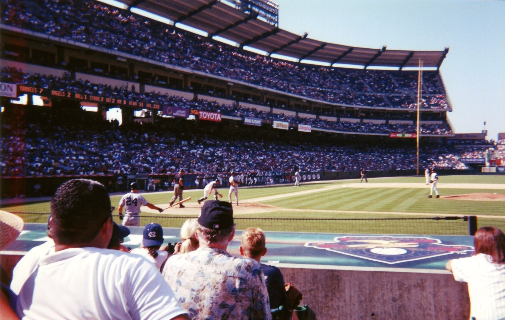
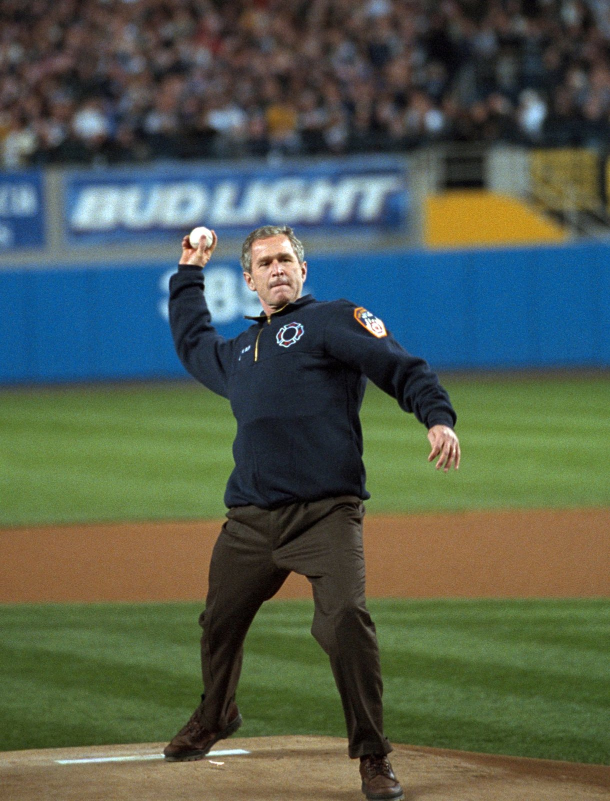
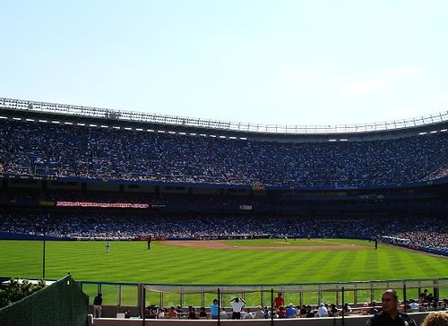

25 years ago today, November 1, 2001, Game 4 of the World Series between the New York Yankees and the Arizona Diamondbacks crossed the midnight threshold at Yankee Stadium. In the opening minutes of a brand-new month, Derek Jeter lined an opposite-field walk-off home run into the right-field bleachers, tying the series and creating one of the most famous moments in baseball history.

## An Emotional Autumn in New York

The fall of 2001 carried immense weight for New York City following the September 11 terrorist attacks on the World Trade Center. During that solemn time, Yankee Stadium had opened its gates to host a citywide memorial service titled 'Prayer for America.' Baseball became a powerful focal point for local pride and resilience as the Yankees returned to action in the Bronx.

Manager Joe Torre steered the Yankees through an exceptional 99th franchise season, finishing with a 95–65 record and cruising to first place, 13.5 games ahead of the Boston Red Sox. Starting pitcher Roger Clemens produced a remarkable 16-game winning streak, tying an American League record shared by Walter Johnson, Lefty Grove, Schoolboy Rowe, and Smoky Joe Wood. Clemens capped the year by capturing the American League Cy Young Award, making him the first pitcher in Major League history to earn six Cy Young Awards.

## Two Powerhouses Collide

The Yankees advanced through October by outlasting the Oakland Athletics three games to two in the Division Series, and then dominating the Seattle Mariners—who had won an astonishing 116 regular season games—four games to one in the ALCS. By winning their fourth consecutive pennant, the 1998–2001 Yankees joined elite dynasties such as the 1921–1924 New York Giants and earlier Yankee eras to reach four straight World Series. New York had won 11 consecutive postseason series over four years.

Waiting for them in the World Series were the Arizona Diamondbacks, a young franchise playing only their fourth season since entering the league. Playing at Bank One Ballpark in Phoenix, Arizona had won the National League West with a 92–70 record. They boasted the premier pitching duo in the majors: Curt Schilling and Randy Johnson, who combined for 43 regular season wins. Randy Johnson, the National League Cy Young winner, had struck out 20 batters in nine innings against Cincinnati on May 8, and later fanned 16 Padres in relief on July 19. Backed by slugger Luis Gonzalez, who launched 57 home runs during the regular season, the Diamondbacks won the first two games in Phoenix before the series shifted to New York.

*Angels vs. Yankees 2001 (Bernie Williams vs. Lou Pote) — Photo: Amin Eshaiker / CC BY-SA 3.0*

## Baseball Steps Into November

Because the regular season schedule had paused in September, postseason play stretched deeper into the calendar than ever before. Game 4 got underway on Halloween night, October 31, at Yankee Stadium. A tense, low-scoring battle unfolded between the two pitching staffs, pushing the game into extra innings.

As the tenth inning began, the stadium clock struck 12:00 a.m., and the calendar officially rolled over to November 1, 2001. It was the very first time in Major League Baseball history that a World Series game was contested in the month of November. The historic timing set the stage for an extraordinary ending.

*2001 World Series first pitch — Photo: White House photo by Eric Draper / Public domain*

## The Birth of 'Mr. November'

With two outs in the bottom of the tenth inning, Derek Jeter stepped into the batter's box. Up to that point, Jeter had struggled at the plate throughout the Fall Classic, batting under .200 for the series. However, Jeter worked the count full and drove a deep fly ball toward the short right-field porch.

The ball cleared the wall for an improbable walk-off home run, sending Yankee Stadium into pandemonium. In the broadcast booth, Yankees television announcer Michael Kay delivered an instantly famous call: 'See ya! See ya! See ya! A home run for Derek Jeter! He is Mr. November! Oh what a home run by Derek Jeter!' Kay uttered the phrase after noticing a sign held up by an alert fan in the grandstands reading 'Mr. November.' With that single swing, the Yankees secured a 4–3 victory and leveled the series at two games apiece.

*Yankee Stadium 2 — Photo: Yankees Fans / CC BY 2.0*

## An Unforgettable Legacy

The 2001 World Series would ultimately conclude in dramatic heartbreak for New York. The series went the full distance to Game 7 in Phoenix, where Arizona broke through against Yankees star closer Mariano Rivera in the bottom of the ninth inning, winning the title on a walk-off hit by Luis Gonzalez. The Diamondbacks became the fastest expansion team in Major League history to capture a World Series title in just their fourth season, a championship that remains the only major professional sports title won by an Arizona-based team.

Yet, despite New York's ultimate defeat, Jeter's Game 4 heroics remained one of the brightest and most celebrated moments of the era. The walk-off home run provided an unforgettable lift to a healing city and gifted the Yankees shortstop a permanent moniker that still resonates across baseball lore a quarter-century later.

### Sources

- <https://en.wikipedia.org/wiki/November%201>
- <https://commons.wikimedia.org/wiki/File:Greg_Olson_(Pitcher).jpg>
- <https://commons.wikimedia.org/wiki/File:Angels_vs._Yankees_2001_(Bernie_Williams_vs._Lou_Pote).jpg>
- <https://commons.wikimedia.org/wiki/File:2001_World_Series_first_pitch.jpg>
- <https://www.flickr.com/photos/7735414@N06/452702546>
