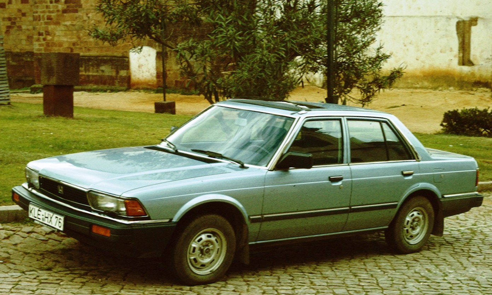
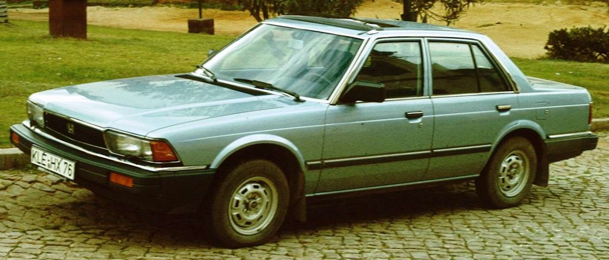
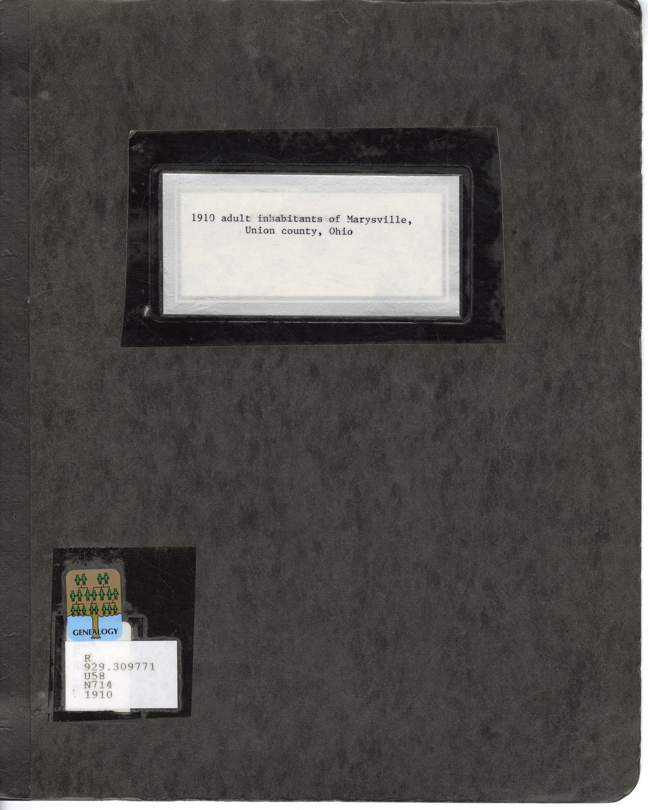

44 years ago today, November 1, 1982. A brand-new Japanese passenger car rolled off an assembly line in the United States for the very first time, as Honda opened its Marysville Auto Plant in Ohio and produced a Honda Accord. The milestone marked a turning point in automotive manufacturing and established a permanent footprint for international automakers in the American heartland.

## From Motorcycle Pioneer to Global Automaker

Honda Motor Co. was founded in October 1946 by Soichiro Honda. The company initially built motorized bicycles using surplus generator engines before expanding into standalone motorcycle manufacturing. By 1959, Honda had risen to become the world's largest motorcycle manufacturer, establishing an international reputation for high-precision engineering.

In 1963, Honda expanded into passenger cars. Early models like the N360 minicar in 1967 and the Civic in 1972 proved that lightweight, front-wheel-drive vehicles could thrive in competitive export markets. The development of the CVCC engine, introduced to the Civic in December 1973, met stringent emissions standards without requiring a catalytic converter or unleaded fuel.

## The Evolution and Debut of the Honda Accord

Following the success of the Civic, Honda began work on a larger, more comfortable vehicle. Initially designated as Project 653, engineering plans originally explored an inline-six engine design before engineers pivoted toward expanding the Civic's efficient platform under Project 671. Body styling was finalized in the fall of 1973.

The finished vehicle debuted on May 7, 1976, as a three-door hatchback named the Accord, a title chosen to reflect harmony between people, society, and the automobile. With balanced handling, a comfortable interior, and refined mechanicals, the Accord established itself as a reliable daily vehicle and laid the foundation for Honda's expanding North American lineup.

*Archive, 1982 — Photo: Charles01 / CC BY-SA 3.0*

## Opening the Marysville Auto Plant in Ohio

On November 1, 1982, Honda made history by opening its automobile manufacturing facility in Marysville, Ohio. Located in Union County, roughly 27 miles northwest of Columbus, Marysville provided the setting where an Asian automaker first assembled passenger vehicles on American soil.

The very first car produced at the new Marysville Auto Plant was a Honda Accord. Local workers stood alongside Honda engineers as the vehicle rolled off the assembly line, proving that advanced Japanese manufacturing standards and quality control systems could be successfully transplanted to the United States.

*Archive, 1982 — Photo: Charles01 / CC BY-SA 3.0*

## Surpassing Domestic Competitors on American Roads

The Marysville plant quickly expanded its output to keep pace with surging consumer demand. American drivers embraced the locally built Accord for its fuel efficiency and build quality, pushing sales upward throughout the decade.

By 1989, the Accord achieved a landmark milestone by becoming the first car sold under an import brand to rank as the overall best-selling passenger car in the United States. It went on to top its sales class in both 1991 and 2001, firmly cementing its place in American suburban life.

*Archive, 1982 — Photo: This file was contributed to Wikimedia Commons by Columbus M / Public domain*

## A Benchmark for Reliability and Global Reach

Over its long production run, the Accord earned widespread critical acclaim, appearing on the Car and Driver 10Best list a record 38 times. Worldwide sales of the nameplate eventually surpassed 19 million units, with around ten million vehicles sold in the United States alone.

Honda's investment in Marysville also transformed the company's trade balance. By 2013, Honda became the first Japanese automaker to become a net exporter from the United States, exporting 108,705 vehicles from American soil while importing 88,357.

## The Marysville Legacy Today

The groundbreaking decision made on November 1, 1982, forever altered the automotive landscape across North America. In 2023, Honda announced that Accord assembly would transition to Greensburg, Indiana, allowing the historic Marysville Auto Plant to prepare for electric vehicle production.

More than four decades after that first Ohio-built sedan left the factory floor, the Marysville plant remains a foundational pillar of American manufacturing and a testament to Honda's lasting partnership with the workers of Ohio.

### Sources

- <https://en.wikipedia.org/wiki/Honda>
- <https://commons.wikimedia.org/wiki/File:Honda_Accord_3dr_UK.JPG>
- <https://commons.wikimedia.org/wiki/File:Honda_Accord_second_gen_1982_Kleve_Kennzeichen.jpg>
- <https://commons.wikimedia.org/wiki/File:Honda_Accord_second_gen_1982.jpg>
- <https://commons.wikimedia.org/wiki/File:1910_Adult_Inhabitants_of_Marysville,_Union_County,_Ohio_-_DPLA_-_d2fd9217ec36032482cb64522b8e544f_(page_1).jpg>
