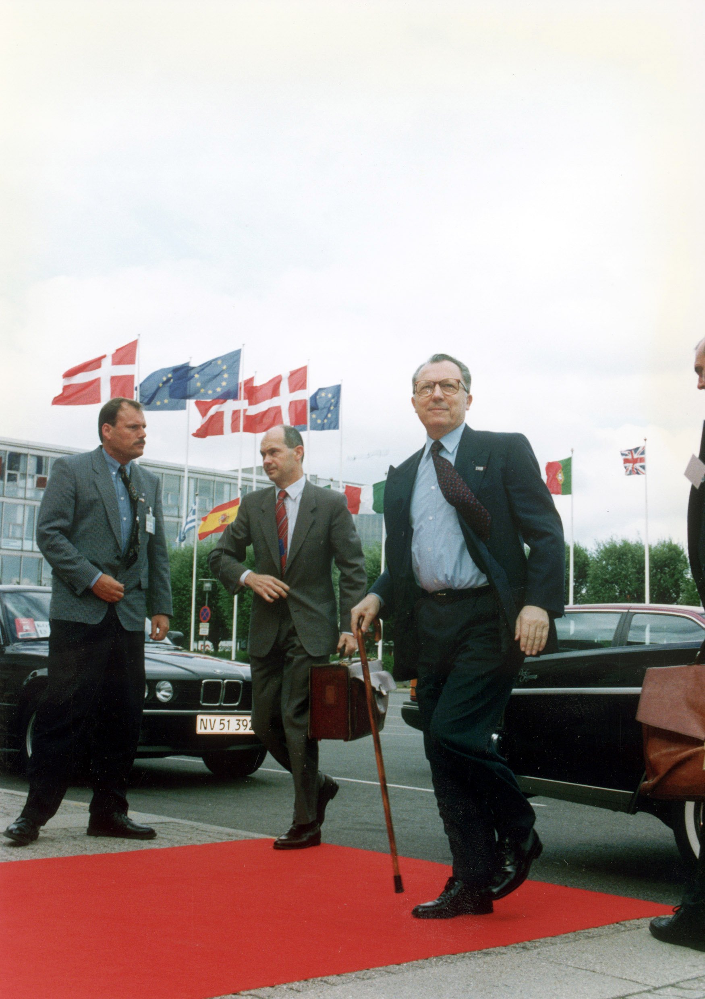
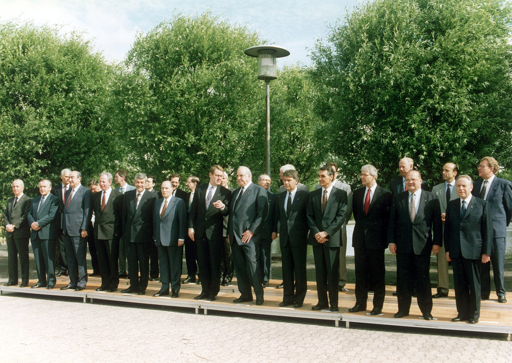
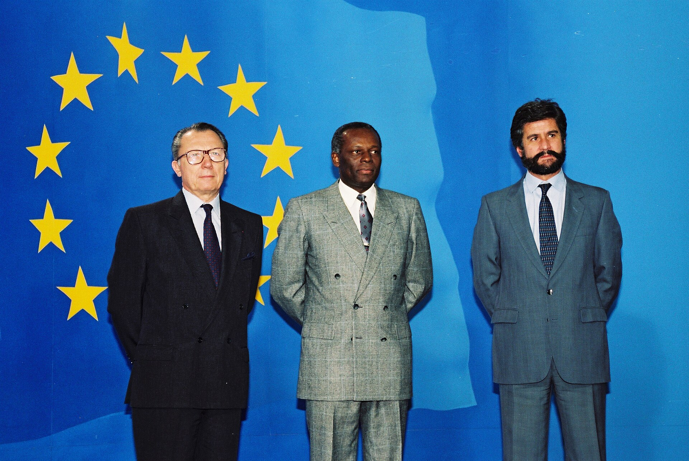

33 years ago today, November 1, 1993, the Maastricht Treaty officially went into force across Europe, formally establishing the European Union. The landmark agreement marked a transformative leap from a post-war economic coalition into a far-reaching political and monetary union.

## The Long Road from Post-War Recovery to Integration

The vision of European integration had roots stretching back to the aftermath of the First World War. Early proposals, such as John Maynard Keynes's 1920 call for a European customs union and the founding of the Paneuropean Union in 1923, sought to rebuild shattered economies and secure continental peace. Following the devastation of World War II, that momentum accelerated with the creation of the European Coal and Steel Community, the European Economic Community, and the European Atomic Energy Community. By the early 1990s, against the backdrop of the end of the Cold War and the reunification of Germany, European leaders determined that a new, deeper level of cooperation was essential.

## Signing the Pact in Maastricht

On February 7, 1992, foreign and finance ministers gathered in the historic Dutch city of Maastricht. Twelve member nations took part in the ceremony: Belgium, Denmark, France, Germany, Greece, Ireland, Italy, Luxembourg, the Netherlands, Portugal, Spain, and the United Kingdom. Signatories included prominent diplomats such as Hans-Dietrich Genscher of Germany, Roland Dumas of France, and Douglas Hurd of the United Kingdom. The Treaty on European Union set forth seven major titles, creating common citizenship, setting standards for a prospective European Central Bank, expanding powers for the directly elected European Parliament, and charting a course for common foreign and security policies.

*Copenhagen European Council, 21–22.06.1993 (P-002366 00-1) — Photo: Fernand Wauthy / CC BY 4.0*

## The Ratification Crisis and Danish Referendum

Bringing the treaty into reality proved far more contentious than negotiating its text. While the agreement originally set a target date of January 1, 1993, every signatory had to ratify it according to its own domestic constitutional procedures. In Denmark, France, and Ireland, this meant putting the treaty directly to voters in national referendums. On June 2, 1992, the Danish electorate delivered a stunning setback to the integration project, rejecting the treaty by a narrow margin of 50.7 percent to 49.3 percent. The unexpected defeat threw the entire timeline into disarray and forced European leaders to scramble for a diplomatic compromise.

*Copenhagen European Council, 21–22.06.1993 (P-002366 00-4) — Photo: Fernand Wauthy / CC BY 4.0*

## Crucial Opt-Outs for Denmark and the United Kingdom

To salvage the treaty, European leaders met in Edinburgh late in 1992 to grant Denmark critical concessions. Most notably, Denmark secured an opt-out ensuring it would not be required to abandon its national currency, the krone. Reassured by these safeguards, Danish voters returned to the polls on May 18, 1993, approving the treaty with a 56.7 percent majority. Meanwhile, the United Kingdom also carved out crucial exemptions. British negotiators secured opt-outs from the final stage of monetary union—meaning Britain would not have to surrender the pound sterling—as well as an exemption from the annexed Agreement on Social Policy.

*NOT FROM THE EVENT · 1991 — Photo: EC / CC BY 4.0*

## A New Union Takes Its First Steps

With the final constitutional hurdles resolved, the Maastricht Treaty took effect on November 1, 1993. The treaty reorganized the existing European Communities into a three-pillar structure, creating the European Union and extending intergovernmental cooperation into justice, home affairs, and defense. It established the office of European Ombudsman and laid down strict fiscal guidelines—known as the Maastricht criteria—for countries wishing to join the future currency union. For millions of citizens across the twelve member states, the treaty introduced the novel concept of European citizenship alongside their national identities.

## The European Union in the Decades Since

In the decades that followed, the European Union grew substantially in both membership and legal authority. Successive pacts, culminating in the 2007 Treaty of Lisbon, refined its governance and gave the union explicit international legal standing. In 2012, the EU was awarded the Nobel Peace Prize for its contribution to peace and reconciliation. While the United Kingdom became the first and only member to exit the bloc in 2020, the European Union stands today as a 27-nation supranational union representing an estimated 452 million people, with 21 member nations fully sharing the euro currency.

### Sources

- <https://en.wikipedia.org/wiki/Maastricht_Treaty>
- <https://commons.wikimedia.org/wiki/File:Copenhagen_European_Council,_21%E2%80%9322.06.1993_(P-002366_00-2).jpg>
- <https://commons.wikimedia.org/wiki/File:Copenhagen_European_Council,_21%E2%80%9322.06.1993_(P-002366_00-1).jpg>
- <https://commons.wikimedia.org/wiki/File:Copenhagen_European_Council,_21%E2%80%9322.06.1993_(P-002366_00-4).jpg>
- <https://commons.wikimedia.org/wiki/File:Visit_of_Jos%C3%A9_Eduardo_dos_Santos,_President_of_Angola,_to_the_CEC.jpg>
