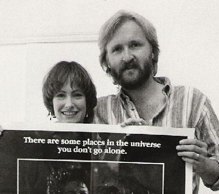
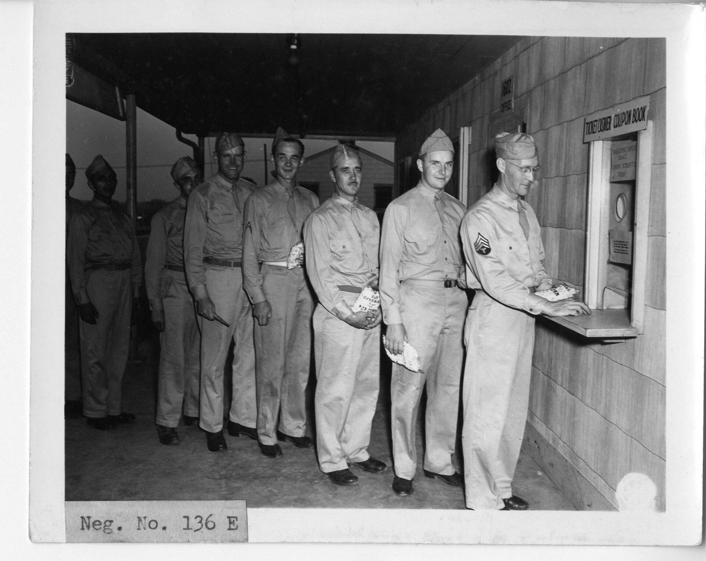

29 years ago today, November 1, 1997, director James Cameron presented his historical disaster epic Titanic to an audience for the very first time at the Tokyo International Film Festival. The screening marked the public arrival of a production that entertainment insiders had spent months writing off as an unprecedented financial catastrophe. Instead, that autumn evening in Japan launched a cinematic phenomenon that redefined Hollywood success.

## Hollywood's Most Expensive Gamble

Leading up to late 1997, Titanic was widely viewed in the film industry as an out-of-control disaster waiting to happen. The production suffered repeated schedule overruns and mounting expenses, eventually reaching a budget of 200 million dollars. At the time, that figure made it the single most expensive motion picture ever produced.

The soaring costs put intense strain on 20th Century Fox, the studio originally developing the project. To mitigate the severe financial exposure, Fox struck a deal with Paramount Pictures to split the investment and share distribution rights. Industry columnists openly questioned whether any film could ever recoup such an exorbitant sum at the box office.

## Recreating the Great Liner from the Ocean Floor Up

The immense project originated from James Cameron's deep fascination with maritime shipwrecks. He believed that the only way to convey the true emotional gravity of the 1912 tragedy, which claimed approximately 1,500 lives, was to interweave an intimate love story with the terrifying reality of human loss.

Production officially began on September 1, 1995, when Cameron led an expedition to film the actual sunken remains of the ocean liner. Modern scenes were filmed aboard the Russian research vessel Akademik Mstislav Keldysh, which served as the operational base for deep-sea dives. To recreate the maiden voyage and sinking, the production utilized scale models, complex computer-generated imagery, and a massive full-scale reconstruction of the ship constructed at Baja Studios. Principal photography spanned from July 1996 to March 1997.

*Gale Ann Hurd and James Cameron (cropped) — Photo: Towpilot / CC BY-SA 3.0*

## The Love Story of Jack and Rose

While the technical scope was vast, the movie's emotional engine was the romance between two passengers divided by social class. Leonardo DiCaprio starred as Jack Dawson, a penniless young artist from Wisconsin who wins third-class passage in a poker game. Opposite him was Kate Winslet as Rose DeWitt Bukater, a 17-year-old aristocrat trapped in an unhappy engagement to the wealthy Cal Hockley.

The expansive supporting cast featured Billy Zane, Kathy Bates, Frances Fisher, Bernard Hill, Jonathan Hyde, Danny Nucci, David Warner, and Bill Paxton. Gloria Stuart anchored the modern framing narrative as the centenarian Rose recalling her lost love and the legendary Heart of the Ocean necklace. Their performances gave the disaster a deeply personal human dimension.

*Unknown woman and man stand with statuette at 1988 Academy Awards — Photo: Alan Light / CC BY 2.0*

## Triumph in Tokyo and Beyond

When Titanic made its public debut at the Tokyo International Film Festival on November 1, 1997, the persistent rumors of failure collapsed. Viewers and critics were swept away by the scale of the visual effects, the precision of the cinematography, James Horner's sweeping score, and the raw emotional depth of the story.

The film opened commercially in the United States on December 19, distributed domestically by Paramount Pictures while 20th Century Fox handled international markets. Rather than fading quickly, Titanic became a cultural force, drawing repeat audiences week after week and dominating movie theaters for months on end.

*Buying movie tickets - DPLA - a1ad76247bfca4432e404ac8a3d3e215 (page 1) — Photo: Moriarty, William John (1903-1978) / Public domain*

## Historic Box Office and Academy Award Glory

Titanic shattered every commercial benchmark in film history. In its initial theatrical run, it generated more than 1.84 billion dollars worldwide, becoming the highest-grossing film of 1997 and the very first motion picture to ever break the 1 billion dollar threshold. Combined with home video, soundtrack sales, and television broadcast rights, total revenue exceeded 3.2 billion dollars.

The critical recognition was equally historic. At the 70th Academy Awards, Titanic earned 14 nominations, matching the long-standing record set by All About Eve in 1950. On Oscar night, it took home 11 awards, including Best Picture and Best Director, tying the all-time victory record established by Ben-Hur in 1959.

## An Unsinkable Cultural Legacy

Titanic remained the highest-grossing movie in box office history for over twelve years until James Cameron eclipsed his own record with Avatar in 2010. Through theatrical re-releases over the years, the film's global ticket sales reached 2.264 billion dollars, cementing its place as the second film ever to surpass the 2 billion dollar mark.

In 2017, the United States Library of Congress selected Titanic for preservation in the National Film Registry, citing its cultural, historical, and aesthetic significance. Decades after its first screening on that November night in Tokyo, Cameron's epic remains an indelible milestone of modern cinematic storytelling.

### Sources

- <https://en.wikipedia.org/wiki/Titanic_(1997_film)>
- <https://commons.wikimedia.org/wiki/File:Titanic_Movie_Cinema_shooting._Airstar_Lighting_balloons.jpg>
- <https://commons.wikimedia.org/wiki/File:Gale_Ann_Hurd_and_James_Cameron_(cropped).jpg>
- <https://commons.wikimedia.org/wiki/File:Unknown_woman_and_man_stand_with_statuette_at_1988_Academy_Awards.jpg>
- <https://commons.wikimedia.org/wiki/File:Buying_movie_tickets_-_DPLA_-_a1ad76247bfca4432e404ac8a3d3e215_(page_1).jpg>
