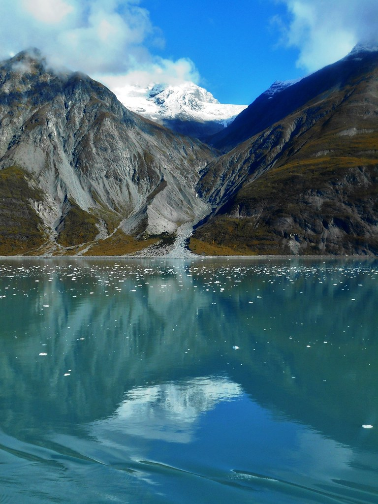
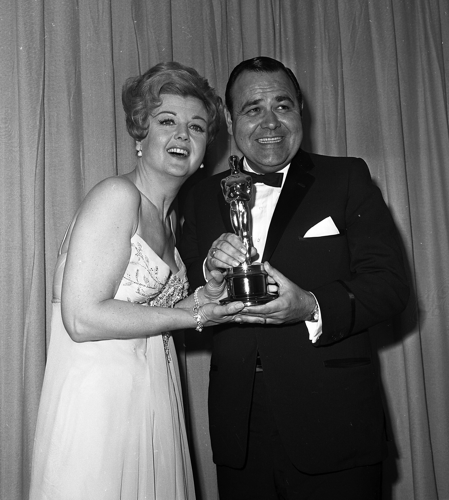
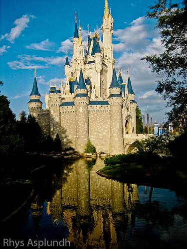

23 years ago today, November 1, 2003. Walt Disney Feature Animation released its 44th animated feature film, Brother Bear, in theaters across the United States. Following a high-profile premiere at the New Amsterdam Theatre on October 20, the wilderness fantasy officially reached nationwide audiences through Buena Vista Pictures Distribution.

## Disney's 44th Animated Feature Milestone

Founded on October 16, 1923, by brothers Walt and Roy O. Disney, Walt Disney Animation Studios stands as the longest-running animation studio in the world. From its very first synchronized sound cartoon, Steamboat Willie in 1928, to Snow White and the Seven Dwarfs in 1937—the first hand-drawn full-length animated feature film in American history—the studio consistently defined the medium.

By 2003, the studio was operating as Walt Disney Feature Animation. Brother Bear arrived as the 44th entry in that historic catalog, carrying forward decades of traditional animation techniques developed at its Burbank studio lot.

## An Alaskan Legend of Kinship and Spirits

Brother Bear transports audiences back to post-ice age Alaska, where local tribes live under the guidance of the Great Spirits who appear across the sky in the northern aurora. The story centers on three brothers: Sitka, the eldest; Denahi, the middle brother; and Kenai, the headstrong youngest brother voiced by Joaquin Phoenix. During a tribal ceremony led by shaman Tanana, Kenai is presented with the bear totem of love, a symbol he initially resents.

When a female brown grizzly steals their catch of sockeye salmon, Kenai pursues the animal, leading to an encounter on a glacier where Sitka sacrifices his life to save his brothers. Blaming the creature, Kenai tracks down and kills the bear atop a rocky cliff. In response, the Spirits intervene, lifting the deceased bear into a golden river of light and magically transforming Kenai into a grizzly cave bear.

*Alaska Wilderness — Photo: moonjazz / Public domain (PDM) 1.0*

## The Journey Toward Forgiveness

Waking in terror at his newfound beastly form, Kenai learns from Tanana that he must seek out the sacred mountain where the northern lights touch the earth. Only by reconciling with Sitka and the Spirits can Kenai atone for his actions and regain his human form.

Along his trek, Kenai encounters Koda, an orphaned bear cub voiced by Jeremy Suarez, and a pair of humorous moose named Rutt and Tuke, voiced by Rick Moranis and Dave Thomas. Kenai's surviving brother Denahi, unaware of the magical transformation and believing his youngest sibling was destroyed by the bear, vows revenge and relentlessly pursues Kenai across the wilderness.

*Angela Lansbury and Jonathan Winters at the 1965 Academy Awards — Photo: John Malmin, Los Angeles Times / CC BY 4.0*

## The Music of Phil Collins and Mark Mancina

To shape the emotional pulse of the ancient northern landscape, Disney turned to Grammy and Academy Award-winning musician Phil Collins. Collins penned a suite of original songs for the production, echoing his acclaimed collaborative work on previous Disney animated projects.

In addition to the songs, Collins partnered with composer Mark Mancina to compose the film's original musical orchestral score. Their combined instrumentation blended sweeping symphonic melodies with percussive rhythms designed to mirror the vast rivers, snowy glaciers, and spiritual transformations depicted on screen.

*Cinderella's Castle - Walt Disney World — Photo: Rhys A. / CC BY 2.0*

## Mixed Reviews, Box Office Triumph, and Oscar Honors

When Brother Bear arrived in theaters, film critics greeted it with mixed-to-negative reviews, questioning whether its narrative formula lived up to Disney's highest historic peaks. Moviegoers, however, delivered a completely different verdict at the box office.

Produced on a reported budget of 46 million dollars, the feature film became a substantial commercial hit, ultimately grossing 250 million dollars worldwide. The industry recognized its technical artistry as well, earning Brother Bear an Academy Award nomination for Best Animated Feature at the 76th Oscars ceremony.

## The Enduring Memory of Hand-Drawn Animation

In the years that followed, Disney's feature animation slate transitioned increasingly toward digital computer animation, eventually leading the studio to reduce its traditional 2D animation pipeline. Brother Bear earned a direct-to-video follow-up, Brother Bear 2, on August 29, 2006, continuing Kenai's journey.

For audiences who settled into theater seats on that crisp autumn weekend in November 2003, the film remains a beloved snapshot of Disney's artistry. Does that day come back to you?

### Sources

- <https://en.wikipedia.org/wiki/Walt_Disney_Animation_Studios>
- <https://commons.wikimedia.org/wiki/File:Joy_Theater_marquee,_Canal_Street,_New_Orleans,_Louisiana_(LOC).jpg>
- <https://www.flickr.com/photos/8398907@N02/9992873223>
- <https://commons.wikimedia.org/wiki/File:Angela_Lansbury_and_Jonathan_Winters_at_the_1965_Academy_Awards.jpg>
- <https://www.flickr.com/photos/51867225@N08/5599612578>
