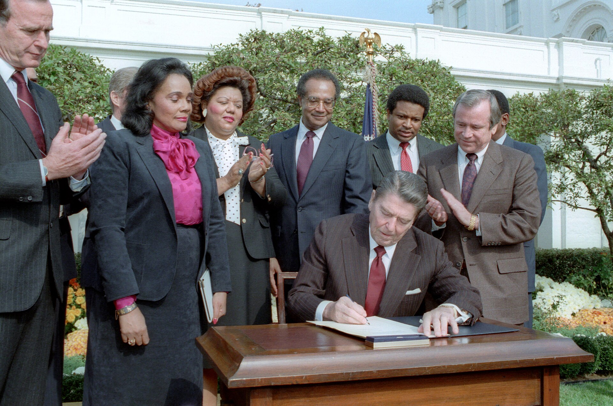
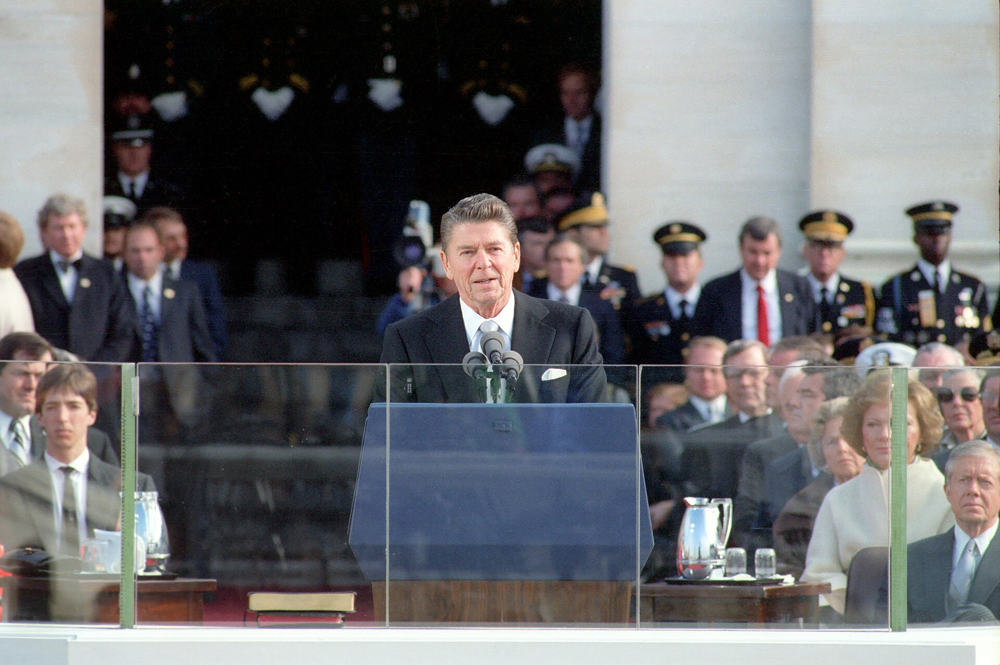
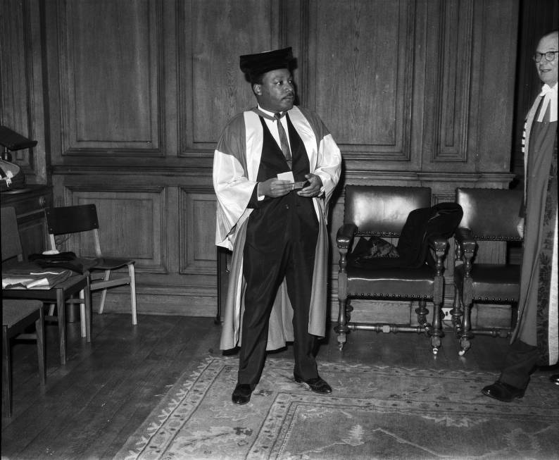

Forty-three years ago today, on November 2, 1983, President Ronald Reagan signed a historic bill in the White House Rose Garden establishing a federal holiday in honor of civil rights leader Martin Luther King Jr. The legislation marked only the third time in American history that an individual received a dedicated national holiday, following George Washington and Christopher Columbus. The signing concluded a grueling fifteen-year national struggle that began immediately following King's assassination in 1968.

## A Fifteen-Year Effort in Congress

The push for federal recognition started almost immediately after King's death in 1968. Representative John Conyers, a Democrat from Michigan, and Senator Edward Brooke, a Massachusetts Republican, introduced the first federal legislation to commemorate King's birthday. Labor unions also championed the concept during collective bargaining negotiations.

Despite broad grassroots enthusiasm, the bill faced relentless resistance in Washington. The measure first reached a floor vote in the House of Representatives in 1979, where an amendment sought to shift the observance to the third Sunday in January instead of a paid Monday. House members rejected that amendment 207 to 191 after sponsors declared it unacceptable, and the underlying proposal stalled.

## Arguments and Objections

Critics in Congress raised several objections to the proposed holiday. Opponents argued that offering an additional paid day off for federal employees would impose an excessive financial burden on the government. Furthermore, traditionalists claimed that dedicating a federal holiday to a private citizen violated historical precedent, noting that King had never held elected public office.

President Ronald Reagan initially expressed personal reservations as well. In correspondence with Meldrim Thomson, the former governor of New Hampshire, Reagan remarked that the momentum behind the holiday was based on image rather than reality. When asked by reporters about allegations regarding King's past, Reagan remarked that the public would know in thirty-five years when sealed FBI surveillance tapes were scheduled to become available.

*Archive, 1983 — Photo: President (1981-1989 : Reagan). White House Photographic Off / Public domain*

## Six Million Signatures and Stevie Wonder

With Congress deadlocked, the King Center turned toward corporate backing and massive public mobilization. Musician Stevie Wonder took up the cause with fervor, releasing his hit tribute single "Happy Birthday" in 1980 to rally national awareness.

In 1981, Wonder hosted the Rally for Peace Press Conference to amplify the call for federal action. Civil rights leaders and volunteers gathered six million signatures on petitions presented directly to Capitol Hill. This monumental petition drive became the largest petition in favor of an issue in United States history, creating irresistible popular pressure on lawmakers.

*Archive, 1981 — Photo: President (1981-1989 : Reagan). White House Photographic Off / Public domain*

## Drama on the Senate Floor

The final legislative push occurred in the autumn of 1983 under legislation introduced by Representative Katie Hall of Indiana. Opponents launched a fierce last stand led by North Carolina Republican Senators Jesse Helms and John P. East. Helms questioned whether King merited such recognition, citing King's opposition to the Vietnam War and accusing him of radical associations.

Helms mounted a filibuster and, on October 3, 1983, delivered a 300-page dossier to the Senate detailing his allegations. The maneuver sparked immediate fury across the aisle. Democratic Senator Daniel Patrick Moynihan of New York took the floor, denounced Helms' dossier as a "packet of filth," hurled the papers onto the Senate floor, and stomped on them before his colleagues.

*Martin Luther King Jr Newcastle University 1967 — Photo: Newcastle University. / CC BY-SA 4.0*

## Veto-Proof Majorities and the Rose Garden

The confrontation on the Senate floor did little to slow the measure's momentum. The House of Representatives approved Hall's bill on August 2, 1983, by a decisive margin of 338 to 90, which included 242 Democrats and 89 Republicans voting in favor, alongside five abstentions. On October 19, 1983, the Senate passed the bill 78 to 22, with 41 Democrats and 37 Republicans forming a veto-proof majority.

Faced with overwhelming bipartisan support, President Reagan welcomed King's family and civil rights leaders to the Rose Garden on November 2, 1983. The law designated the third Monday in January as the official observance. The bill also created the Martin Luther King, Jr. Federal Holiday Commission to coordinate national observances, with King's widow, Coretta Scott King, later appointed a permanent member for life by President George H. W. Bush in May 1989.

## The Journey to State Observance

The federal holiday was observed for the first time on January 20, 1986, yet several states resisted immediate adoption. In Arizona, Governor Bruce Babbitt established the holiday by executive order in 1986, but successor Evan Mecham rescinded the order upon taking office in 1987. Arizona voters rejected two holiday ballot measures in November 1990, leading the National Football League to move Super Bowl XXVII from Arizona to Pasadena before voters finally approved a paid holiday in 1992.

Other states took years to grant full recognition. New Hampshire replaced its traditional Fast Day with Civil Rights Day in 1991 and adopted King's name in 1999, celebrating it for the first time in January 2000. In May 2000, South Carolina Governor Jim Hodges signed legislation making King's birthday an official paid state holiday, replacing an arrangement where workers chose between MLK Day or Confederate holidays. By 2000, official observance took effect in each state's law as well as federal law.

### Sources

- <https://en.wikipedia.org/wiki/White_House>
- <https://commons.wikimedia.org/wiki/File:Meeting_to_Discuss_The_Situation_in_Grenada_with_a_Group_of_Bipartisan_Members_of_Congress_with_Tip_O%27Neill_and_Bob_Michel_in_Cabinet_Room_-_DPLA_-_522462c995b6e7960861783636f81bd2.jpg>
- <https://commons.wikimedia.org/wiki/File:President_Reagan_at_Signing_Ceremony_for_Martin_Luther_King_Holiday_Legislation_in_the_Rose_Garden_with_Coretta_Scott_King,_George_Bush,_Howard_Baker,_Bob_Dole,_Jack_Kemp,_Samuel_Pi_-_DPLA_-_4e348270f5d83a7644e8b8182bfa6dd1.jpg>
- <https://commons.wikimedia.org/wiki/File:President_Ronald_Reagan_Giving_the_Inaugural_Address_from_the_United_States_Capitol_-_DPLA_-_a1a8d6f8394d7f093fb06df270b57a2e.jpg>
- <https://commons.wikimedia.org/wiki/File:Martin_Luther_King_Jr_Newcastle_University_1967.jpg>
