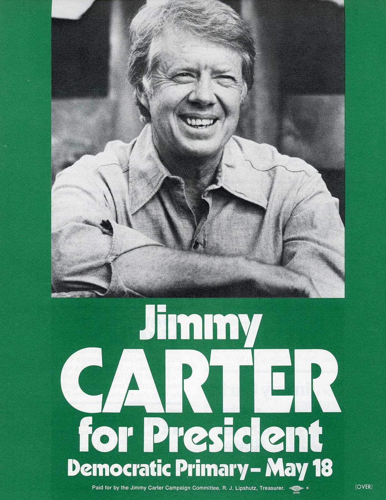
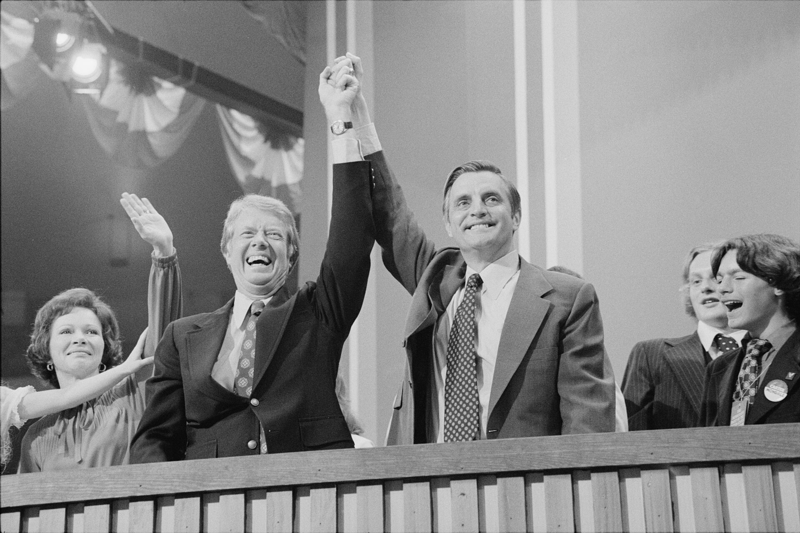
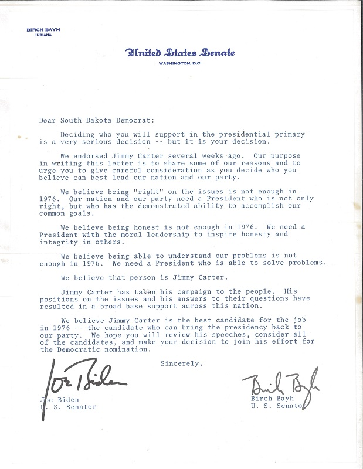

50 years ago today, November 2, 1976, former Georgia governor Jimmy Carter defeated incumbent president Gerald Ford in a remarkably close election. Carter's victory made him the first candidate from the Deep South to win the presidency since the American Civil War.

## The Shadow of Watergate and an Unelected President

The 1976 presidential contest unfolded in the immediate shadow of unprecedented federal upheaval. President Gerald Ford had risen to the executive office under extraordinary circumstances. Spiro Agnew, Richard Nixon's first vice president, had resigned in 1973 following a bribery scandal, leading to Ford's appointment as vice president. When Nixon resigned in August 1974 during the Watergate scandal, Ford assumed the presidency without having won a national election.

Ford soon faced sharp political blowback after issuing a full pardon to Nixon. Coupled with a struggling economy and the fall of South Vietnam, Ford's administration faced deep public skepticism. Within his own party, conservative challenges emerged, culminating in a bitter primary fight where Ford only narrowly fended off former California governor Ronald Reagan to capture the Republican nomination.

## An Unknown Outsider from Plains, Georgia

Jimmy Carter entered the 1976 campaign with very little national name recognition. A former state senator and one-term governor of Georgia, Carter had grown up in Plains, Georgia, where his family owned a peanut farm. He graduated from the U.S. Naval Academy in 1946 and served aboard submarines before returning to run the family business and enter local politics.

Recognizing the public hunger for honesty and reform following Watergate, Carter positioned himself as a Washington outsider. He entered early primaries and caucuses across the nation, beginning with the Iowa caucuses and the New Hampshire primary. While better-known establishment figures divided votes or skipped early contests, Carter built momentum state by state, eventually securing the Democratic nomination alongside Minnesota senator Walter Mondale.

*Archive, 1976 — Photo: Unknown authorUnknown author / Public domain*

## The 1976 Campaign Trail and Debates

Once the general election began, Carter held a commanding lead in summer public opinion polls. Ford pursued a 'Rose Garden strategy,' remaining at the White House to emphasize his role and experience as chief executive. Carter countered by highlighting his outsider status, presenting himself as a centrist reformer who remained entirely unconnected to Washington institutions.

As autumn arrived, the race tightened significantly. The televised debates provided Ford with opportunities to demonstrate his command of federal policy, allowing him to erase much of Carter's initial polling advantage. By late October, political analysts regarded the race as a dead heat heading into election day.

*Archive, 1976 — Photo: Warren K. Leffler / Public domain*

## Election Night: Decided by the Narrowest Margins

On November 2, 1976, voters turned out in massive numbers across the country. As returns rolled in throughout the evening, clear regional divides emerged. Ford swept virtually the entire American West, carrying both the Pacific Coast and Mountain states. Carter, in turn, consolidated solid backing across the Deep South, carrying every single southern state and winning several states in the Northeast.

The final outcome turned on pivotal Midwestern battlegrounds. Carter managed narrow victories in Ohio and Wisconsin, which held a combined 36 electoral votes. With those crucial Midwestern states secured, Carter crossed the necessary threshold to win the White House, finishing with 297 Electoral College votes to Ford's 240. In the popular vote, Carter claimed 50.1 percent against Ford's 48.0 percent.

*Archive, 1976 — Photo: Birch Bayh and Joe Biden / Public domain*

## Historical Milestones of the 1976 Vote

The election of 1976 produced several notable historical distinctions. It was the first presidential race since 1932 in which an incumbent president was defeated for reelection. Carter became the first candidate from the Deep South to capture the executive mansion since the Civil War, and the first Democrat since Franklin D. Roosevelt in 1944 to sweep the Deep South.

For Gerald Ford, the loss marked the conclusion of a unique tenure in executive leadership. Ford remains the only president in American history to serve without having ever won an election as either president or vice president. Furthermore, Carter's win stood as the sole Democratic presidential victory across the six national elections held between 1968 and 1988.

## A Legacy of Trust and Outsider Politics

Jimmy Carter assumed office in January 1977, facing the daunting task of governing a nation weary of executive overreach and institutional deception. While his single term would encounter complex domestic and foreign challenges, the election of 1976 reshaped the American political landscape.

Carter proved that a candidate operating outside the traditional Washington establishment could mount an effective grassroots campaign and reach the nation's highest office. Half a century later, the 1976 election remains a defining portrait of an American electorate searching for renewal and integrity in the aftermath of a national crisis.

### Sources

- <https://en.wikipedia.org/wiki/November%202>
- <https://commons.wikimedia.org/wiki/File:Carter_and_Ford_in_a_debate,_September_23,_1976.jpg>
- <https://commons.wikimedia.org/wiki/File:1976_Presidential_campaign_flyer.jpg>
- <https://commons.wikimedia.org/wiki/File:Jimmy_Carter_and_Walter_Mondale_at_the_Democratic_National_Convention,_New_York_City.jpg>
- <https://commons.wikimedia.org/wiki/File:Birch_Bayh_and_Joe_Biden_1976_letter_in_support_of_Jimmy_Carter%27s_presidential_campaign.jpg>
