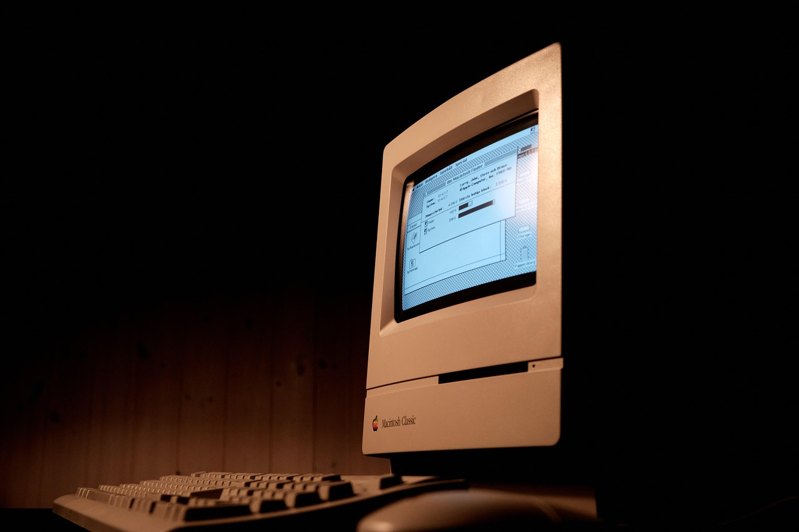
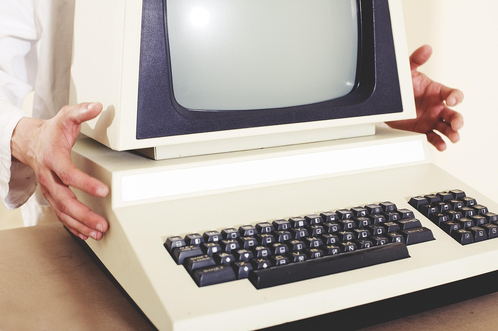
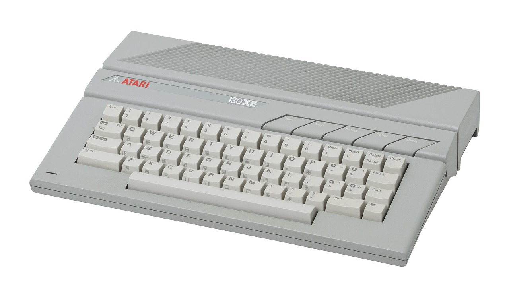

38 years ago today, November 2, 1988, the infant Internet experienced its very first nationwide breakdown. At 8:30 in the evening, a hidden program began spreading silently from machine to machine, rapidly overloading systems and bringing academic and research hubs across the United States to a standstill.

## A Mysterious Program Unleashed from MIT

On that Wednesday night in November 1988, terminal screens at research centers and universities began freezing without explanation. The culprit was a self-replicating program that seized upon the nascent network connecting the country's most advanced computing facilities. Within hours, system administrators watched helplessly as workstations slowed to a crawl and crashed under mysterious, invisible workloads.

The code had been launched through the Massachusetts Institute of Technology network. The author chose that location deliberately, hoping that releasing it from Cambridge would hide any connection to Cornell University, where he was enrolled as a doctoral student.

## The Cryptographer's Son and His Motive

The creator of the program was Robert Tappan Morris. Computing ran in his family: his father, Robert Morris, was a renowned computer scientist at Bell Labs who helped develop Multics and Unix, and later served as the chief scientist at the National Security Agency's National Computer Security Center.

The younger Morris claimed that he never designed the software to cause destruction. He argued that his goal was simply to gauge the scope of the Internet and point out vulnerabilities in existing network setups. A friend later noted that Morris wanted to see if such a program could be executed, turning an intellectual curiosity into an unmanageable crisis.

*Not a photo of the event itself · NOT FROM THE EVENT · Stock image — Photo: SSidde / Pixabay Content License*

## The 14 Percent Flaw That Paralyzed Systems

Morris crafted his worm to exploit known weaknesses in targeted systems. It targeted DEC VAX computers and Sun-3 workstations running the 4.2 and 4.3 Berkeley UNIX operating systems. The program took advantage of a debug mode loophole in sendmail, a buffer overrun flaw in the finger network service, and transitive trust in remote shell execution, while also guessing basic passwords.

The real catastrophe stemmed from an intentional calculation. Morris anticipated that administrators might program their machines to tell the worm they were already infected to ward off the software. To counteract this, Morris instructed the code to replicate itself 14 percent of the time regardless of the answer it received. That 14 percent replication rate turned the worm into a devastating denial-of-service mechanism. Computers were invaded repeatedly, multiplying processes until machines collapsed like a fork bomb.

*Not a photo of the event itself · NOT FROM THE EVENT · Stock image — Photo: andreas160578 / Pixabay Content License*

## An Estimated One Tenth of the Internet Frozen

The consequences were immediate and severe. At the time, observers estimated that the Morris worm disrupted roughly one tenth of all computers connected to the Internet. System administrators scrambled into action, feverishly studying lines of decompiled code to understand how the worm propagated and how to purge it from their networks.

The financial toll proved significant for the era. During subsequent court proceedings, the cost of eliminating the worm from individual computer installations was estimated between $200 and $53,000 per system. The overall economic impact was calculated to reach as high as $10,000,000, forcing the computing community to create coordinated defenses such as the CERT Coordination Center.

*Not a photo of the event itself · NOT FROM THE EVENT · Stock image — Photo: WikimediaImages / Pixabay Content License*

## The First Federal Computer Crime Trial

In 1989, federal prosecutors indicted Morris under Title 18 of the United States Code, specifically 18 U.S.C. § 1030, marking the first prosecution under the 1986 Computer Fraud and Abuse Act. The courtroom battle centered on intent versus outcome, as Morris maintained his desire had only been to demonstrate security defects rather than inflict harm.

In December 1990, Morris was convicted and sentenced to three years of probation, 400 hours of community service, and a $10,050 fine plus supervisory costs. His conviction was affirmed on appeal the following March, and he completed his sentence in 1994, closing the legal chapter of the nation's inaugural federal computer crime trial.

## A Legacy That Reshaped Cybersecurity

Morris eventually returned to academia, earning his doctorate in applied sciences from Harvard University in 1999. In 1995, he cofounded Viaweb alongside Paul Graham, which later sold to Yahoo for $49 million, and he went on to cofound the venture funding firm Y Combinator. Morris later joined the faculty at MIT, earning tenure in 2006 and election to the National Academy of Engineering in 2019.

Yet the event unleashed on November 2, 1988, remains the defining moment of early cyber history. It shattered the unwritten honor code of the early Internet, proving to the world that interconnected machines required rigorous defense, strong passwords, and constant vigilance against unintended code.

### Sources

- <https://en.wikipedia.org/wiki/Morris_worm>
- <https://pixabay.com/photos/commodore-c128-c64-pc-computer-2202541/>
- <https://pixabay.com/photos/macintosh-apple-macintosh-classic-7633258/>
- <https://pixabay.com/photos/computer-retro-old-privacy-policy-1895383/>
- <https://pixabay.com/photos/video-game-console-video-game-play-2202517/>
