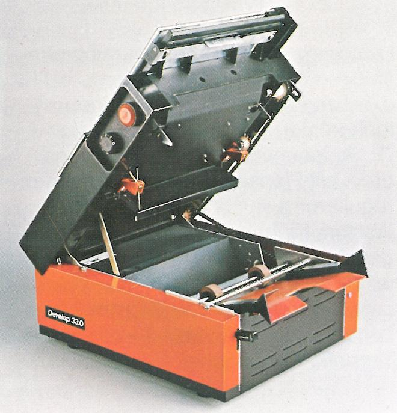
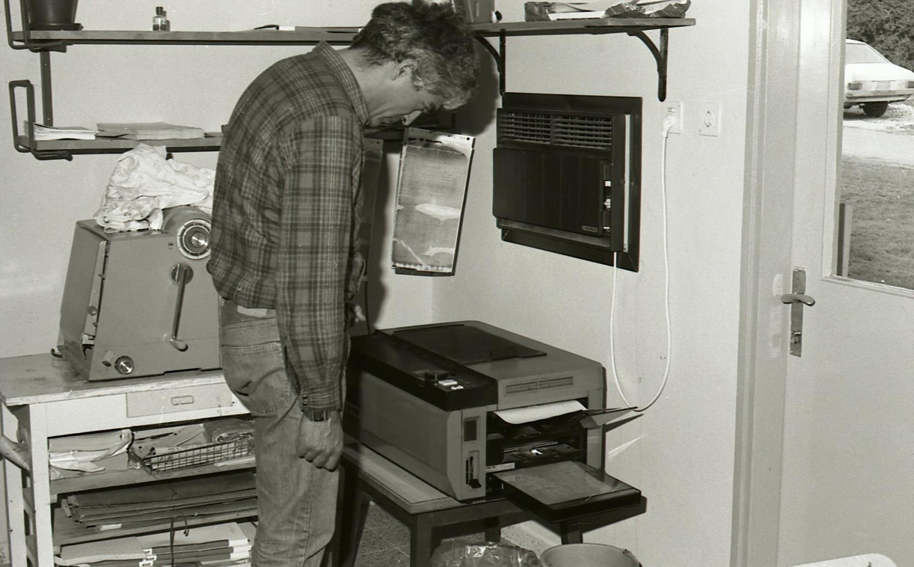
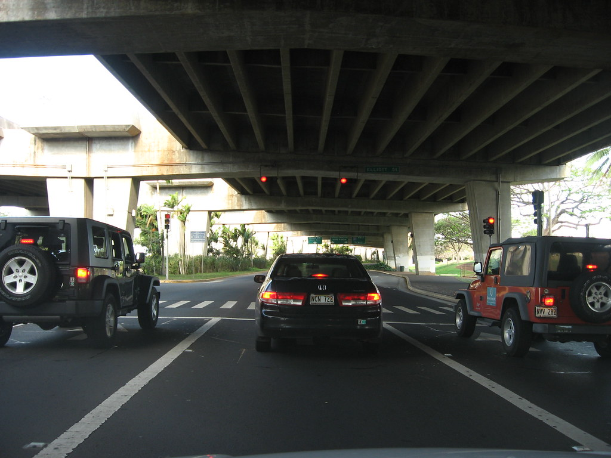

27 years ago today, November 2, 1999. In Honolulu, Hawaii, a service technician walked into a Xerox regional office and fatally shot his supervisor and six coworkers. The tragedy stunned the island community and permanently altered the state's sense of workplace safety.

## A Morning Routine Shattered on Nimitz Highway

At 8:00 on the morning of November 2, 1999, employees at the Xerox Corporation building at 1200 North Nimitz Highway were starting their shifts. Byran Koji Uyesugi, a 40-year-old copier service technician who had worked for Xerox since 1984, arrived carrying a semi-automatic pistol. Without warning, he opened fire on his supervisor and colleagues inside the office. Uyesugi discharged a total of 28 rounds, with 25 bullets striking people inside the building. Seven men died at the scene, while an eighth employee managed to flee unhurt as shots were aimed in his direction.

## The Victims of the Island's Deadliest Attack

The seven men murdered during the shooting were dedicated service technicians and company managers. The victims were Jason Balatico, 33; Ford Kanehira, 41; Ronald Kataoka, 50; Ronald Kawamae, 54; Melvin Lee, 58; Peter Mark, 46; and John Sakamoto, 36. News of the sudden massacre spread rapidly across Oahu and the nation. For an island community known for low rates of violent crime, the loss of seven working men in a single morning represented an unprecedented shock.

*Develop 330 — Photo: Develop GmbH / CC BY-SA 3.0 de*

## Growing Workplace Conflict and Hidden Warning Signs

In the years preceding the attack, Uyesugi had exhibited increasingly erratic behavior. After a high school car crash in 1977 where he struck his head on a windshield, his family noticed personality shifts, and by 1988, he began complaining of a poking sensation in his head. At work, he accused fellow technicians of tampering with his equipment and spreading rumors about him. In 1993, he had been ordered into anger management after kicking in an elevator door. Xerox management was transitioning away from the older copier models Uyesugi serviced. Fearing he could not master newer machines, he resisted retraining. On November 1, his manager gave an ultimatum that training would begin the next morning. Uyesugi later told forensic psychiatrist Dr. Michael Welner that he believed he would be fired, stating, 'I decided to give them a reason to fire me.'

*122377 kibbutz geva PikiWiki Israel — Photo: ישראל לוסטיג / Public domain*

## A Five-Hour Standoff Above Honolulu

Following the shooting, Uyesugi fled the Nimitz Highway premises in a company work van. By mid-morning, police spotted the vehicle parked near the Hawaii Nature Center in Makiki Heights, overlooking downtown Honolulu. Officers cordoned off the area and initiated negotiations. Inside the van, Uyesugi brandished his weapon, smoked cigarettes, and read magazines while surrounded by law enforcement. Negotiators worked methodically for five hours until Uyesugi finally surrendered peacefully around 3:00 in the afternoon.

*Nimitz Highway, Honolulu, Hawaii — Photo: Ken Lund / CC BY-SA 2.0*

## A Month-Long Trial and a Landmark Verdict

Uyesugi's trial opened on May 15, 2000. Prosecuting Attorney Peter Carlisle led the state's case, while defense attorneys Jerel Fonseca and Rodney Ching argued Uyesugi was not guilty by reason of insanity. Defense experts pointed to Uyesugi's delusions that coworkers were harming his pet fish. However, prosecution experts, including Dr. Harold Hall and Dr. Michael Welner, testified that while Uyesugi suffered from schizophrenia, his actions were deliberate, premeditated, and driven by anger over potential dismissal. On June 13, 2000, the jury rejected the insanity defense, finding Uyesugi guilty of first-degree murder.

## Sentencing, Aftermath, and Lasting Legacy

On August 8, 2000, Judge Marie N. Milks sentenced Uyesugi to life in prison without parole, alongside an additional life term for attempted murder. Because Hawaii does not have capital punishment, the Hawaii Paroling Authority established a mandatory minimum prison term of 235 years, the longest ever ordered for an inmate in the state. Xerox vacated the Nimitz Highway building, which later served as a production soundstage for television programs. Decades later, the tragedy remains Hawaii's deadliest mass shooting, remembered somberly by families and coworkers across the islands.

### Sources

- <https://en.wikipedia.org/wiki/Xerox>
- <https://commons.wikimedia.org/wiki/File:DFC_100.JPG>
- <https://commons.wikimedia.org/wiki/File:Develop_330.JPG>
- <https://commons.wikimedia.org/wiki/File:122377_kibbutz_geva_PikiWiki_Israel.jpg>
- <https://www.flickr.com/photos/75683070@N00/4549275534>
