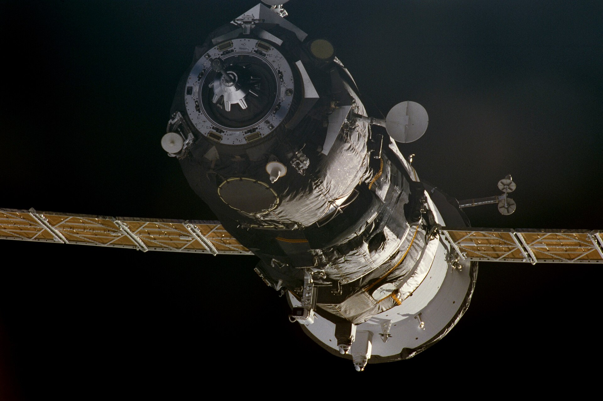
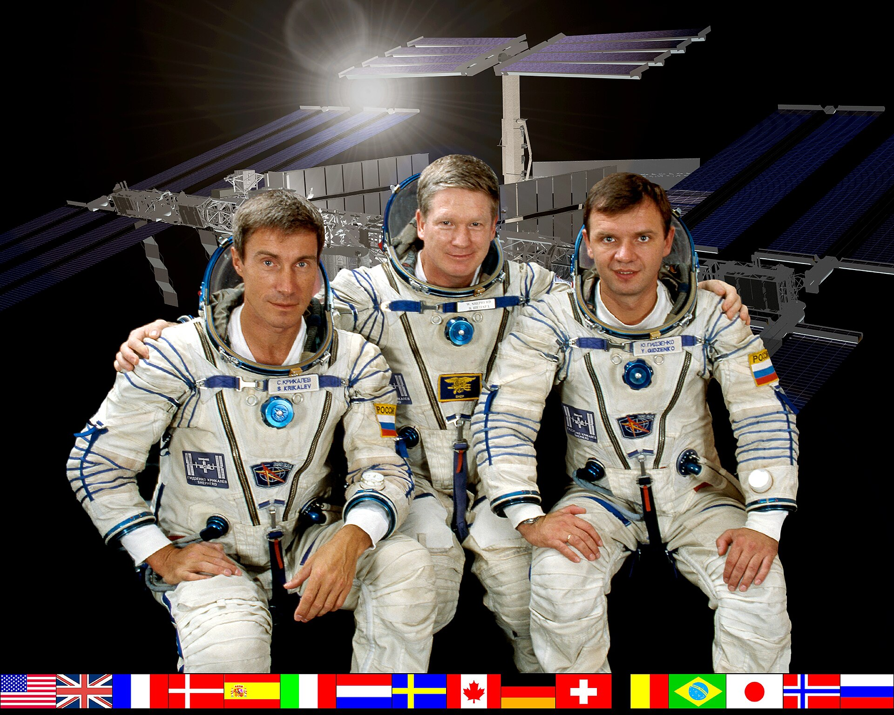
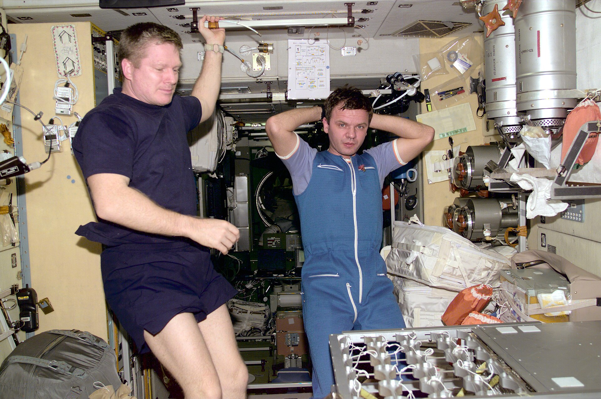

On November 2, 2000, human history reached an unprecedented milestone far above the atmosphere. The Expedition 1 crew docked with the International Space Station, marking the beginning of humanity's first long-duration stay onboard. That historic entry established a continuous human presence in space that has remained uninterrupted ever since.

## Uniting Rival Visions in Low Earth Orbit

For decades, the United States and the Soviet Union competed fiercely in the Space Race. Each nation developed ambitious blueprints for orbiting laboratories. The United States planned Space Station Freedom, while the Soviet Union worked on Mir-2. As geopolitical landscapes shifted in the 1990s, international leaders chose cooperation over competition, merging these separate visions into one global initiative.

The International Space Station program brought together five partner space agencies. NASA of the United States, Roscosmos of Russia, the European Space Agency, the Japan Aerospace Exploration Agency, and the Canadian Space Agency joined forces. Construction began in 1998 when the first module launched into orbit. Rocket stages from Proton, Soyuz, and the American Space Shuttle delivered components across dozens of complex assembly missions.

## The Day the Station Came to Life

On November 2, 2000, the Expedition 1 crew arrived to turn an empty metal shell into a working habitat. Their docking marked the transition of the station from an uncrewed construction site to a permanently inhabited home.

Stepping into the pressurized modules, the crew initiated systems that would support living beings in zero gravity. They set up communication networks with mission control centers in Houston and Moscow. From that precise day forward, humanity has never once been entirely absent from space.

*Progress-m1-4 — Photo: NASA / Public domain*

## A Giant Laboratory Racing Across the Sky

The International Space Station quickly expanded into the largest human spacecraft ever constructed. Measuring 358 feet by 239 feet with its solar arrays deployed, the complex covers an area comparable to a full-sized football field. Inside, its pressurized internal volume reaches 35,491 cubic feet, roughly equal to the interior of a Boeing 747 airliner.

The station travels in low Earth orbit at an altitude of approximately 250 miles, or 400 kilometers, above Earth. Moving at a staggering speed of 17,200 miles per hour, or 7.67 kilometers per second, it circles the globe once every 93 minutes. The crew witnesses 15.5 sunrises and sunsets every single day as they fly between 51.64 degrees north and south latitude.

*ISS-Expedition 1-crew — Photo: NASA / Public domain*

## Cutting-Edge Science Above the Atmosphere

Operating as an orbital research outpost, the station provides a laboratory environment impossible to replicate on Earth. Microgravity allows scientists to explore physical sciences, materials development, astrobiology, and meteorology. With six crew members providing around 160 man-hours of labor each week, experiments run continuously while data beams down directly to terrestrial researchers.

One landmark instrument mounted on the exterior is the Alpha Magnetic Spectrometer, designed to detect dark matter and cosmic rays. In April 2013, researchers announced that data from this instrument confirmed an unexplained excess of high-energy positrons, offering tantalizing hints about dark matter. NASA has compared the scientific significance of this detector to that of the Hubble Space Telescope.

*ISS-01 William M. Shepherd and Yuri P. Gidzenko in the Zvezda Service Module — Photo: NASA / Public domain*

## Understanding the Human Body in Space

Prolonged stays aboard the station also provide crucial medical data for future space exploration. Space is naturally hostile to living organisms, exposing astronauts to cosmic rays, vacuum, extreme temperature swings, and zero gravity. Without gravity, human bodies experience significant fluid shifts, rapid muscle atrophy, and bone loss.

Medical research conducted for the National Space Biomedical Research Institute tracks these physical changes in detail. Studies published in 2006 highlighted that bone and muscle deterioration posed severe risks for astronauts landing after extended journeys, such as a six-month flight to Mars. Technologies such as in-flight ultrasound scanning help researchers design countermeasures, laying the groundwork for eventual human voyages deeper into the solar system.

## A Quarter Century of Cooperation

Over the decades, the space station has welcomed visiting crews transported by the Space Shuttle, Soyuz, and Crew Dragon spacecraft. Robotic cargo vehicles including Progress, Cargo Dragon, Cygnus, the Automated Transfer Vehicle, and HTV-X have kept the outpost supplied with food, water, and scientific gear. By August 2025, 290 individuals from 26 countries had visited the station.

The station is slated to continue operations through the end of 2030, with commercial modules like Axiom Space's Payload Power Thermal Module pointing toward a new era. What started on November 2, 2000, proved that diverse nations could work together to maintain a permanent home among the stars.

### Sources

- <https://en.wikipedia.org/wiki/November%202>
- <https://commons.wikimedia.org/wiki/File:NASA-Krikalev-inside-ISS.jpg>
- <https://commons.wikimedia.org/wiki/File:Progress-m1-4.jpg>
- <https://commons.wikimedia.org/wiki/File:ISS-Expedition_1-crew.jpg>
- <https://commons.wikimedia.org/wiki/File:ISS-01_William_M._Shepherd_and_Yuri_P._Gidzenko_in_the_Zvezda_Service_Module.jpg>
