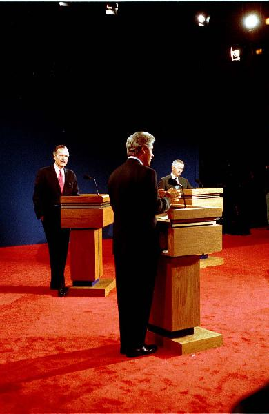
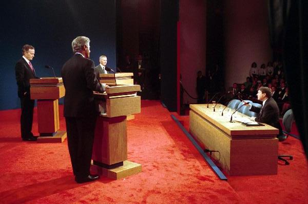
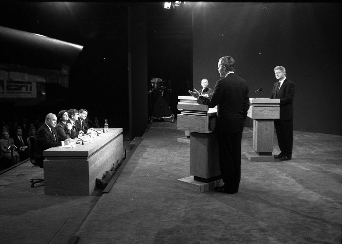

34 years ago today, November 3, 1992. Democratic Arkansas Governor Bill Clinton won the United States presidential election, defeating incumbent Republican President George H. W. Bush and independent businessman Ross Perot. The historic election reshaped the American political landscape, ushering in the first president of the Baby Boomer generation.

## The Incumbent Commander-in-Chief

George Herbert Walker Bush entered the 1992 presidential contest with one of the most distinguished resumes in modern American political history. Born in Milton, Massachusetts, Bush enlisted in the U.S. Navy Reserve on his 18th birthday and flew 58 combat missions during World War II, earning the Distinguished Flying Cross. After graduating from Yale University in 1948, he achieved business success in the Texas oil industry with Zapata Corporation, becoming a millionaire by the age of 40.

Bush transitioned into public service by winning election to the House of Representatives from Texas in 1966. During the administrations of Richard Nixon and Gerald Ford, he served as U.S. Ambassador to the United Nations, Chairman of the Republican National Committee, U.S. Ambassador to China, and Director of Central Intelligence. After serving as the 43rd vice president under Ronald Reagan from 1981 to 1989, Bush was elected the 41st president of the United States in 1988, defeating Democratic nominee Michael Dukakis.

## Domestic Headwinds and Broken Promises

Foreign policy initially defined Bush's presidency, marked by pivotal global transformations. He navigated the final years of the Cold War, played a central role in the reunification of Germany, and directed successful military operations in Panama and the Gulf War, which ended the Iraqi occupation of Kuwait. Domestically, Bush signed major bipartisan reforms into law in 1990, including the Americans with Disabilities Act, the Immigration Act, and the Clean Air Act Amendments, while also appointing David Souter and Clarence Thomas to the Supreme Court.

However, shifting domestic conditions eroded Bush's standing with voters. The nation entered an economic recession, and the political climate changed as the Cold War concluded. Bush also faced immense criticism for enacting tax increases to reduce the federal budget deficit, directly backpedaling on a prominent pledge from his 1988 campaign. These economic anxieties left the incumbent president vulnerable to a vigorous political challenge.

*Debate 771 — Photo: George Bush Presidential Library and Museum / Public domain*

## The Challenger from Hope, Arkansas

The Democratic challenge emerged from Arkansas in the form of Governor Bill Clinton. Born William Jefferson Blythe III on August 19, 1946, at the Julia Chester Hospital in Hope, Arkansas, Clinton never knew his biological father, who died in an automobile accident three months before his birth. He was raised initially by his grandparents, Eldridge and Edith Cassidy, who ran a small grocery store that extended credit to neighbors regardless of race during the era of racial segregation. In 1950, his mother married Roger Clinton Sr., and the family moved to Hot Springs, where Bill later adopted his stepfather's surname.

A gifted student and tenor saxophone player who led the state band section and played in a jazz trio called The 3 Kings, Clinton attended Georgetown University, graduating in 1968, before attending Yale Law School, where he met Hillary Rodham. Returning to Arkansas, Clinton was elected state attorney general, serving from 1977 to 1979, and then became governor, serving from 1979 to 1981 and again from 1983 to 1992. As governor, Clinton overhauled the state's education system and served as chairman of the National Governors Association, building a national reputation as a pragmatic reformer.

*Debate 772 — Photo: George Bush Presidential Library and Museum / Public domain*

## A High-Stakes Three-Way Contest

Launching his national campaign, Clinton ran as a 'New Democrat,' championing a centrist Third Way political philosophy that would come to be known as Clintonism. His platform blended social progressivism with fiscal moderation and domestic economic renewal. The 1992 general election also featured an aggressive third-party campaign from independent businessman Ross Perot, who drew extensive support from voters dissatisfied with traditional party politics.

Clinton concentrated his campaign strategy on the day-to-day economic difficulties facing ordinary American families during the downturn. By emphasizing job creation, domestic investment, and government reform, Clinton created a coalition that appealed to working-class voters and suburban communities across the country.

*First debate 3244 — Photo: George Bush Presidential Library and Museum / Public domain*

## The Changing of the Guard

On the night of November 3, 1992, voters delivered their verdict. Clinton defeated both President Bush and Ross Perot, ending twelve consecutive years of Republican control in the White House. The result made Bush a rare single-term incumbent, concluding his presidency in January 1993.

With his victory, Clinton became the 42nd president of the United States and the very first president born in the Baby Boomer generation. He went on to become the youngest president to serve two full terms, overseeing what was then the longest period of peacetime economic expansion in American history, passing legislation such as the North American Free Trade Agreement, and seeing the federal budget achieve its first surplus since 1969 during his final three years in office.

## A Legacy of Post-Presidency Partnership

Following his departure from Washington, George H. W. Bush saw his family's political legacy continue, with his eldest son, George W. Bush, winning the presidency in 2000 and 2004, making them the second father-son pair to serve as president after John Adams and John Quincy Adams. President Bush lived to see his historical reputation rise, with historians consistently ranking him as an above-average president prior to his death in Houston in 2018.

In their post-White House years, the two former competitors forged a notable public friendship and cooperative partnership. They frequently joined forces on global humanitarian initiatives, most notably establishing the Clinton Bush Haiti Fund following the catastrophic earthquake in 2010. The fierce rivalry of November 3, 1992, ultimately paved the way for decades of shared national service.

### Sources

- <https://en.wikipedia.org/wiki/George_H._W._Bush>
- <https://commons.wikimedia.org/wiki/File:George_H._W._Bush_1992_Election_Night.jpg>
- <https://commons.wikimedia.org/wiki/File:Debate_771.jpg>
- <https://commons.wikimedia.org/wiki/File:Debate_772.jpg>
- <https://commons.wikimedia.org/wiki/File:First_debate_3244.jpg>
