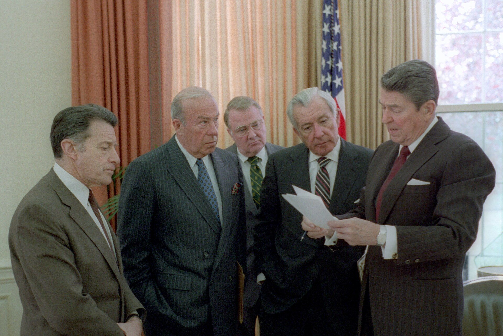
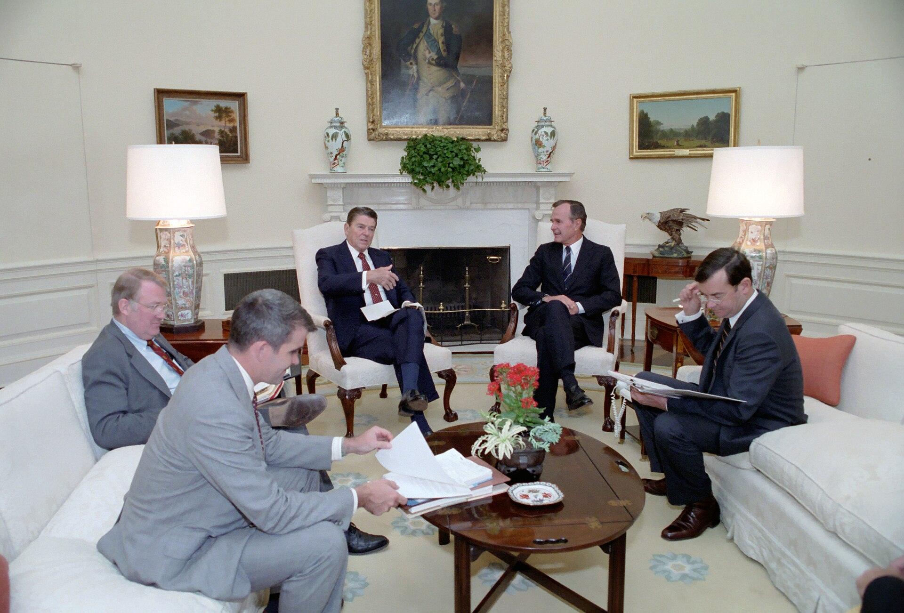
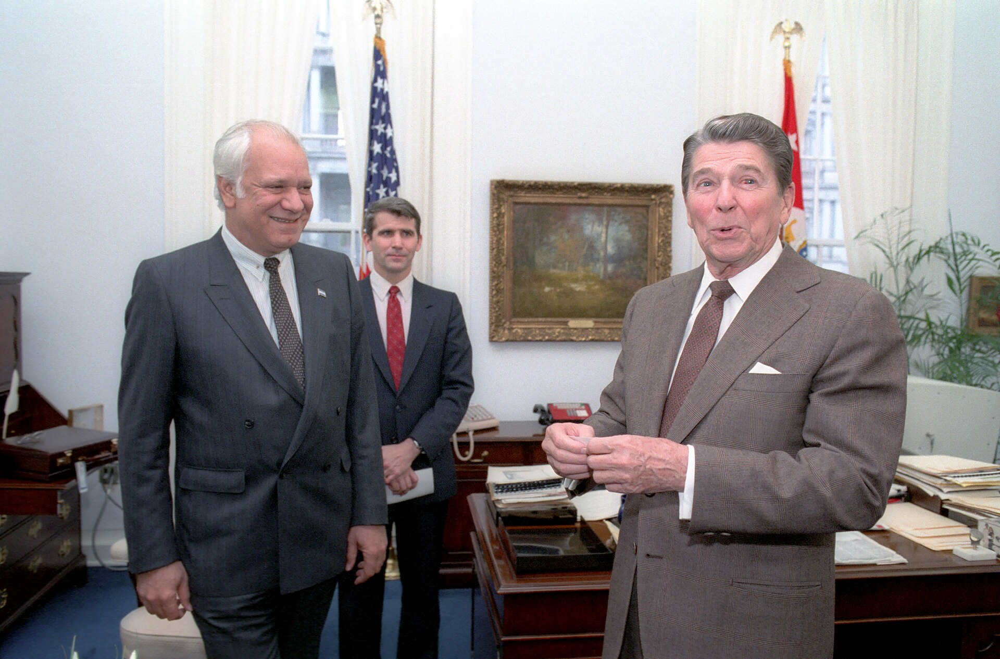

40 years ago today, November 3, 1986, a small weekly magazine in Beirut, Lebanon, published a report that shook the foundations of Washington. Ash-Shiraa revealed that the United States government had secretly been selling military weapons to Iran in an effort to secure the freedom of American hostages held in Lebanon.

## An Embargo Broken in Secret

Relations between Washington and Tehran had been bitterly fractured since the 1979 Iranian Revolution and the subsequent hostage crisis, which prompted an official American arms embargo. In 1983, the Reagan administration had even launched Operation Staunch, an aggressive worldwide diplomatic initiative aimed at blocking all international arms shipments and spare parts to the Islamic Republic during its grueling war with Iraq. Publicly, the official American policy was absolute: no weapons sales to Iran and no concessions to terrorists.

## The Hostages in Lebanon and a Dangerous Plan

Behind that resolute public stance lay a desperate problem. In Lebanon, seven American citizens had been seized and held hostage by Hezbollah, an Islamist paramilitary organization tied to Iran's Islamic Revolutionary Guard Corps. Seeking a way to break the deadlock, officials in the Reagan administration entertained an idea presented by an expatriate Iranian arms dealer named Manucher Ghorbanifar. The proposal suggested that discreetly providing military hardware to Tehran could persuade Iranian leaders to press Hezbollah for the captives' release.

*President Ronald Reagan meets with aides on Iran-Contra (cropped) — Photo: Series: Reagan White House Photographs, 1/20/1981 - 1/20/198 / Public domain*

## Diverting Funds to the Nicaraguan Contras

The covert operation soon grew even more perilous. At the same time, the White House was passionately committed to backing the Contras, a guerrilla force fighting the leftist Sandinista government of Nicaragua. Congress, however, had strictly prohibited direct military funding for the insurgency through the Boland Amendments, culminating in a total ban on government agency assistance taking effect in October 1984. To circumvent this congressional ban, senior administration officials secretly funneled the profits generated from the Iranian weapon sales directly to the Nicaraguan rebels.

*NOT FROM THE EVENT · 1983 — Photo: President (1981-1989 : Reagan). White House Photographic Off / Public domain*

## The Scoop That Broke the Scandal

The entire clandestine enterprise collapsed on November 3, 1986, when Ash-Shiraa, one of Lebanon's oldest weekly publications, published the details of the secret shipments. The scoop quickly triggered international headlines, forcing the administration into public defense. In the executive branch, officials rushed to destroy or withhold sensitive files before federal authorities could intervene. President Ronald Reagan initially appeared on national television insisting that the United States did not swap arms for hostages, but the mounting evidence proved insurmountable.

*NOT FROM THE EVENT · 1985 — Photo: President (1981-1989 : Reagan). White House Photographic Off / Public domain*

## Investigation, Indictments, and the Aftermath

By March 1987, President Reagan again addressed the nation, accepting full responsibility and conceding that the policy had deteriorated into trading arms for hostages. In December 1986, Lawrence Walsh was named independent counsel to head an exhaustive criminal inquiry alongside investigations by Congress and the Reagan-appointed Tower Commission. Dozens of senior figures were indicted over the course of the probe, including Secretary of Defense Caspar Weinberger and Lieutenant Colonel Oliver North. Although eleven convictions were secured, several were overturned on appeal, and outgoing President George H. W. Bush pardoned the remaining key defendants in the final days of his term, leaving only one defendant, Thomas G. Clines, to serve a prison sentence.

## A Lasting Constitutional Lesson

Independent Counsel Walsh submitted his final comprehensive report on August 4, 1993, later documenting the systemic deception and cover-up in his memoir. Four decades after an overseas weekly exposed the covert pipeline, the Iran-Contra affair stands as a historic reminder of the severe consequences when foreign policy operations bypass congressional oversight and federal law.

### Sources

- <https://en.wikipedia.org/wiki/Iran%E2%80%93Contra_affair>
- <https://commons.wikimedia.org/wiki/File:President_with_Caspar_Weinberger_George_Shultz_Ed_Meese_and_Don_Regan_in_The_Oval_Office_Discussing_The_President%27S_Remarks_on_The_Iran-Contra_Affair_-_DPLA_-_e04a304b13c6dd40ae68d70b6fa92d20.jpg>
- <https://commons.wikimedia.org/wiki/File:President_Ronald_Reagan_meets_with_aides_on_Iran-Contra_(cropped).jpg>
- <https://commons.wikimedia.org/wiki/File:National_Security_Briefing_in_the_oval_office_with_Ed_Meese_George_Bush_Bill_Clark_Oliver_North_-_DPLA_-_7b104d7411fe633370094225fc899415.jpg>
- <https://commons.wikimedia.org/wiki/File:President_Ronald_Reagan_in_Robert_Mcfarlane%27S_Office_with_Adolfo_Calero_a_Nicaraguan_Democratic_Resistance_(Contra)_Leader_and_Oliver_North_-_DPLA_-_aec13c97b4aa6b39e2eba241d79cc0ab.jpg>
