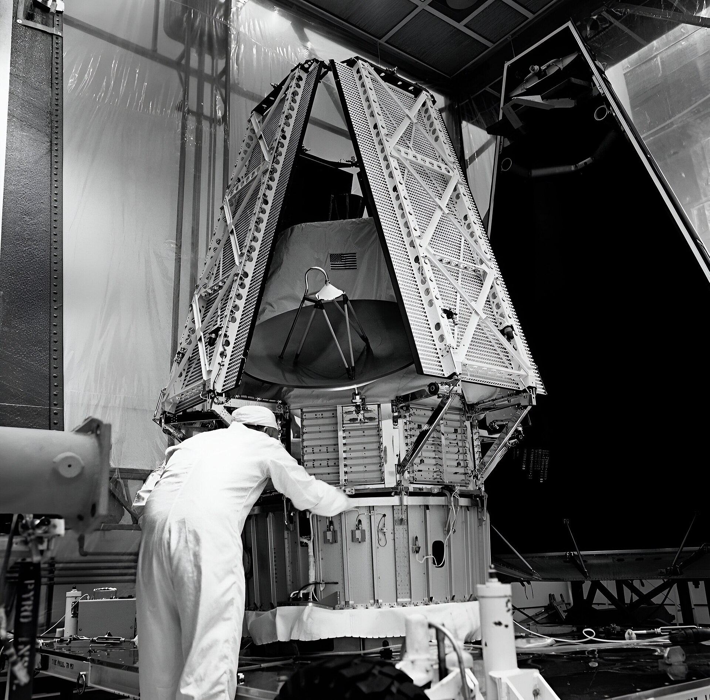
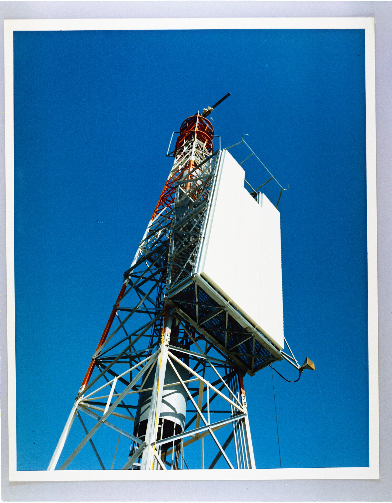

53 years ago today, November 3, 1973, NASA launched Mariner 10 from its launchpad, setting the robotic probe on a daring trajectory toward Mercury. It was the final flight of the pioneering Mariner series, aiming to reach the innermost planet of the Solar System.

## The Ambition of the Mariner Program

The Mariner program was conceived and managed by NASA and designed by the Jet Propulsion Laboratory (JPL) beginning in 1960. The primary goal was to conduct small-scale, frequent explorations of neighboring planetary worlds. Between 1962 and late 1973, JPL designed and constructed 10 robotic spacecraft to study Venus, Mars, and Mercury. The entire effort represented an investment of approximately $554 million.

NASA had decided on the name Mariner in May 1960 at the suggestion of Edgar M. Cortright. Planetary probes were patterned after nautical terms to convey the distinct impression of long journeys across great distances to remote destinations. This naming philosophy also set the stage for subsequent projects like Ranger, Surveyor, and Viking.

## Engineering Marvels for Deep Space Flight

Every Mariner probe was built around a rigid hexagonal or octagonal bus that housed sensitive electronics and provided mounting points for science packages, thrusters, and communication antennae. Engineers designed them to be three-axis stabilized so they would not spin, allowing cameras and directional sensors to remain firmly pointed at target planets while communications dishes stayed aimed at Earth.

While earlier probes like Mariner 4 utilized four deployable solar panels, Mariner 10 was equipped with two solar panels. Because it was sent inward toward the blazing heat of the Sun, the spacecraft relied on tailored systems and advanced television cameras to snap close-up images of foreign landscapes. Mariner 10 was launched using an Atlas-Centaur rocket booster, providing the immense power needed to break free of Earth orbit.

*Archive, 1971 — Photo: NASA Kennedy Space Center (NASA-KSC), image IDs: KSC-71P-036 / Public domain*

## The Challenge of Reaching Mercury

Mercury represents one of the most difficult destinations in the Solar System. As the closest planet to the Sun and the smallest of all the major planets, it requires the highest delta-v, or velocity change, for a spacecraft traveling from Earth. With almost no protective atmosphere and a surface gravity slightly lower than that of Mars, its environment is stark and unforgiving.

To bridge the vast orbital gap without exceeding weight limits, mission planners designed Mariner 10 to execute the first-ever interplanetary gravity assist maneuver. By sweeping past Venus, the spacecraft traded orbital energy to redirect its path directly inward toward Mercury, demonstrating a navigation technique that would later become essential for exploring outer planets.

*JET PROPULSION LABORATORY JPL GOLDSTONE TESTS - NARA - 17444084 — Photo: Unknown authorUnknown author or not provided / Public domain*

## Triumph at the Innermost World

Following its launch on November 3, 1973, Mariner 10 completed its voyage through the inner Solar System over the course of several months. On March 29, 1974, the spacecraft achieved its primary objective by becoming the very first probe ever to encounter Mercury.

Its television cameras beamed back extraordinary close-up images of a landscape heavily pitted with impact craters, vast thrust fault systems known as rupes, and bright ejecta rays. Among its greatest discoveries was Caloris Planitia, an enormous impact basin measuring 1,550 kilometers in diameter—roughly one-third the entire diameter of the planet. It also detected a faint magnetic field and gathered crucial radiometric data on equatorial temperatures that swung from extreme nighttime cold to daytime highs of 420 degrees Celsius.

*Gen. Terhune and Dr. Pickering receiving the Pasadena Chamber of Commerce "Crown City Award" on behalf of JPL — Photo: NASA/JPL / Public domain*

## A Lasting Heritage for American Space Science

Of the 10 spacecraft launched throughout the Mariner program, seven achieved complete mission success. The technological lineage begun by Mariner lived on directly in subsequent flagship exploration initiatives. The planned Mariner Jupiter-Saturn concepts evolved into the famous Voyager missions, the Viking Mars orbiters were enlarged variants of Mariner 9, and subsequent spacecraft like Galileo, Magellan, and Cassini-Huygens all incorporated core Mariner design principles.

Mariner 10 closed out the original Mariner series by demonstrating that humanity could successfully navigate the intense gravitational and thermal environment near the Sun. Decades later, the historic flight of Mariner 10 remains one of the proudest chapters in planetary exploration.

### Sources

- <https://en.wikipedia.org/wiki/Mariner_program>
- <https://commons.wikimedia.org/wiki/File:Atlas_I-CENTAUR.jpg>
- <https://commons.wikimedia.org/wiki/File:Mariner_9_undergoes_final_checks.jpg>
- <https://commons.wikimedia.org/wiki/File:JET_PROPULSION_LABORATORY_JPL_GOLDSTONE_TESTS_-_NARA_-_17444084.jpg>
- <https://commons.wikimedia.org/wiki/File:Gen._Terhune_and_Dr._Pickering_receiving_the_Pasadena_Chamber_of_Commerce_%22Crown_City_Award%22_on_behalf_of_JPL.jpg>
