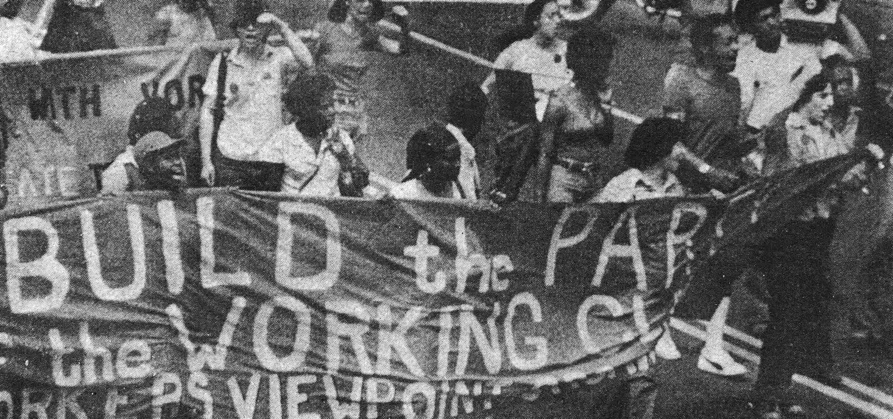
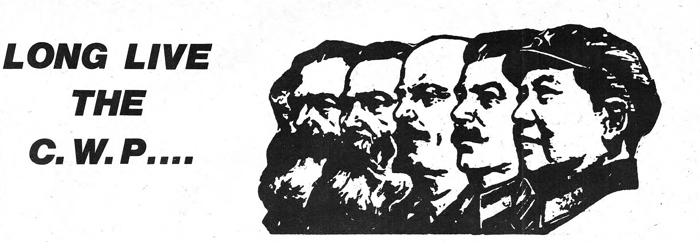
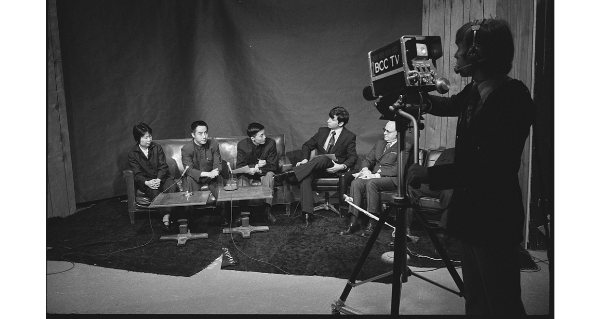

47 years ago today, November 3, 1979, gunfire erupted in broad daylight during a public demonstration in Greensboro, North Carolina. What was planned as a 'Death to the Klan' rally organized by labor activists turned into one of the deadliest confrontations in modern North Carolina history.

## Labor Organizing and Rising Tensions

During the mid-1970s, organizers associated with the Workers Viewpoint Organization—which later became the Communist Workers Party—arrived in the Carolina Piedmont region. The group sought to build multi-racial labor unions across regional textile mills and healthcare facilities. Members took jobs directly on the factory floors in places like Haw River, Kannapolis, Durham, and Greensboro to rally workers.

Among them was James Waller, who stepped away from his medical career to work full-time as an organizer. He eventually became president of the local textile workers union at Cone's Granite Finishing Plant in Haw River. The efforts to unionize Black and White mill workers met fierce opposition from local Ku Klux Klan chapters and members of the National Socialist Party of America throughout 1979.

## The Clashing Convergence on November 3

The Communist Workers Party scheduled a march and rally under the slogan 'Death to the Klan' for November 3, 1979, in Greensboro. The weeks leading up to the gathering were marked by aggressive rhetoric and threats of violence from both sides. Unknown to the public at the time, undercover law enforcement operatives had infiltrated the white supremacist organizations and were aware of movements leading up to the demonstration.

As anti-Klan demonstrators assembled at the starting location on that Saturday morning, a motorcade carrying Klansmen and neo-Nazis drove directly into the area. Shouting quickly escalated into physical confrontations, and weapons were drawn from vehicle trunks.

*Workers Viewpoint banner in the forefront during African Liberation Day — Photo: Communist Workers Party / Public domain*

## Gunfire in Front of News Cameras

In a matter of minutes, gunfire shattered the rally. News cameras from local television stations captured the violence as shots were fired into the crowd. Five demonstrators were killed: four members of the Communist Workers Party and one woman whose spouse was a party member. James Waller was among those fatally struck.

In addition to the five deaths, nine other anti-Klan demonstrators, two television journalists, and one Klansman suffered gunshot wounds or injuries. The raw video footage of the shootout was broadcast across the United States, shocking viewers with images of open violence on a Southern city street.

*Long Live the CWP — Photo: Communist Workers Party / Public domain*

## Criminal Acquittals and Federal Trials

The aftermath moved rapidly to state courtrooms, where prosecutors charged Klansmen and neo-Nazis with murder and riot offenses. In 1980, an all-white jury acquitted all the defendants of state criminal charges. In 1984, federal prosecutors pursued criminal civil rights charges against nine men, but the defense argued they had acted in self-defense, and another all-white federal jury returned acquittals on all counts.

A subsequent civil trial in federal court produced a different outcome. In 1985, a federal civil jury found eight defendants, including several Klansmen, neo-Nazis, and Greensboro police officials, liable for the wrongful death of Michael Nathan, a physician and demonstrator who was not a member of the party. The verdict marked the only legal finding of liability related to the shootings.

*Television studio at Bethesda-Chevy Chase High School, Bethesda, Maryland — Photo: Warren K. Leffler, U.S. News &amp; World Report Magazine / Public domain*

## A Community's Long Path to Reconciliation

For years, the violence left deep divisions in Greensboro. In 2004, community members established the Greensboro Truth and Reconciliation Commission to formally examine the causes and consequences of November 3, 1979. The commission heard extensive testimony and concluded that while both political factions had contributed to rising animosity, the Klan and neo-Nazi members entered the rally intending to inflict physical harm, and local police agencies bore significant responsibility for failing to protect the marchers.

Decades after the event, the Greensboro City Council issued a formal apology for the tragic deaths. In 2015, the city dedicated an official historical marker at the site to ensure the lives lost and the lessons of that day are preserved in public memory.

### Sources

- <https://en.wikipedia.org/wiki/Greensboro_massacre>
- <https://commons.wikimedia.org/wiki/File:Wv-4-18-color_(page_1_crop).jpg>
- <https://commons.wikimedia.org/wiki/File:Workers_Viewpoint_banner_in_the_forefront_during_African_Liberation_Day.jpg>
- <https://commons.wikimedia.org/wiki/File:Long_Live_the_CWP.jpg>
- <https://commons.wikimedia.org/wiki/File:Television_studio_at_Bethesda-Chevy_Chase_High_School,_Bethesda,_Maryland.png>
