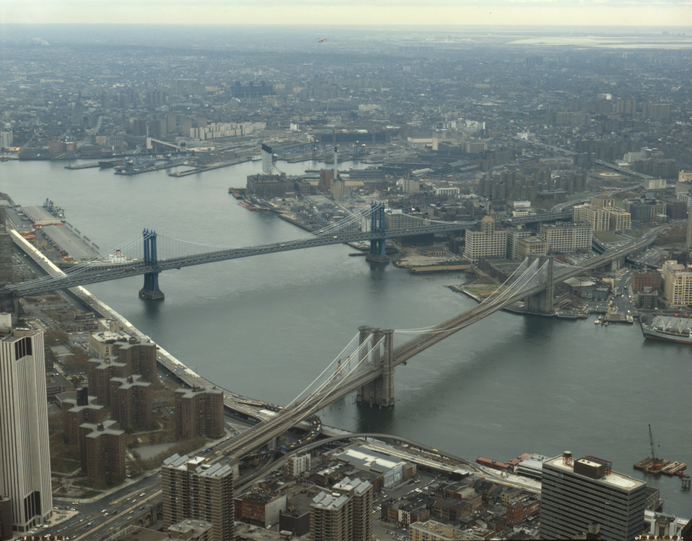
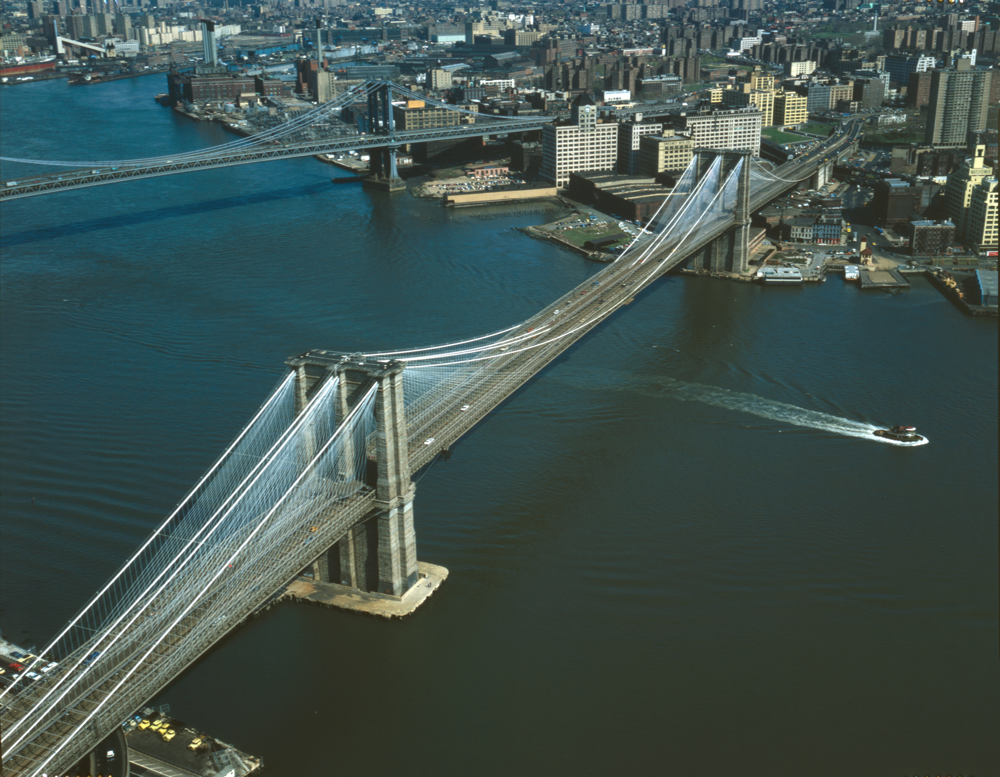
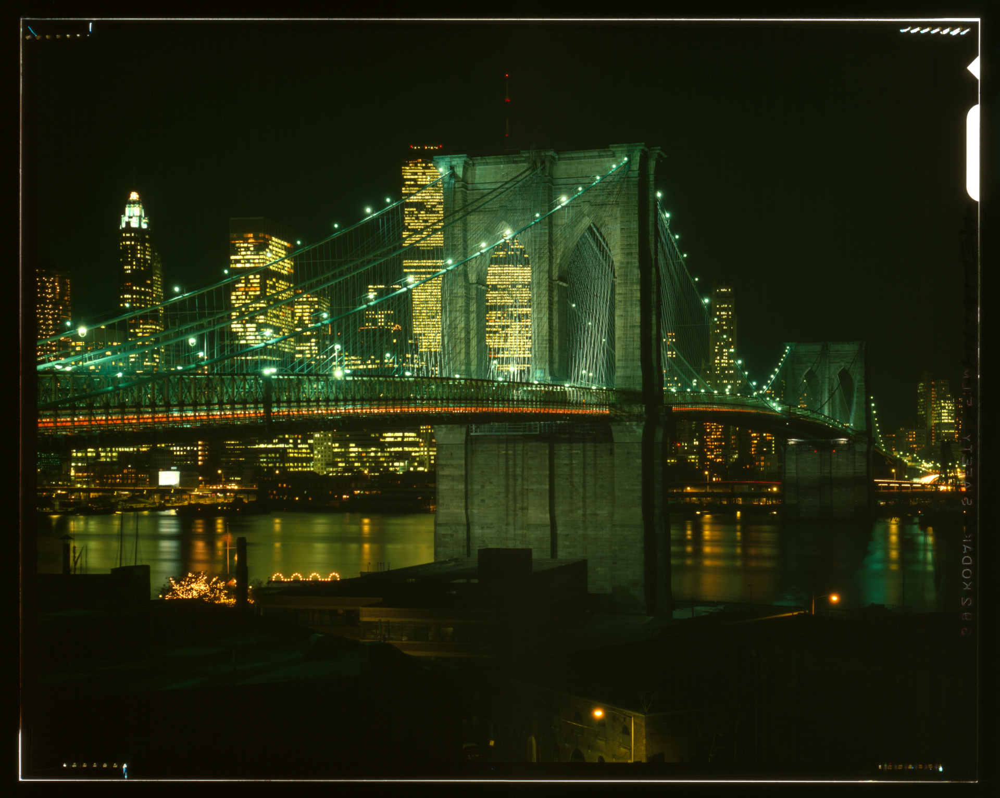

44 years ago today, November 3, 1982, the Dow Jones Industrial Average surged 43.41 points, or 4.25 percent, to close at 1,065.49. The closing figure marked the index's first all-time high in more than 9 years, bringing a decisive close to a prolonged drought on Wall Street.

## A Historic Surge Past the 1,000 Mark

Trading on November 3, 1982, concluded with a decisive move across American equity markets. The Dow Jones Industrial Average advanced by 43.41 points in a single session, representing a gain of 4.25 percent. The index ended the day at 1,065.49, marking its first fresh record high since the early 1970s. Market participants had watched the index hover below record levels for nearly a decade, making the single-day advance a notable milestone for market observers.

## The Nine-Year Wait Since January 1973

Before the breakout on November 3, 1982, the Dow had last reached an all-time record on January 11, 1973. On that day, the average had closed at 1,051.70. For more than 9 years following that peak, the market experienced numerous cyclical downturns and recoveries without ever climbing above 1,051.70. The 43.41-point jump finally pushed the 30-stock index beyond the barrier that had contained it for more than 3,500 calendar days.

*LOC Brooklyn Bridge and East River 2 — Photo: Jet Lowe, photographer. / Public domain*

## Charles Dow and the Origins of Market Averages

The benchmark was created by founder Charles Dow and his business associate, statistician Edward Jones. In 1884, Charles Dow formulated his first stock average featuring 11 stocks, which were predominantly railroad companies. This initial list later developed into the Dow Jones Transportation Average. Dow initially published these market calculations in Customer's Afternoon Letter, a daily two-page financial news bulletin that served as the precursor to The Wall Street Journal. On February 16, 1885, the Dow Jones Average launched as a 14-stock index. The composition was revised on January 2, 1886, dropping from 14 to 12 stocks after the removal of Central Pacific Railroad and Central Railroad of New Jersey.

*LOC Brooklyn Bridge and East River 3 — Photo: Jet Lowe / Public domain*

## The 1896 Debut of the Industrial Benchmark

The Dow Jones Industrial Average made its official debut on May 26, 1896, tracking 12 industrial stocks with an initial base value of 40.94. The 12 original constituent companies were American Cotton Oil Company, American Sugar Company, American Tobacco Company, Chicago Gas Company, Distilling & Cattle Feeding Company, and General Electric. Completing the original group were Laclede Gas Company, National Lead Company, North American Utility Company, Tennessee Coal & Iron, U.S. Leather Company preferred stock, and U.S. Rubber Company. Over the subsequent decades, the index expanded to track 30 large companies listed on United States exchanges, with constituent changes overseen by an index committee.

*LOC Brooklyn Bridge and East River 6 — Photo: Jet Lowe / Public domain*

## How the Divisor and Price Weighting Work

The Dow Jones Industrial Average is structured as a price-weighted index, meaning companies with a higher price per share exert a proportionally greater influence on the movement of the average. The value of the index is calculated by summing the share prices of all 30 constituent stocks and dividing that sum by a specific mathematical figure known as the Dow Divisor. When the index began, the divisor was simply the number of component companies, forming an arithmetic average. Over time, stock splits, spinoffs, and structural changes required regular recalculation of the divisor so that corporate actions would not distort the index level. After decades of adjustments, the divisor fell well below one. As an illustration of its mechanics, by July 2026 the factor stood at approximately 0.168, and on June 29, 2026, the specific Dow Divisor was 0.16824816528350, meaning every one-dollar change in a constituent stock's price moved the overall average by approximately 5.943601 points.

## Investment Products and Modern Perspectives

Today, the Dow Jones Industrial Average is maintained by S&P Dow Jones Indices and serves as the underlying measure for a wide range of investment vehicles. These include index mutual funds, exchange-traded funds, and derivative products such as futures and options contracts. Some strategies use modified approaches, including equal weighting, covered call strategies, leverage, or performance buffers. Another long-standing investment approach is known as the Dogs of the Dow, which tracks the 10 constituent companies with the highest dividend yields. Because the index includes only 30 stocks and assigns weights by share price rather than total market capitalization, companies like Goldman Sachs have carried substantial individual weight, and during the 2008 financial crisis, the index suffered significantly from the decline of then-component AIG. While many financial advisors do not consider the 30-stock measure fully representative of the broader United States economy, its long-term performance has closely tracked the broader S&P 500.

### Sources

- <https://en.wikipedia.org/wiki/Dow_Jones_Industrial_Average>
- <https://commons.wikimedia.org/wiki/File:LOC_Brooklyn_Bridge_and_East_River_1.png>
- <https://commons.wikimedia.org/wiki/File:LOC_Brooklyn_Bridge_and_East_River_2.png>
- <https://commons.wikimedia.org/wiki/File:LOC_Brooklyn_Bridge_and_East_River_3.png>
- <https://commons.wikimedia.org/wiki/File:LOC_Brooklyn_Bridge_and_East_River_6.png>
