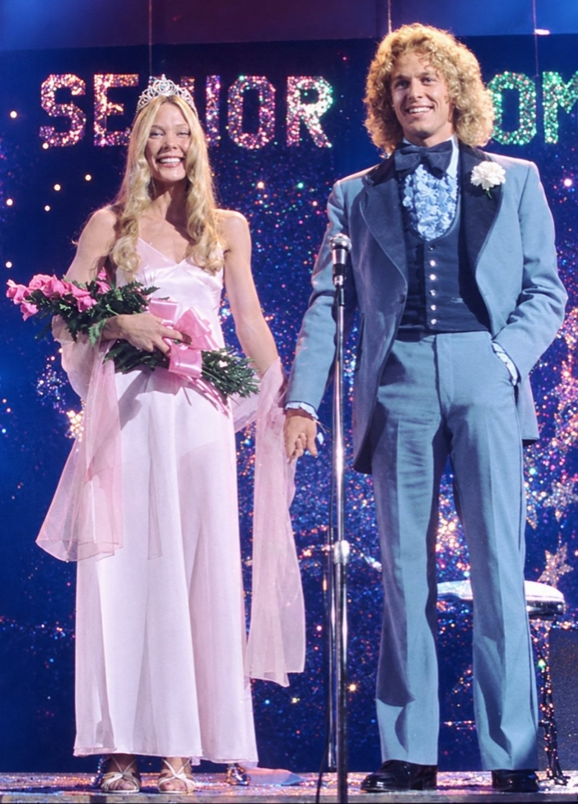
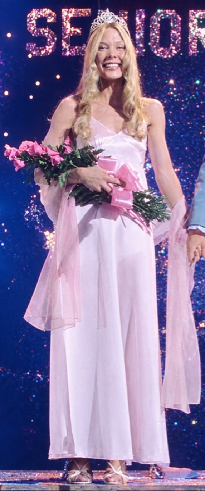
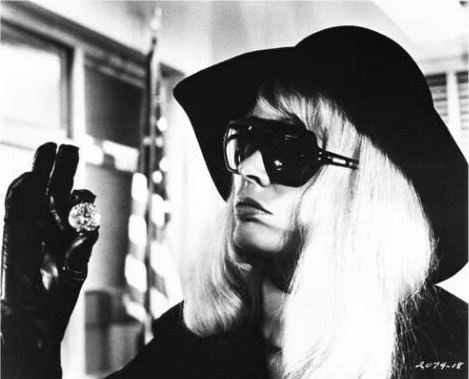

50 years ago today, November 3, 1976, a supernatural horror film titled Carrie quietly arrived on the big screen. The film opened in just 17 theaters across the Washington, D.C. and Baltimore area, released by United Artists. Directed by Brian De Palma, it marked the first time any story by author Stephen King had ever reached movie theater audiences.

## An Ambitious Director and Stephen King's First Novel

In 1976, Stephen King was still a new voice in American literature. His 1974 novel Carrie had been his first published book, following an awkward high school student named Carrie White who develops telekinesis after years of isolation and bullying.

Brian Russell De Palma, an emerging filmmaker of the New Hollywood generation, became intrigued by King's book. De Palma had developed an obsession with suspense cinema after seeing works like Orson Welles' Citizen Kane and Alfred Hitchcock's Vertigo during his college years. Eager to take on the material, De Palma pushed the studio for permission to direct the adaptation with screenwriter Lawrence D. Cohen, working with a modest budget of just 1.8 million dollars.

## Casting Sissy Spacek and Piper Laurie

The production found its centerpiece in Sissy Spacek, who was encouraged by her husband to audition for the title role of Carrie White. Spacek brought quiet vulnerability to the role of the 16-year-old outcast living in Chamberlain, Maine.

Piper Laurie was cast as Margaret White, Carrie's abusive and religiously fanatical mother who confines her daughter to a prayer closet. The ensemble featured young talents who would soon become familiar faces across American cinema, including John Travolta, Amy Irving, Nancy Allen, William Katt, P. J. Soles, and Betty Buckley.

*Sissy Spacek & William Katt — Photo: CBS / Public domain*

## From Cruelty to Supernatural Retribution

The story traced Carrie's painful struggles at high school, beginning with an agonizing gym shower incident where fellow students threw sanitary pads at her after she experienced her first period. When her gym teacher intervened and punished the bullies, ringleader Chris Hargensen refused detention and was barred from the senior prom.

Chris and her boyfriend Billy Nolan retaliated with a cruel scheme, slaughtering pigs to suspend a bucket of blood above the gymnasium stage. Meanwhile, classmate Sue Snell felt remorse for the bullying and convinced her boyfriend Tommy Ross to escort Carrie to the prom. When Carrie and Tommy were voted Prom Queen and King, the bucket was triggered, soaking Carrie in blood and igniting her telekinetic wrath against the entire gymnasium.

*Sissy Spacek - Carrie — Photo: CBS / Public domain*

## A Box Office Hit and Historic Oscar Recognition

Released theatrically on November 3, 1976, Carrie became both a critical triumph and an overwhelming commercial success. The 1.8 million dollar production went on to gross more than 33.8 million dollars at the box office.

The film also achieved a rare breakthrough for the horror genre during the 49th Academy Awards. Sissy Spacek earned a nomination for Best Actress, while Piper Laurie secured a nomination for Best Supporting Actress. The recognition established horror as a genre capable of serious performance accolades.

*Archive, 1976 — Photo: Universal Pictures / Public domain*

## A Half-Century of Cultural Impact

The release of Carrie inaugurated a historic cinematic relationship with Stephen King's literature, becoming the first of more than 100 film, television, and theater productions adapted from his published works. The franchise expanded across decades, eventually inspiring an eight-episode television series developed by Mike Flanagan for Amazon Prime Video, starring Summer H. Howell as Carrie White.

In 2008, Empire placed Carrie at number 86 on its list of the 500 Greatest Movies of All Time, and Bravo ranked its climactic prom scene eighth on its program The 100 Scariest Movie Moments. In 2022, the Library of Congress selected the film for preservation in the United States National Film Registry as culturally, historically, or aesthetically significant.

### Sources

- <https://en.wikipedia.org/wiki/Carrie_(1976_film)>
- <https://commons.wikimedia.org/wiki/File:Carrie_(1976).jpg>
- <https://commons.wikimedia.org/wiki/File:Sissy_Spacek_%26_William_Katt.jpg>
- <https://commons.wikimedia.org/wiki/File:Sissy_Spacek_-_Carrie.jpg>
- <https://commons.wikimedia.org/wiki/File:Family_Plot_1976_Still.jpg>
