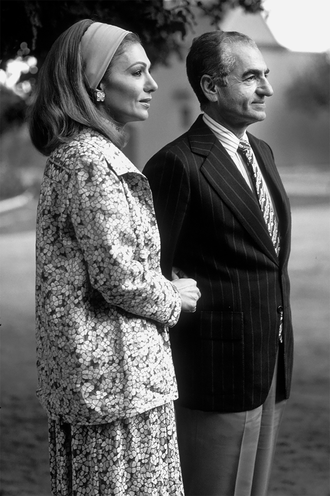
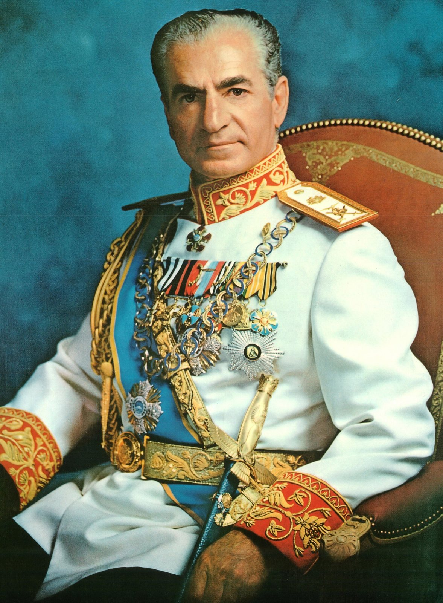
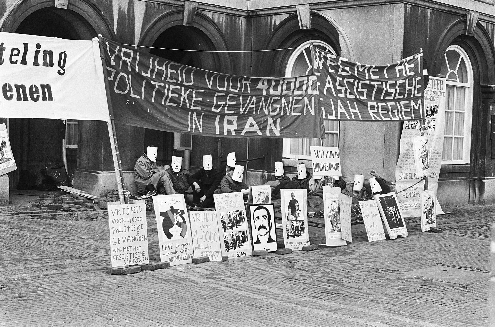

47 years ago today, November 4, 1979, thousands of Iranian protesters breached the outer walls of the United States Embassy in Tehran, capturing dozens of diplomats and staff members in an event that shocked the world. The raid ignited a 444-day international crisis that altered the political trajectory of the United States and cemented a bitter divide between Washington and Iran.

## Simmering Tensions and the Fall of the Monarchy

Relations between the United States and Iran had been fraught long before the crisis began. In 1953, American and British intelligence agencies orchestrated Operation Ajax, a covert coup that ousted Iran's nationalist prime minister, Mohammad Mosaddegh, and consolidated absolute monarchical authority in the hands of Mohammad Reza Pahlavi. For decades afterward, Washington provided military and economic support to the Shah, while Iran's domestic opposition endured severe repression under his state security apparatus.

Opposition reached a boiling point in early 1979, when the Iranian Revolution ousted the monarch and brought Ayatollah Ruhollah Khomeini back from fifteen years of exile. As the country transitioned toward a theocracy, American diplomats in Tehran faced mounting hostility. The embassy compound had already endured brief intrusions and gunfire, prompting officials to install bulletproof glass and reduce staff numbers from nearly one thousand down to just over sixty personnel.

## The Catalyst: Medical Treatment in New York

The immediate catalyst for the siege came in late October 1979. Mohammad Reza Pahlavi, suffering from advanced lymphoma, sought medical attention abroad. Despite warnings from State Department officials regarding potential retaliation against diplomats in Tehran, President Jimmy Carter granted the former ruler entry into the United States on October 22 to receive specialized care at New York Hospital-Cornell Medical Center.

The decision provoked widespread fury among revolutionary factions in Iran. Suspecting that the United States was planning another covert operation to reinstall the monarchy, Iranian radicals intensified their public demonstrations. Khomeini delivered speeches assailing American policy, framing Washington's sheltering of the former leader as direct defiance of the Iranian people.

*Mohammad Reza Pahlavi and Farah Pahlavi in exile, Morocco, 1979 — Photo: TriXthebest / CC BY-SA 4.0*

## November 4, 1979: The Embassy Overrun

On the morning of November 4, roughly 3,000 demonstrators, identifying themselves as the Muslim Student Followers of the Imam's Line, marched on the 27-acre diplomatic compound in Tehran. Among the notable figures leading the assailants were future military commanders Hossein Dehghan, Mohammad Ali Jafari, and Mohammad Bagheri. The mob breached the perimeter, overpowered local guards, and cornered embassy personnel inside the chanceries.

A total of 66 Americans, including foreign service diplomats, communications staff, and Marine security guards, were taken into custody alongside several non-American embassy employees. The captors paraded blindfolded hostages before television cameras, demanding that the United States extradite the Shah to stand trial in Tehran in exchange for the release of the diplomatic staff.

*Mohammad Reza Pahlavi in 1973 — Photo: Royal Court of Iran / Public domain*

## Diplomatic Standoff and Failed Rescue

President Carter denounced the hostage-taking as an act of international blackmail, stressing that diplomats and embassies are granted inviolable immunity under the Vienna Convention. While six American diplomats successfully evaded capture and were later rescued in January 1980 through a covert operation dubbed the Canadian Caper, the core diplomatic staff remained confined inside the Tehran compound.

With diplomatic talks deadlocked, Carter authorized a high-risk military rescue initiative, Operation Eagle Claw, in April 1980. The mission met with disaster in the Iranian desert when mechanical failures and an aircraft collision resulted in the deaths of eight American service members and one Iranian civilian. The tragedy prompted the immediate resignation of Secretary of State Cyrus Vance and shattered hopes for a swift resolution.

*Demonstraties, spandoeken, maskers, Bestanddeelnr 927-9155 — Photo: Hans Peters for Anefo / CC0*

## The Road to the Algiers Accords

The political calculus shifted dramatically in the summer and autumn of 1980. The former Shah died in Cairo, Egypt, on July 27, removing the primary demand put forward by the hostage-takers. Shortly thereafter, in September 1980, neighboring Iraq launched a full-scale invasion of Iran, pushing the revolutionary government in Tehran to seek access to frozen assets and focus its resources on regional warfare.

Through Algerian mediation, American and Iranian diplomats finalized the Algiers Accords. Out of the original group, 52 American hostages remained in captivity until the final hours. On January 20, 1981, just minutes after Ronald Reagan was sworn in as the 40th President of the United States, an aircraft carrying the 52 hostages departed Tehran airspace, concluding an ordeal that had lasted 444 days.

## An Enduring Legacy of Estrangement

The crisis fundamentally reshaped American domestic politics and foreign policy. The nightly television coverage and perceived helplessness during the standoff severely damaged Carter's standing, contributing decisively to his landslide defeat in the 1980 presidential election. In Iran, the standoff solidified the authority of the revolutionary regime and marginalized moderate factions who favored normal ties with Western nations.

Decades later, formal diplomatic relations between Washington and Tehran remain entirely severed. The former embassy complex in Tehran stands as a monument to revolutionary resistance, while generations of Americans still recall the yellow ribbons and nightly news broadcasts that marked one of the most agonizing chapters in modern diplomatic history.

### Sources

- <https://en.wikipedia.org/wiki/Iran_hostage_crisis>
- <https://commons.wikimedia.org/wiki/File:Iran_hostage_crisis_-_Iraninan_students_comes_up_U.S._embassy_in_Tehran.jpg>
- <https://commons.wikimedia.org/wiki/File:Mohammad_Reza_Pahlavi_and_Farah_Pahlavi_in_exile,_Morocco,_1979.jpg>
- <https://commons.wikimedia.org/wiki/File:Mohammad_Reza_Pahlavi_in_1973.jpg>
- <https://commons.wikimedia.org/wiki/File:Demonstraties,_spandoeken,_maskers,_Bestanddeelnr_927-9155.jpg>
