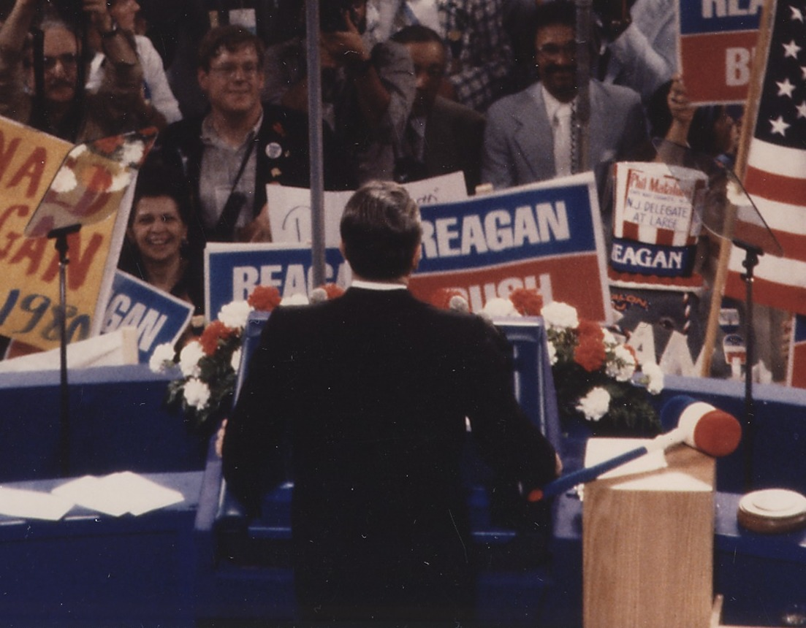
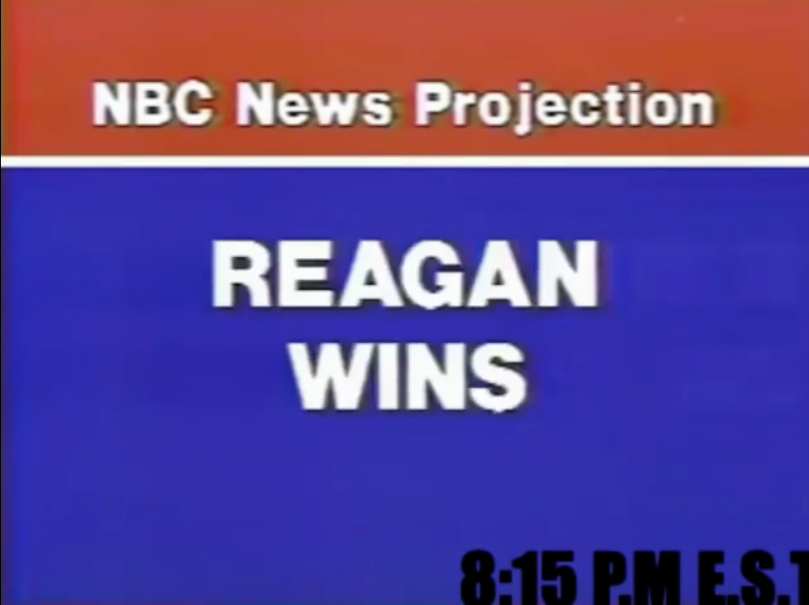
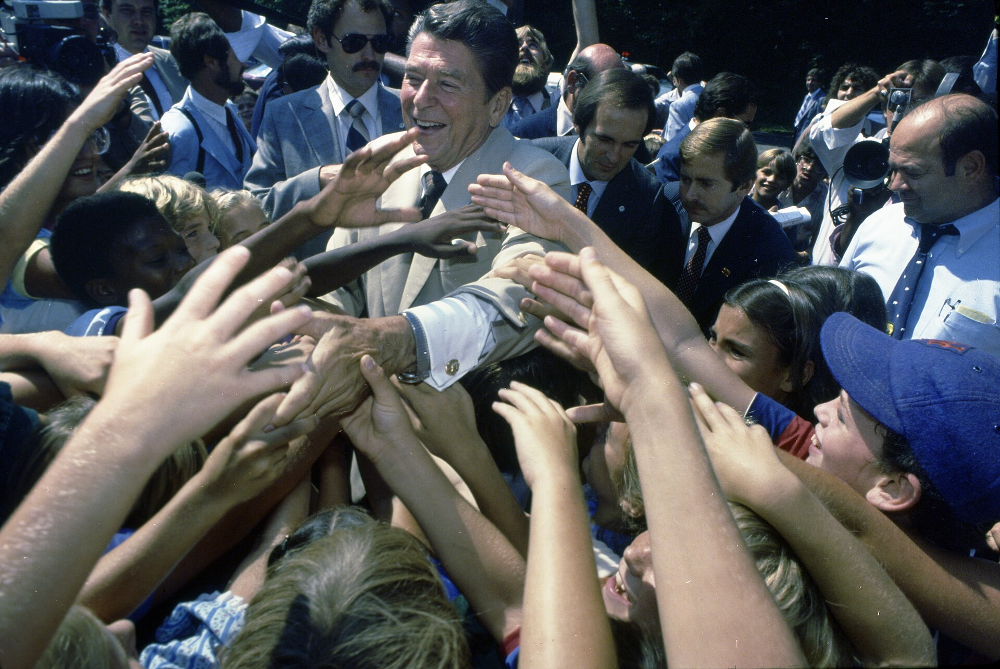

46 years ago today, November 4, 1980, former California Governor Ronald Reagan defeated incumbent Democratic President Jimmy Carter in a sweeping landslide. The victory brought an end to a tumultuous single term for Carter and set the stage for an era of conservative realignment that redefined American politics for decades to come.

## An Economy Crippled by Stagflation and Gas Lines

By 1980, the American public was exhausted by years of economic stagnation coupled with relentless inflation, a condition known as stagflation. Interest rates were climbing, and economic growth had slowed to a crawl. In late 1978, a major uprising in Iran damaged that country's oil infrastructure, severely weakening its oil production. After Iran's Shah fled in January 1979 and Ayatollah Ruhollah Khomeini established an Islamic Republic, global oil supplies were thrown into disarray.

By the spring and summer of 1979, the United States was struck by severe energy shortages. Long lines formed at gas stations across the country, reviving memories of the shortages that followed the 1973 Yom Kippur War. President Jimmy Carter bore the brunt of public blame. Carter retreated to Camp David in July 1979, meeting with dozens of political, labor, and religious leaders. His pollster, Pat Caddell, warned that the country faced a deep crisis of confidence, stemming from the assassinations of the 1960s, the Vietnam War, and Watergate. Carter addressed the nation, but public discontent continued to deepen.

## The Shadow of the Iran Hostage Crisis

Foreign affairs dealt Carter an even heavier blow. On November 4, 1979, Iranian militants seized the United States Embassy in Tehran, taking American personnel hostage. While the crisis initially prompted an early rally-round-the-flag effect that helped Carter hold off an intra-party primary challenge from Massachusetts Senator Ted Kennedy, the standoff dragged on without resolution.

As months passed, the ongoing captivity of American diplomats became a daily reminder of national vulnerability. By election day in 1980, the crisis had lasted for exactly one full year. What had once unified the country behind the sitting commander-in-chief had evolved into a decisive political liability for the Carter administration.

*Archive, 1980 — Photo: Unknown authorUnknown author or not provided / Public domain*

## A Fierce Three-Way Presidential Contest

The Republican nomination was contested by a competitive field that included Ronald Reagan, former Central Intelligence Agency director George H. W. Bush, and Illinois Representative John B. Anderson. Reagan emerged victorious and selected Bush as his running mate. Anderson, unwilling to exit the national stage, launched an independent general election campaign alongside former Wisconsin Governor Patrick Lucey.

Reagan presented an optimistic, conservative vision, advocating for supply-side economic policies, deep tax reductions, increased military spending, and a balanced federal budget. The Carter campaign attempted to push back by painting Reagan as a dangerous right-wing extremist who would dismantle popular entitlement programs like Medicare and Social Security. But Carter's warnings struggled to gain traction amid widespread public dissatisfaction with the status quo.

*Archive, 1980 — Photo: NBC News / Public domain*

## The Decisive Verdict at the Ballot Box

When the votes were tallied on the evening of November 4, 1980, the outcome was an unmistakable repudiation of Carter's presidency. Reagan captured 489 electoral votes, winning 44 states. Carter secured just 49 electoral votes, carrying only six states and the District of Columbia. In the popular vote, Reagan received 50.7 percent compared to Carter's 41.0 percent, while Anderson took 6.6 percent.

The 1980 election made history in several respects. It marked the first time since 1888 that an incumbent Democratic president was defeated for reelection. It was also the second consecutive election in which a sitting president lost the White House, following Carter's own defeat of Gerald Ford in 1976. Furthermore, 1980 represented the first presidential election in American history in which women's voter turnout rate surpassed that of men.

*Archive, 1980 — Photo: President (1981-1989 : Reagan). White House Photographic Off / Public domain*

## The Beginning of the Reagan Era

Historians widely view the 1980 election as a major political realignment that forged a powerful coalition of free-market advocates, social conservatives, and foreign policy hawks. Reagan's victory elevated conservative governance into the American mainstream, giving rise to supply-side economic reforms termed Reaganomics and a renewed escalation of Cold War defense spending.

Today, 46 years after that pivotal November evening, the 1980 election remains a defining milestone in modern American political history. It demonstrated the decisive impact of economic discontent and foreign policy crises on the American electorate, closing one troubled chapter in the presidency and inaugurating an era that reshaped the nation's political trajectory.

### Sources

- <https://en.wikipedia.org/wiki/1980_United_States_presidential_election>
- <https://commons.wikimedia.org/wiki/File:Carter_Reagan_Debate_10-28-80.png>
- <https://commons.wikimedia.org/wiki/File:Photograph_of_Ronald_Reagan_giving_his_Acceptance_Speech_at_the_Republican_National_Convention,_Detroit,_MI_-_NARA_-_198599_(1).jpg>
- <https://commons.wikimedia.org/wiki/File:NBC_projects_Reagan_wins_the_1980_election_at_eight-fifteen_EST.png>
- <https://commons.wikimedia.org/wiki/File:Ronald_Reagan_Shaking_Hands_with_Supporters_on_a_Campaign_Stop_in_Indiana_-_DPLA_-_37bc7a2acbf7a700eb4f5c34064213f0.jpg>
