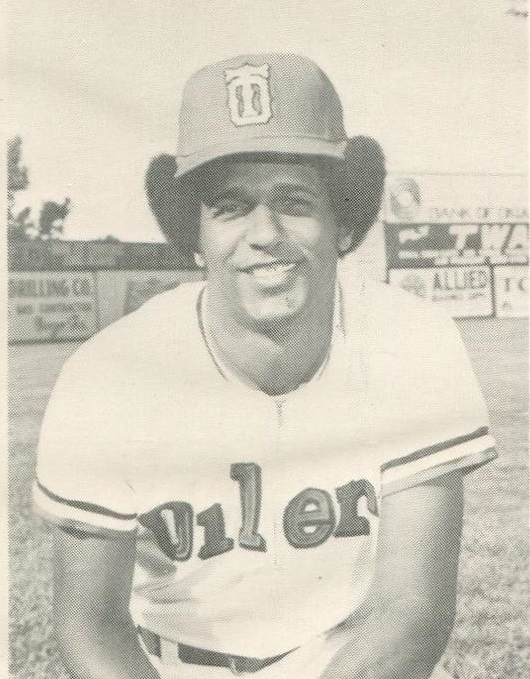
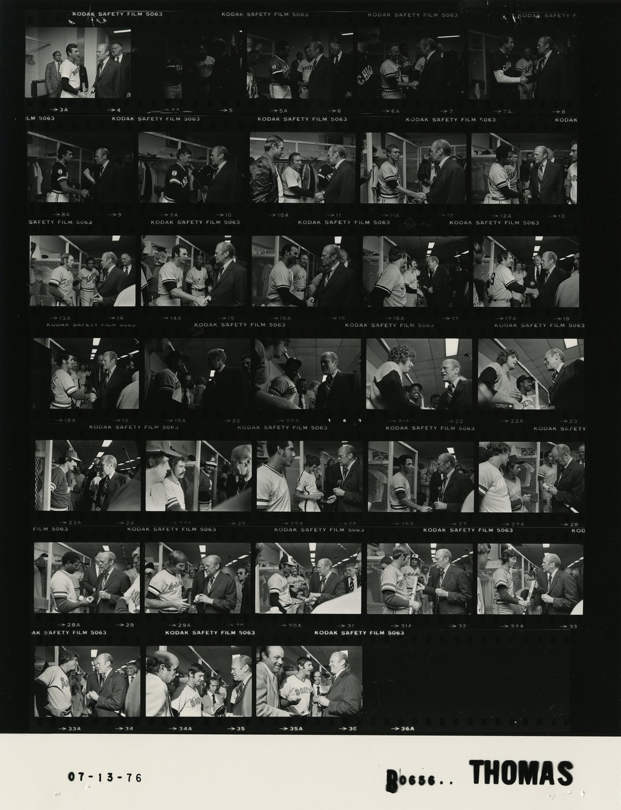

Fifty years ago today, November 4, 1976, Detroit Tigers pitcher Mark Fidrych won the American League Rookie of the Year Award, celebrating a historic debut season that captivated baseball fans across the country. Known affectionately as "The Bird," the eccentric rookie combined dominant pitching with spirited mound antics that made him an overnight cultural phenomenon.

## A Historic Honor for Detroit's Rookie Sensation

On November 4, 1976, Detroit Tigers pitcher Mark Fidrych was officially named the American League Rookie of the Year. It was the crowning achievement of a summer that electrified Major League Baseball and captivated millions of sports fans across the nation. Fidrych, a lanky 6-foot-3 right-handed pitcher, had quickly transformed from an unknown rookie into one of the most recognizable figures in American sports. Over the course of the 1976 campaign, he led the entire major leagues with an earned run average of 2.34 and compiled an impressive 19–9 win-loss record. His pitching prowess and joyful personality re-energized Tiger Stadium and turned every start he made into must-see television.

## From Northborough to the Tigers Organization

Mark Steven Fidrych was born on August 14, 1954, in Worcester, Massachusetts, the son of an assistant school principal. Growing up in central Massachusetts, he developed his pitching talent while playing baseball at Algonquin Regional High School in Northborough and later at Worcester Academy. In the 1974 amateur draft, the Detroit Tigers selected the young right-hander in the 10th round. When Fidrych received the initial telephone call informing him that he had been selected, he later joked that he assumed he had been drafted into the armed services, never imagining that a Major League Baseball team was considering him. While pitching in the minor leagues with the Lakeland Tigers, a coach gave him the nickname "The Bird" due to his curly hair, tall frame, and physical resemblance to the Big Bird character on the popular children's television program Sesame Street.

*Sam Mejias - Tulsa Oilers — Photo: Goof's Pants / Public domain*

## The May Debut That Started the Phenomenon

Fidrych joined the Detroit Tigers during spring training in 1976 and successfully earned a spot on the opening roster. However, he was used sparingly at first, making his official major league debut on April 20 and pitching only one single inning through the middle of May. His breakthrough opportunity arrived on May 15, when he was handed his very first major league start against the Cleveland Indians. Catching behind the plate was Bruce Kimm, his batterymate from the 1975 minor league season with Triple-A Evansville. In that memorable start, Fidrych held Cleveland hitless through six innings and went the distance for a complete-game 2–1 victory, allowing just two hits, walking one, and striking out five. Sports writer Jim Hawkins noted in the Detroit Free Press that the young pitcher was truly something to behold. Cleveland hitter Rico Carty even commented that he thought Fidrych was attempting to hypnotize opposing batters.

*Archive, 1976 — Photo: White House Photographic Office (WHPO) - Thomas / Public domain*

## Mound Antics That Captured the Country

Beyond his effective pitching, Fidrych fascinated spectators with his quirky and animated antics on the mound. He routinely talked to the baseball before delivering a pitch, strutted in an enthusiastic circle around the pitcher's mound after recording an out, and dropped to his knees to smooth down the dirt with his hands. During his first start on May 15, he even refused to let the Tiger Stadium groundskeepers repair the mound in the sixth inning, preferring to tend the dirt himself. After suffering his first loss on May 25 at Fenway Park against Luis Tiant and the Boston Red Sox—despite two busloads of supporters traveling from his hometown of Northborough—Fidrych went on a dominant pitching run. He threw an 11-inning complete-game victory over the Milwaukee Brewers on May 31, followed by another 11-inning complete-game win over the Texas Rangers in Arlington on June 5. Crowds quickly surged whenever he took the mound, drawing 36,377 spectators at Tiger Stadium on June 11 against the California Angels and 21,659 against the Kansas City Royals on June 19.

*Not a photo of the event itself · NOT FROM THE EVENT · Stock image — Photo: jatocreate / Pixabay Content License*

## National Spotlight on Monday Night Baseball

Fidrych's rapid rise reached a fever pitch on June 28, 1976, when the Tigers hosted the New York Yankees at Tiger Stadium. A massive crowd of 47,855 fans packed the ballpark, while a national television audience numbering in the millions tuned in to watch the broadcast on ABC's Monday Night Baseball. With broadcasters Bob Prince, Warner Wolf, and Bob Uecker in the booth, Fidrych put on a masterclass, completing the game in just over an hour and leading Detroit to a commanding 5–1 victory. His infectious enthusiasm and relentless pace endeared him to sports fans throughout North America. The performance solidified his status not just as an emerging star, but as baseball's biggest drawing card during the 1976 bicentennial summer.

## A Lasting Legacy Cut Short by Injuries

Fidrych's brilliant season culminated in his recognition on November 4, 1976, when baseball writers selected him as the American League Rookie of the Year. Unfortunately, the meteoric rise was soon cut short by injuries that severely limited his subsequent playing time. His major league career lasted only five seasons with the Detroit Tigers, concluding with an overall record that did not fully reflect his sheer talent. Fidrych passed away on April 13, 2009, but his singular 1976 season remains one of the most beloved chapters in the history of the Detroit Tigers and Major League Baseball. Even half a century later, longtime baseball enthusiasts still fondly remember the summer when "The Bird" took the sports world by storm.

### Sources

- <https://en.wikipedia.org/wiki/Major_League_Baseball>
- <https://commons.wikimedia.org/wiki/File:1976_Long_Beach_Poly_High_School_Varsity_Baseball_(Tony_Gwynn_crop).jpg>
- <https://commons.wikimedia.org/wiki/File:Sam_Mejias_-_Tulsa_Oilers.jpg>
- <https://commons.wikimedia.org/wiki/File:Ford_B0656_NLGRF_photo_contact_sheet_(1976-07-13)(Gerald_Ford_Library).jpg>
- <https://pixabay.com/photos/baseball-little-league-youth-kids-7985432/>
