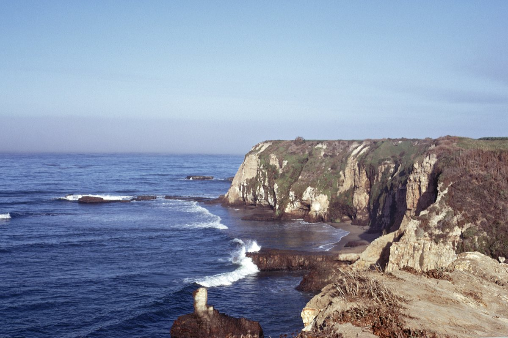

56 years ago today, November 4, 1970, social workers in Los Angeles, California, took custody of a thirteen-year-old girl who had spent nearly her entire life locked in solitary confinement. Known to the public only by the pseudonym Genie, she entered state care unable to speak, walk normally, or understand the world around her, sparking an unprecedented scientific inquiry into human development.

## Twelve Years in a Locked Room

Genie was born in 1957 in Arcadia, California, the last and second surviving of four children. When she reached approximately 20 months of age, her father confined her to a single locked room in the family home. The conditions she endured were extreme. Her father almost constantly strapped her to a child's toilet chair during the day or bound her inside a crib at night, keeping her arms and legs completely immobilized.

Throughout these years, Genie was deprived of virtually all environmental and sensory stimulation. Her father forbade other family members from speaking to her or interacting with her in any meaningful way. Severely malnourished and utterly cut off from human society, she was never exposed to spoken conversation. As a result, she never acquired language during her early childhood years.

## The Intervention of Los Angeles Welfare Authorities

Genie's confinement came to light in November 1970, when she was 13 years and 7 months old. Los Angeles County child welfare authorities intervened, and she was officially made a ward of the state of California. Her discovery shocked the officials who handled her case, revealing that an American child had grown up in modern Los Angeles County under conditions resembling complete feral isolation.

Authorities immediately arranged for her admission to Children's Hospital Los Angeles. There, a specialized team of physicians, pediatricians, and psychologists took over her daily management and rehabilitation. Genie was underweight, could barely stand upright, and exhibited behaviors typical of an unsocialized person who had never encountered society.

*Diaz Ordaz Nixon San Diego Naval Air Station — Photo: White House photo by Knudsen, Robert L. (Robert LeRoy), 1929 / Public domain*

## A Unique Opportunity for Linguistic Science

Genie's case immediately drew the attention of psychologists, linguists, and neuroscientists across the country. For decades, researchers had debated the existence of a 'critical period' in childhood during which the human brain must receive linguistic input in order to learn language natively. Genie provided a rare, real-world case study to evaluate these theories.

Scientists frequently compared her case to that of Victor of Aveyron, a nineteenth-century French wild child who had also been studied for delayed psychological development and late language acquisition. A dedicated research team formed to document Genie's progress and evaluate how much cognitive and linguistic ground she could regain after more than a decade of silence.

*Coast Big Sur 1970 (004) — Photo: Gordon F. Smith's parents / CC BY-SA 3.0*

## Remarkable Progress and Persistent Barriers

During her initial period of intensive study, Genie showed notable advances in her psychological and mental development. Within a matter of months, she demonstrated exceptional nonverbal communication abilities. She learned to express her feelings through gestures and facial expressions and gradually picked up basic social rules.

She also began learning individual words and using basic phrases to interact with caregivers and researchers. However, her progress encountered sharp linguistic limits. While she could memorize vocabulary, she struggled continually with grammar, syntax, and complex sentence structures, remaining unable to fully master a first language even after years of instruction.

*Coast Big Sur 1970 (003) — Photo: Gordon F. Smith's parents / CC BY-SA 3.0*

## Shifting Custody and Institutional Abuse

Genie's living arrangements soon became a point of deep conflict among caregivers and scientists. In June 1971, she left Children's Hospital Los Angeles to live in the home of her teacher. Approximately one and a half months later, state authorities placed her with the family of the scientist who led the research team, where she remained for nearly four years.

Shortly after turning 18, Genie returned to live with her biological mother. However, after only a few months, her mother decided she could not handle her care. At her mother's request, authorities transferred Genie into a series of foster homes and private care institutions for disabled adults. In several of these facilities, she was isolated from the people she had grown to trust and subjected to severe emotional and physical abuse, causing her health and newly acquired language skills to rapidly deteriorate.

## The End of Testing and an Enduring Legacy

In early January 1978, Genie's mother abruptly cut off all scientific observation and testing, effectively ending the academic case study that had spanned nearly eight years. Since that time, very little verified information has emerged regarding her personal circumstances. As of 2016, she was believed to still reside under the care of the state of California.

More than five decades after her rescue in November 1970, Genie's story remains one of the most widely cited accounts in abnormal psychology, medical ethics, and linguistic history. Her life stands as an enduring testament to both human resilience and the profound, irreplaceable importance of early childhood care.

### Sources

- <https://en.wikipedia.org/wiki/Los_Angeles>
- <https://commons.wikimedia.org/wiki/File:Ashford_Mills_Site_Death_Valley_CA_1970.jpg>
- <https://commons.wikimedia.org/wiki/File:Diaz_Ordaz_Nixon_San_Diego_Naval_Air_Station.jpg>
- <https://commons.wikimedia.org/wiki/File:Coast_Big_Sur_1970_(004).jpg>
- <https://commons.wikimedia.org/wiki/File:Coast_Big_Sur_1970_(003).jpg>
