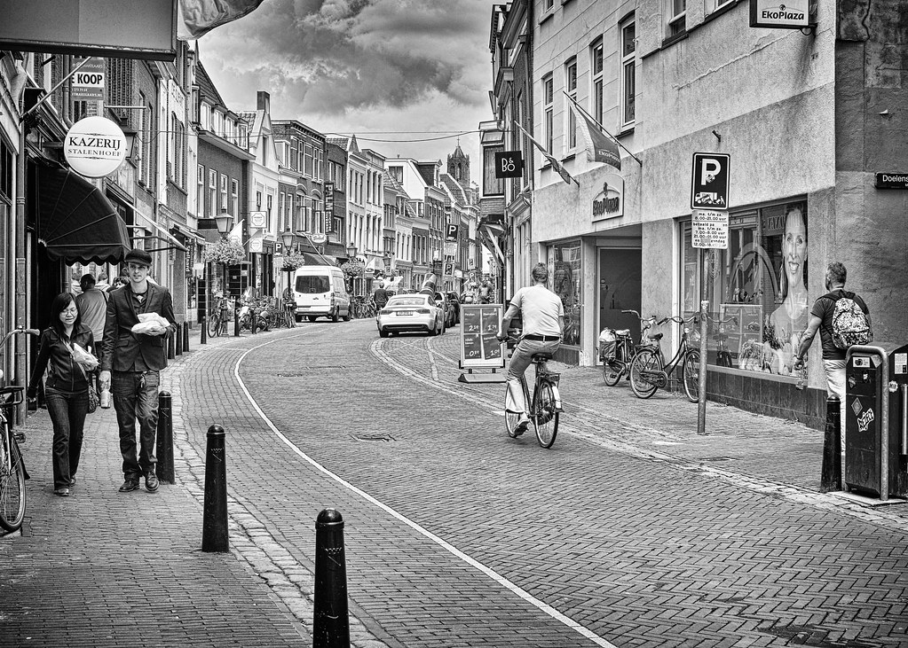
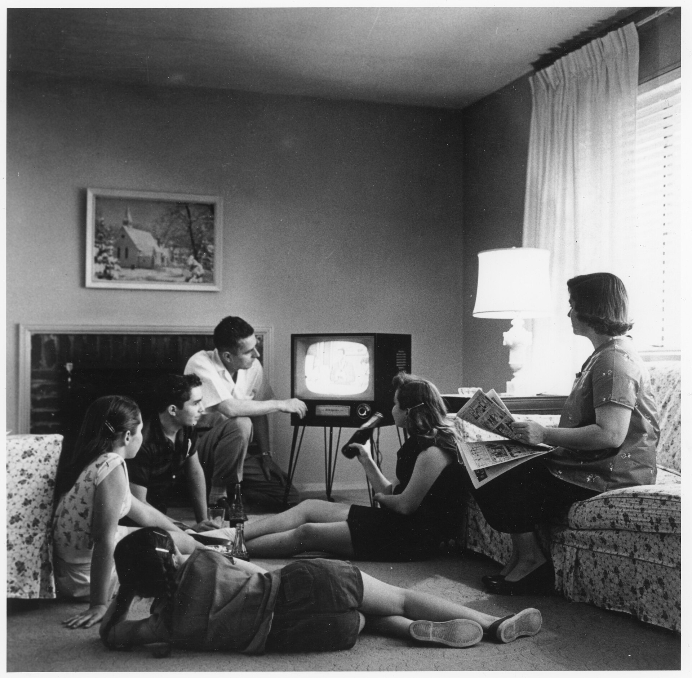
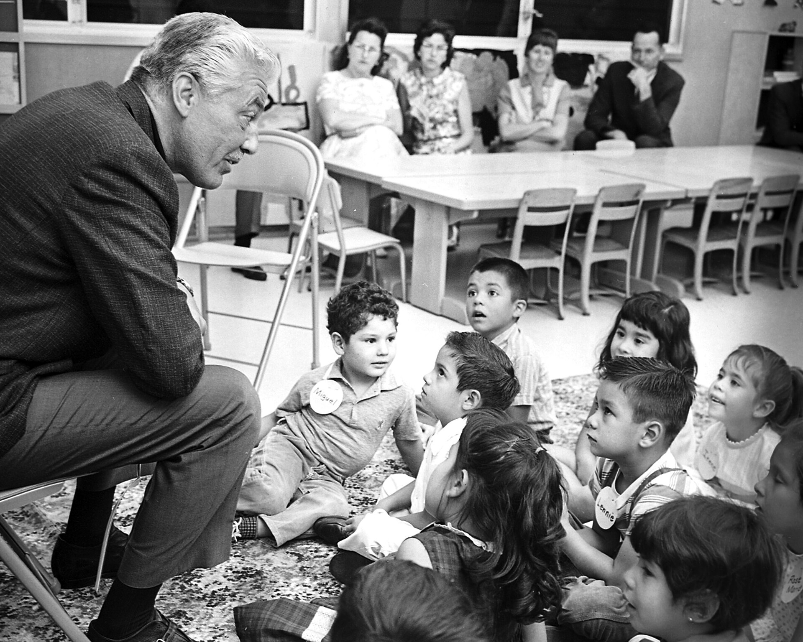

53 years ago today, November 4, 1973, motorways across the Netherlands fell completely silent as the nation held its very first car-free Sunday. With oil supplies choked off by international conflict, the Dutch government prohibited private driving to conserve essential fuel. What was meant to be a strict emergency measure quickly transformed into an unforgettable sight: multi-lane expressways were taken over entirely by cyclists and roller skaters.

## The Yom Kippur War and the OAPEC Embargo

The roots of the sudden driving ban lay in the Middle East. In October 1973, Egypt and Syria launched a large-scale surprise attack against Israel in an attempt to recover territories lost during the 1967 Six-Day War. The outbreak of the Yom Kippur War quickly reverberated across the globe. In response to Western nations backing Israel, the Organization of Arab Petroleum Exporting Countries, known as OAPEC, announced a total embargo on petroleum exports. Led by King Faisal of Saudi Arabia, OAPEC initially singled out five countries: Canada, Japan, the United Kingdom, the United States, and the Netherlands. The embargo list was later expanded to include Portugal, Rhodesia, and South Africa.

## The First Oil Shock: Crude Prices Leap by 300 Percent

The embargo triggered what became known as the first oil shock, disrupting the global economy and exposing Western reliance on imported energy. Globally, crude oil prices surged by nearly 300 percent, leaping from US$3 per barrel to nearly US$12 per barrel. The Netherlands, an advanced Northwestern European nation with over 18 million people and a land area of 33,500 square kilometers, faced an immediate crisis. With 26 percent of its territory situated below sea level across low-lying polders, the densely populated country depended heavily on imported fuel to sustain its industry and transport network. Dutch political leaders recognized that conservation had to begin at once.

*Twijnstraat - Utrecht — Photo: Joris_Louwes / CC BY 2.0*

## November 4, 1973: Cyclists and Skaters Reclaim the Highways

On Sunday, November 4, 1973, the Dutch government enforced a strict ban on passenger vehicles. Motor traffic vanished from arterial routes connecting major cities like Amsterdam, Rotterdam, and The Hague. The deserted asphalt, however, did not sit idle. Highways were used only by cyclists and roller skaters who flocked to the empty expressways. Residents brought out utility bicycles outfitted with lights, mudguards, and pannier racks, riding freely along wide roads that had previously belonged to automobiles. Roller skaters joined them, using streets and highway lanes as oversized recreational spaces. A wartime resource restriction turned into an extraordinary communal event.

*Scene of the era (not a photo of this event) — Photo: Evert F. Baumgardner / Public domain*

## The US Connection: Peaking Production and Nixon's Quota Shift

The crisis in the Netherlands mirrored the severe energy strains unfolding in the United States. American domestic oil production had peaked in 1969 and could no longer keep pace with escalating vehicle demand. When President Richard Nixon requested $2.2 billion to support Israel's military effort, OAPEC cut oil shipments to America as well. Between 1959 and 1973, the United States had maintained mandatory import quotas initiated by President Dwight D. Eisenhower, which critics dubbed the drain America first policy. A review committee headed by George Shultz recommended replacing the quotas with tariffs, but Nixon kept them before ultimately ending the quota system in 1973. Meanwhile, reliance on oil had crippled the domestic coal sector, with coal supplying only 19 percent of American energy by 1973 compared to 51 percent in 1951. When the embargo hit, US oil imports had surged to 6.2 million barrels per day, and American consumers faced price increases significantly higher than the global average.

*Scene of the era (not a photo of this event) — Photo: Los Angeles Times / CC BY 4.0*

## Aftermath and the Enduring Legacy of Dutch Pedal Power

OAPEC finally lifted the oil embargo in March 1974, though high crude prices lingered and a second oil shock followed in 1979 after the Iranian Revolution. Even as regular vehicle traffic returned, the car-free Sundays of late 1973 left a permanent cultural imprint on the Netherlands. While more than 50 percent of the human population knows how to ride a bicycle, the Dutch turned pedal power into a primary pillar of national infrastructure. Today, Denmark and the Netherlands have the most bicycles per capita in Europe and lead the continent in using bicycles for everyday transport. The sight of silent highways filled with cyclists in November 1973 remains a defining moment in modern transport history.

### Sources

- <https://en.wikipedia.org/wiki/1973_oil_crisis>
- <https://commons.wikimedia.org/wiki/File:Aankomst_bij_de_ingang_van_het_Ministerie_van_Economisch_Zaken_tweede_van_recht,_Bestanddeelnr_926-8681.jpg>
- <https://www.flickr.com/photos/22026003@N04/14505914167>
- <https://commons.wikimedia.org/wiki/File:Family_watching_television_1958.jpg>
- <https://commons.wikimedia.org/wiki/File:Cesar_Romero_visits_elementary_school_class.jpg>
