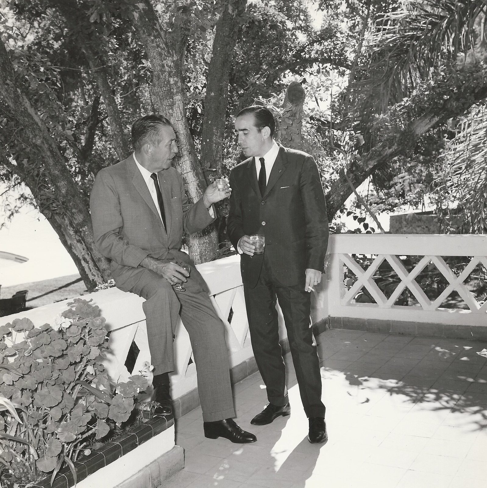
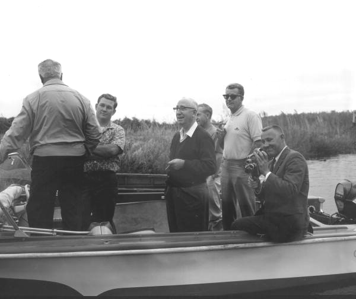
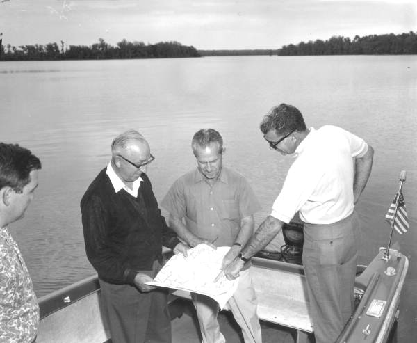

21 years ago today, November 4, 2005, Walt Disney Pictures released Chicken Little in theaters across the United States. As the studio's 46th feature film, it officially became Disney's first fully computer-animated feature created entirely in-house.

## A Historic Studio Built on Hand-Drawn Heritage

For over eight decades, the Walt Disney name stood as the undisputed world leader in traditional, hand-drawn character animation. Brothers Walt and Roy O. Disney established their studio on October 16, 1923, in California after the closure of Walt's early venture in Missouri. In 1928, Walt Disney introduced synchronized sound with Steamboat Willie, and in 1937, the studio premiered Snow White and the Seven Dwarfs, the world's first full-length hand-drawn animated feature. Over the ensuing decades, generations of artists produced timeless classics including Pinocchio, Fantasia, Dumbo, Bambi, Cinderella, and Sleeping Beauty.

Yet as technological advancements transformed Hollywood, computer-generated animation began reshaping the cinematic landscape. While Disney collaborated with partner studios, its own flagship animation unit—based at the Roy E. Disney Animation Building in Burbank, California—needed to prove that its in-house artists could produce a fully computer-animated feature film independently.

## Reinventing an Old Folk Tale for a New Generation

To lead this digital transition, Disney turned to a classic narrative. The production was loosely inspired by the centuries-old European folk tale known as 'Henny Penny', familiar to generations of American school children as 'Chicken Little'. Disney had previously adapted the story as a wartime animated short back in 1943, but this new project reimagined the fable as a science-fiction family comedy.

Directed by Mark Dindal and written by Steve Bencich, Ron J. Friedman, and Ron Anderson, the film followed the titular chicken in the town of Oakey Oaks. After ringing the town alarm to warn that a piece of the sky was falling, Chicken Little found himself dismissed and ridiculed by his neighbors. As he sought to repair his reputation and earn the pride of his father, Buck Cluck, he stumbled upon an unexpected extraterrestrial discovery.

*Balsa & Disney — Photo: Carmen Balsa / CC BY-SA 3.0*

## A Star-Studded Cast and Hollywood Premiere

To bring the lively inhabitants of Oakey Oaks to life, the production assembled a diverse ensemble of comedic performers. Zach Braff led the cast in the title role of Chicken Little. Joan Cusack voiced his loyal friend Abby Mallard, joined by Dan Molina as Fish Out of Water and Steve Zahn as Runt of the Litter. The supporting cast featured veteran entertainment icons, including filmmaker Garry Marshall as Buck Cluck and beloved television legend Don Knotts, alongside Amy Sedaris and Mark Walton.

Chicken Little celebrated its world premiere at the historic El Capitan Theatre in Hollywood on October 30, 2005. Five days later, on November 4, the film opened across theaters nationwide, inviting families into Disney's freshly animated universe.

*Roy Disney and company inspecting property for Disney World — Photo: Unknown authorUnknown author / Public domain*

## A Technological First with Digital 3-D Projection

The release of Chicken Little marked a major turning point not only for Disney's animators, but also for theater technology worldwide. The film represented the first mainstream theatrical release presented in Digital 3-D. To accommodate this groundbreaking format, approximately 100 theaters across the globe were specially equipped with newly installed digital 3-D projectors.

This high-tech presentation offered moviegoers an immersive visual experience that went far beyond older 3-D formats. By pairing advanced digital projection with computer-generated animation, Disney demonstrated the technical capabilities of modern cinema, setting a template that theaters would adopt extensively throughout the decade.

*Roy Disney inspecting property in Florida — Photo: Unknown photographer Florida Memory / Public domain*

## Box Office Success in a Competitive Market

The box office response provided an immediate boost to the studio. Although the film met with mixed evaluations from film critics, family audiences embraced the lighthearted adventure. Chicken Little generated substantial ticket sales, outperforming much of the studio's recent animated output from that period.

By the end of its theatrical run, Chicken Little grossed 314 million dollars worldwide. That substantial haul established the movie as the second-highest-grossing animated film of 2005. For Disney's Burbank animators, the numbers confirmed that their investment in digital tools and internal training had paid off with audiences.

## The Lasting Transformation of Disney Feature Animation

Chicken Little stood as a pivotal bridge between Disney's hand-drawn past and its digital future. The studio, which was renamed Walt Disney Animation Studios in 2007, continued to refine its computer animation pipelines. By 2013, the studio announced that it had shifted its main feature development entirely to computer animation, reflecting the enduring commercial strength of digital films.

Today, with a library spanning over 60 animated feature releases, the Burbank studio continues to produce world-renowned computer-animated stories. But it was on November 4, 2005, that Chicken Little took the very first step into full computer animation for the world's longest-running animation studio.

### Sources

- <https://en.wikipedia.org/wiki/Walt_Disney_Animation_Studios>
- <https://commons.wikimedia.org/wiki/File:Roy_O._%26_Edna_Disney,_by_Aldo_%26_Andrea_Favilli.jpg>
- <https://commons.wikimedia.org/wiki/File:Balsa_%26_Disney.jpeg>
- <https://commons.wikimedia.org/wiki/File:Roy_Disney_and_company_inspecting_property_for_Disney_World.jpg>
- <https://commons.wikimedia.org/wiki/File:Roy_Disney_inspecting_property_in_Florida.jpg>
