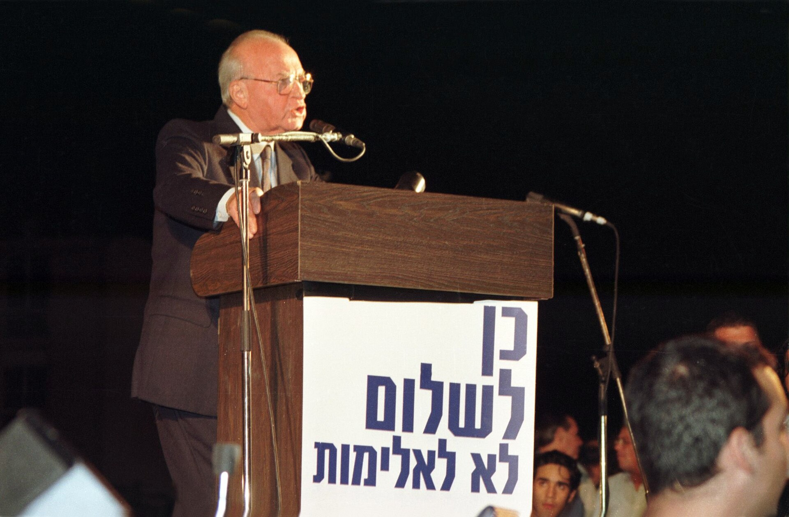
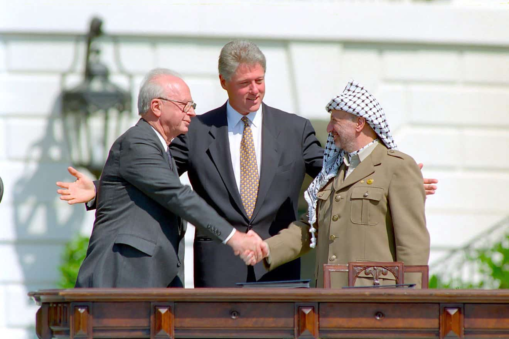
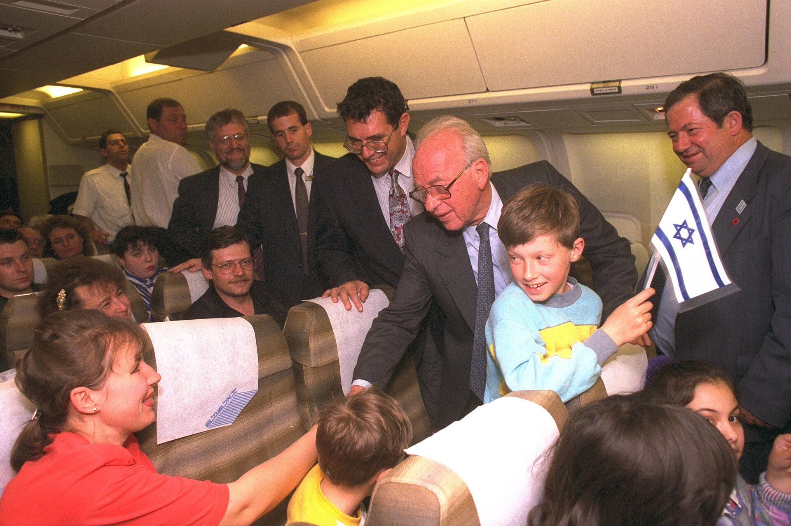

31 years ago today, November 4, 1995, Israeli Prime Minister Yitzhak Rabin was assassinated by an extremist Israeli gunman. The shocking murder of the veteran military commander turned Nobel Peace Prize laureate stunned the world and dealt a profound blow to the Israeli-Palestinian peace process.

## From Jerusalem Youth to Military Command

Yitzhak Rabin was born on March 1, 1922, in Jerusalem during the era of Mandatory Palestine under British control, making him the first Israeli prime minister born in the land itself. His father, Nehemiah Rabin, had emigrated from Eastern Europe to the United States before volunteering for the Jewish Legion during World War I and settling in Palestine. His mother, Rosa Cohen, was an active political organizer born in Belarus. Growing up in an environment shaped by Labor Zionism, the young Rabin studied agriculture before turning his focus toward defense.

As a teenager, Rabin enlisted in the Palmach, the elite commando wing of the Jewish community's defense organization. His natural leadership and tactical ability quickly propelled him through the ranks. During the 1948 Arab-Israeli War, Rabin served as the chief of operations for the Palmach, playing a pivotal role in the military campaigns surrounding the birth of the State of Israel.

## Twenty-Seven Years in Uniform and the Six-Day War

Following Israel's independence in 1948, Rabin transitioned into the newly created Israel Defense Forces (IDF), embarking on a distinguished 27-year career as a professional soldier. Throughout the 1950s, he helped construct the training doctrine of the armed forces and later commanded the military's Operations Directorate from 1959 to 1963. Rabin's career reached its military peak in 1964, when he was appointed chief of the general staff and attained the rank of Rav Aluf, the most senior rank in the Israeli military.

Three years later, in June 1967, Rabin oversaw Israeli forces during the Six-Day War. The decisive conflict resulted in Israel capturing and occupying the West Bank, the Gaza Strip, the Golan Heights, and the Sinai Peninsula. The victory cemented Rabin's standing as one of the country's most respected military strategists, earning him immense credibility with the Israeli public on security matters.

*Archive, 1995 — Photo: Israel Press and Photo Agency (I.P.P.A.) photographer / CC BY 4.0*

## Statesmanship, Diplomacy, and the First Premiership

Retiring from military uniform, Rabin entered diplomacy. From 1968 to 1973, he served as Israel's ambassador to the United States in Washington, D.C., playing a critical role in strengthening strategic and political ties between the two nations. Upon his return to domestic politics, he was chosen as Prime Minister of Israel in 1974 following the resignation of Golda Meir.

During his first term as prime minister, Rabin demonstrated decisive governance, signing the Sinai Interim Agreement with Egypt and authorizing the renowned Entebbe rescue operation in 1976. He resigned from office in 1977 following a financial scandal, but remained a prominent national figure. In the 1980s, Rabin served as minister of defense, overseeing military responses during the outbreak of the First Intifada in 1987.

*Archive, 1993 — Photo: Vince Musi / The White House / Public domain*

## The Oslo Accords and the Nobel Peace Prize

In 1992, Rabin returned to the premiership after leading his party to victory on a platform committed to achieving negotiated peace with the Palestinians. Recognizing that military force alone could not resolve decades of conflict, Rabin embarked on direct diplomacy that culminated in the 1993 Oslo Accords. Under the accords, Israel and the Palestinian leadership agreed to establish limited Palestinian self-rule in the West Bank and Gaza Strip.

Rabin's diplomatic breakthrough transformed the geopolitical landscape of West Asia. In 1994, he signed a landmark peace treaty with King Hussein of Jordan, ending decades of formal hostility between the two neighboring states. That same year, Rabin was awarded the Nobel Peace Prize alongside his political colleague Shimon Peres and Palestinian leader Yasser Arafat, receiving global acclaim for his willingness to compromise for peace.

*Archive, 1994 — Photo: https://www.flickr.com/people/69061470@N05 / CC BY-SA 3.0*

## The Fatal Attack of November 4, 1995

Despite international praise, the peace agreements provoked fierce domestic opposition within Israel. Right-wing and religious extremists bitterly rejected territorial concessions and Palestinian self-government, viewing the Oslo Accords as a betrayal of Jewish land and security. Tensions mounted across the country as polarized political demonstrations became increasingly hostile toward Rabin and his cabinet.

On November 4, 1995, that ideological hostility turned deadly. Rabin was assassinated by Yigal Amir, an extremist Israeli who strongly opposed the peace accords. Amir fired fatal shots at the prime minister before being apprehended on the spot. Amir was subsequently tried, convicted of Rabin's murder, and sentenced to life imprisonment.

## An Irreplaceable Symbol and an Unfinished Legacy

The assassination of Yitzhak Rabin remains the only murder of an Israeli prime minister in the country's history, and he became only the second prime minister to die in office after Levi Eshkol. For people across the globe and in the United States, which had long sponsored bilateral Middle East peace initiatives, Rabin's death marked a heartbreaking turning point.

In the decades that followed, the Israeli-Palestinian conflict witnessed renewed uprisings, territorial entrenchment, and severe military confrontations. Yet Rabin's transition from a battlefield commander to a champion of peace left an indelible mark on history. Today, Yitzhak Rabin is remembered worldwide as an enduring symbol of courage—a soldier who dared to wager his life on the promise of peace.

### Sources

- <https://en.wikipedia.org/wiki/Israel>
- <https://commons.wikimedia.org/wiki/File:Madeleine_Albright_and_Yitzhak_Rabin_at_Press_Conference_in_Jerusalem.jpg>
- <https://commons.wikimedia.org/wiki/File:Assassination_of_Prime_Minister_Yitzhak_Rabin,_1995_Dan_Hadani_Archive.jpg>
- <https://commons.wikimedia.org/wiki/File:Bill_Clinton,_Yitzhak_Rabin,_Yasser_Arafat_at_the_White_House_1993-09-13.jpg>
- <https://commons.wikimedia.org/wiki/File:Flickr_-_Government_Press_Office_(GPO)_-_P.M._Rabin_with_Russian_Immigrants.jpg>
