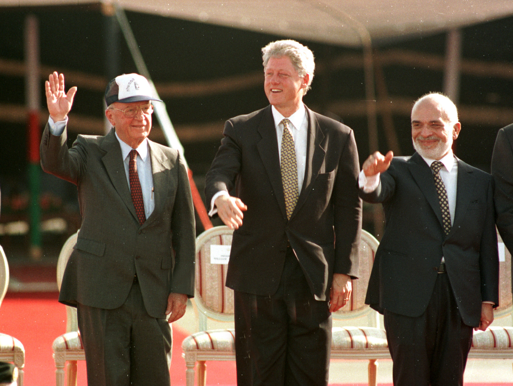

Thirty years ago today, on November 5, 1996, President Bill Clinton defeated Republican nominee Bob Dole to claim a second four-year term in the White House. The triumph capped a remarkable turnaround for an administration that had once looked deeply vulnerable.

## A Presidency in the Balance After 1994

In the middle of his first term, Bill Clinton faced formidable political obstacles. In the 1994 midterm elections, the Republican Party captured both chambers of Congress in a sweeping realignment. Led by Representative Newt Gingrich, Republicans seized control of the House of Representatives for the first time in forty years and won back the Senate for the first time in eight years.

Operating under their legislative manifesto, the Contract with America, congressional Republicans aggressively challenged the White House. A prolonged clash over federal spending culminated in a partial government shutdown. Although Clinton was forced to abandon his comprehensive health care reform plan, he demonstrated political resilience by signing bipartisan welfare reform and utilizing presidential veto power to check the Republican majority.

## The Contenders and the Primaries

Clinton and Vice President Al Gore secured renomination by the Democratic Party with virtually no organized opposition. The Republican primary field, however, was fiercely competitive. Former Senate Majority Leader Bob Dole emerged as the early favorite and eventually clinched the nomination after overcoming challenges from publisher Steve Forbes and paleoconservative commentator Pat Buchanan.

To balance his ticket, Dole selected former New York congressman and football player Jack Kemp, who had previously served as housing secretary under President George H. W. Bush. Meanwhile, billionaire businessman Ross Perot launched another presidential bid under the Reform Party banner alongside economist Pat Choate, although he was barred from the official debates and drew less media attention than during his 1992 campaign.

*Archive, 1994 — Photo: Bob McNeely, January 13, 1994 - Courtesy of the White House / Public domain*

## Clashing Visions on the Campaign Trail

The autumn campaign drew sharp contrasts between the candidates. Dole pledged to stimulate growth with a sweeping fifteen percent across-the-board reduction in federal income taxes. He attacked Clinton as a spoiled Baby Boomer who had never sacrificed for the nation. However, Dole faced persistent scrutiny regarding his advanced age, and several campaign missteps compounded his difficulties with voters.

Clinton framed his reelection around steady economic progress as the country recovered from the recession of the early 1990s. The incumbent president closely linked Dole to House Speaker Gingrich, warning voters that Republican budget policies would increase deficits and undermine vital federal programs such as Social Security and Medicare.

*Archive, 1993 — Photo: Vince Musi / The White House / Public domain*

## A Decisive Night in the Electoral College

When the ballots were counted on November 5, 1996, Clinton secured a comprehensive victory. He captured 379 electoral votes across thirty-one states and the District of Columbia, while Dole took 159 electoral votes. In the popular vote, Clinton earned 49.2 percent to Dole's 40.7 percent.

Ross Perot's third-party campaign captured more than eight percent of the popular vote, preventing either major-party nominee from reaching an outright majority. Perot's showing cemented his status as the last independent or third-party candidate to claim more than five percent of the presidential popular vote.

*Archive, 1994 — Photo: Gideon Markowiz / CC BY 4.0*

## A Shifting Political Map

The 1996 election produced a geographic coalition that stands apart in modern American political history. Clinton won his home state of Arkansas as well as neighboring southern and border states including Kentucky, Louisiana, Missouri, Tennessee, and West Virginia. It remains the last presidential election in which a Democratic nominee carried any of those states.

Clinton also carried Arizona, a state that would not vote for another Democratic presidential candidate until twenty-four years later in 2020. His ability to win across both traditional Democratic strongholds and conservative rural regions underlined the broad appeal of his centrist platform at that time.

## Voter Apathy and Lasting Legacy

Despite the decisive electoral outcome, the 1996 election entered the history books for a less celebratory reason. Voter participation fell sharply across the country, resulting in the lowest turnout for an American presidential contest since 1924. Relative economic stability and the perception of an inevitable Clinton victory contributed to widespread public disengagement.

Nevertheless, the election validated Clinton's political recovery following the 1994 midterms, demonstrating how presidential incumbency and steady economic conditions could reshape national politics even in an era of deep partisan division.

### Sources

- <https://en.wikipedia.org/wiki/Democratic_Party_(United_States)>
- <https://commons.wikimedia.org/wiki/File:Bill_Clinton_1995_im_Parlament_in_London.jpg>
- <https://commons.wikimedia.org/wiki/File:Bill_Clinton_and_Boris_Yeltsin_1994.jpg>
- <https://commons.wikimedia.org/wiki/File:Bill_Clinton,_Yitzhak_Rabin,_Yasser_Arafat_at_the_White_House_1993-09-13.jpg>
- <https://commons.wikimedia.org/wiki/File:Bill_Clinton,_Yitzhak_Rabin_and_Hussein_of_Jordan_during_the_signing_of_the_1994_Israel-Jordan_peace_treaty.jpg>
