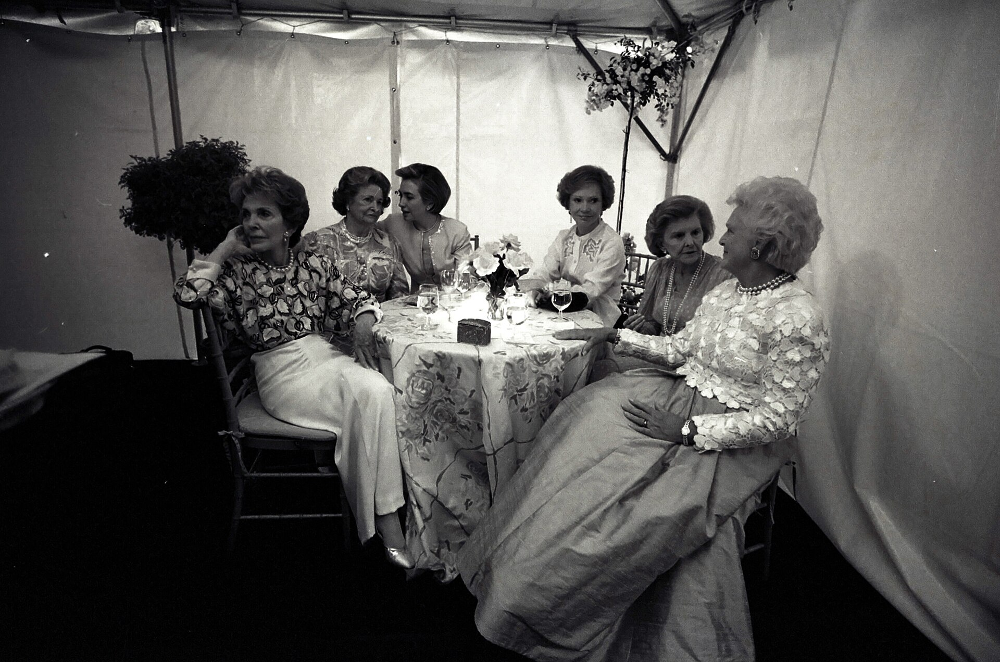
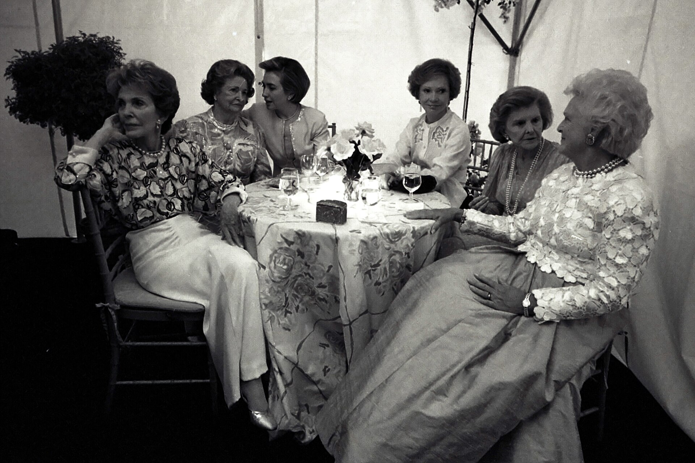
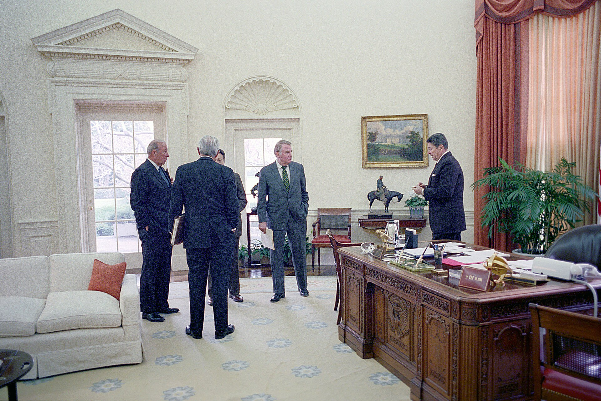

32 years ago today, on November 5, 1994, former President Ronald Reagan released an announcement that he had been diagnosed with Alzheimer's disease. The disclosure by one of the most prominent figures of late-twentieth-century American politics marked a watershed moment for public awareness of dementia.

## A Public Announcement to the Nation

On November 5, 1994, Ronald Reagan made the solemn announcement that he had received a diagnosis of Alzheimer's disease. Having stepped down from the presidency in 1989, Reagan had envisioned an active post-presidency. The diagnosis altered those plans, prompting him to speak directly to the American public about the health battle that lay ahead.

His decision to disclose the illness openly broke with historical precedents of public figures keeping severe medical conditions private. By stepping forward, the former commander-in-chief put an instantly recognizable face on a condition that affected millions of families across the country.

## From Small-Town Illinois to Hollywood

Born in Tampico, Illinois, on February 6, 1911, Reagan attended Eureka College, graduating in 1932. He began his professional career as a sports broadcaster in Iowa before moving to California in 1937 to pursue acting in motion pictures.

Reagan quickly became a well-known film actor and served two stints as president of the Screen Actors Guild, first from 1947 to 1952 and again from 1959 to 1960. During World War II, he served in the United States Army Air Forces, producing training films until his discharge as a captain in 1945. In the 1950s, he hosted General Electric Theater and toured as a motivational speaker, laying the groundwork for his transition into politics.

*First Ladies at the National Garden Gala - DPLA - e8e5222d39c74f617a78761d30e96cca — Photo: President (1993-2001 : Clinton). White House Photograph Offi / Public domain*

## The Rise of a Conservative Icon

Reagan gained national political prominence following his 1964 televised address titled 'A Time for Choosing.' Two years later, in 1966, he was elected governor of California, serving two terms in Sacramento where he balanced the state budget.

After an unsuccessful bid for the Republican presidential nomination in 1976 against Gerald Ford, Reagan secured the nomination in 1980. He achieved a landslide victory over incumbent President Jimmy Carter, entering the White House as the 40th president of the United States. In 1984, he won reelection in one of the most decisive landslides in American history, defeating former vice president Walter Mondale.

*First-Ladies cropped — Photo: Barbara Kinney / Public domain*

## Two Terms in the White House

During his presidency from 1981 to 1989, Reagan implemented sweeping economic deregulation and substantial cuts to income taxes and federal domestic spending, a program popularized as 'Reaganomics.' Although his economic program sparked the longest peacetime expansion in American history up to that point, the national debt nearly tripled during his tenure.

Reagan survived an assassination attempt in 1981 and oversaw major foreign policy maneuvers, including the 1983 invasion of Grenada and the 1986 bombing of Libya. In his second term, he navigated the Iran-Contra affair while pursuing groundbreaking diplomatic negotiations with Soviet leader Mikhail Gorbachev, culminating in the Intermediate-Range Nuclear Forces Treaty.

*A card of the Oval Office with caricatures of the Reagans, Tip O'Neill, Secret Service members and Air Force One and others on the table in the Cabinet Room - DPLA - 2c5cd115e1089c875214a9ac02e6e515 — Photo: President (1981-1989 : Reagan). White House Photographic Off / Public domain*

## Understanding Alzheimer's Disease

Alzheimer's disease is a neurodegenerative disorder and the leading cause of dementia, representing 60 to 70 percent of cases worldwide. First identified by German psychiatrist and pathologist Alois Alzheimer in 1906, the disease is characterized by the accumulation of amyloid plaques and neurofibrillary tangles in the cerebral cortex.

Early signs typically involve difficulty recalling recent events, gradually progressing to disorientation, language difficulties, behavioral changes, and loss of bodily functions. With no cure capable of reversing its course, the illness places significant physical, emotional, and financial burdens on individuals and their caregivers.

## A Legacy of Awareness

Following his 1994 announcement, Reagan lived with Alzheimer's disease for nearly a decade as his physical and cognitive capacities gradually deteriorated. He passed away on June 5, 2004, at the age of 93.

His openness about his condition transformed how the public and policymakers viewed dementia. By addressing his diagnosis candidly, Reagan fostered greater sympathy for caregivers, diminished social stigma, and catalyzed federal and global commitments to Alzheimer's research that continue today.

### Sources

- <https://en.wikipedia.org/wiki/Ronald_Reagan>
- <https://commons.wikimedia.org/wiki/File:Presidents_at_the_funeral_of_President_Richard_Nixon.jpg>
- <https://commons.wikimedia.org/wiki/File:First_Ladies_at_the_National_Garden_Gala_-_DPLA_-_e8e5222d39c74f617a78761d30e96cca.jpg>
- <https://commons.wikimedia.org/wiki/File:First-Ladies_cropped.jpg>
- <https://commons.wikimedia.org/wiki/File:A_card_of_the_Oval_Office_with_caricatures_of_the_Reagans,_Tip_O%27Neill,_Secret_Service_members_and_Air_Force_One_and_others_on_the_table_in_the_Cabinet_Room_-_DPLA_-_2c5cd115e1089c875214a9ac02e6e515.jpg>
