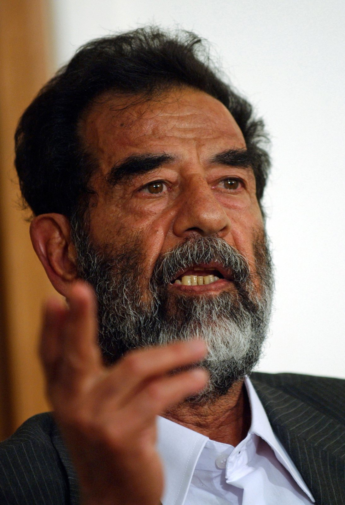
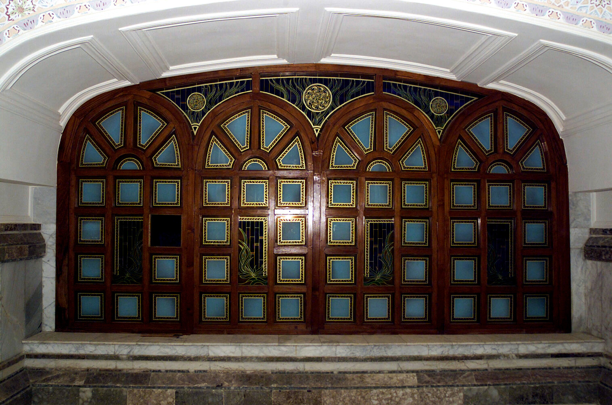
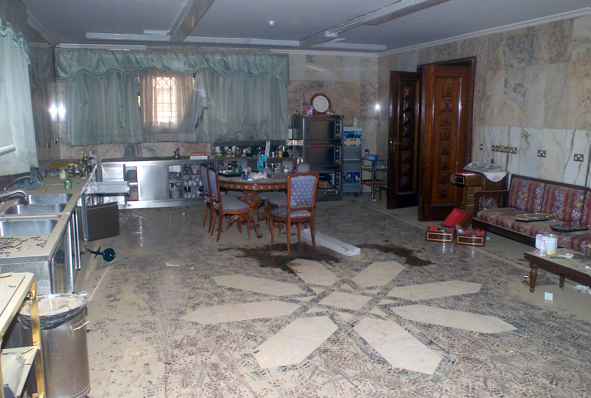

20 years ago today, November 5, 2006, former Iraqi president Saddam Hussein stood before a Baghdad courtroom and was sentenced to death by hanging. The Iraqi High Tribunal found him guilty of crimes against humanity for his role in the 1982 massacre of 148 Shi'a Muslims, concluding a momentous trial that drew worldwide attention.

## The Historic Verdict in Baghdad

Inside a fortified courtroom in the Iraqi capital, the Iraqi High Tribunal delivered its verdict following months of testimony. Saddam Hussein, who had ruled Iraq with an iron fist for nearly a quarter of a century, heard the presiding judge sentence him to die by hanging. His co-defendants, including his half-brother Barzan Ibrahim al-Tikriti and former Revolutionary Court judge Awad Hamed al-Bandar, were also sentenced to death for their direct roles in the killings.

## The Peasant Who Rose to Absolute Rule

Saddam Hussein was born on April 28, 1937, in the village of al-Awja near Tikrit into a peasant Sunni Arab family. After his father died before his birth, he experienced a harsh childhood and fled at age 10 to Baghdad to live with his uncle Khairallah Talfah, a veteran of the 1941 Anglo-Iraqi War who helped shape his militant nationalist views.

After attending law school for three years, Saddam dropped out in 1957 at age 20 to join the revolutionary pan-Arab Ba'ath Party. He played a key role in the 17 July Revolution of 1968, becoming vice president under Ahmed Hassan al-Bakr. Following al-Bakr's resignation in 1979, Saddam formally assumed power as Iraq's fifth president and prime minister, filling major government posts with fellow Sunni Arabs, who formed only a fifth of the nation's population.

*Archive, 2004 — Photo: N/A. Edited by jjron / Public domain*

## Decades of Conflict and Internal Repression

Upon taking power in 1979, Saddam consolidated control through a violent purge of the Ba'ath Party. In 1980, he ordered the invasion of Iran, igniting the Iran-Iraq War in an effort to seize Khuzistan province and counter the Iranian revolution. That brutal conflict lasted nearly eight years until a ceasefire was reached, inflicting economic losses of $561 billion on Iraq and costing an estimated 1 million lives.

In 1990, Saddam invaded and occupied Kuwait, accusing the neighboring state of slant-drilling Iraqi oil fields. A United States-led multinational coalition drove Iraqi forces out during the 1990-1991 Gulf War. Despite subsequent United Nations sanctions, Saddam ruthlessly suppressed the 1991 uprisings among Kurds and Shia Muslims, with his regime ultimately responsible for an estimated 250,000 arbitrary deaths and disappearances.

*NOT FROM THE EVENT · 2003 — Photo: Department of Defense. American Forces Information Service.  / Public domain*

## The 1982 Massacre at Dujail

The trial that resulted in Saddam's death sentence focused specifically on the events that took place in the town of Dujail. In 1982, an assassination attempt was carried out against Saddam as he traveled through the area. In retaliation, security forces enacted brutal collective punishment against the local population.

A total of 148 Iraqi Shi'a residents were killed, while scores of villagers were imprisoned and tortured. The Iraqi Intelligence Service, known as the Mukhabarat, carried out the systematic crackdown under the leadership of Saddam's half-brother Barzan Ibrahim al-Tikriti.

*NOT FROM THE EVENT · 2003 — Photo: Department of Defense. American Forces Information Service.  / Public domain*

## Invasion, Capture, and the Courtroom

In 2003, the United States and allied forces invaded Iraq, falsely accusing Saddam's regime of developing weapons of mass destruction and having ties to al-Qaeda. The Ba'ath Party was banned, and Saddam went into hiding until his capture by coalition troops on December 13, 2003.

His trial was conducted under the Iraqi Interim Government before the Iraqi High Tribunal. Prosecutors presented witness accounts and signed execution orders linking Saddam, Barzan, and Awad Hamed al-Bandar to the systematic executions in Dujail. Despite repeated courtroom outbursts challenging the legitimacy of the tribunal, the judges found the evidence conclusive.

## The Coalition and the Trial's Legacy

For viewers in the United States and across the world, the November 5 verdict was a defining milestone of the post-invasion era. American forces had led the military effort that removed Saddam from power and provided security for the judicial proceedings in Baghdad. The trial represented the first time a modern Middle Eastern ruler was held criminally accountable in a domestic court of law for atrocities committed against his own citizens.

## The Final Execution and Modern Iraq

Saddam Hussein was executed by hanging on December 30, 2006, just weeks after the ruling was handed down. Barzan Ibrahim al-Tikriti was executed the following month, on January 15, 2007. The executions marked the definitive conclusion of the Ba'athist era that began in 1968, leaving behind a nation embarking on a long and difficult path of post-war reconstruction.

### Sources

- <https://en.wikipedia.org/wiki/Saddam_Hussein>
- <https://commons.wikimedia.org/wiki/File:SaddamHussein_in_court_2004July01_DF-SD-05-03944.jpg>
- <https://commons.wikimedia.org/wiki/File:Saddam_Hussein_at_trial,_July_2004-edit1.JPEG>
- <https://commons.wikimedia.org/wiki/File:Elaborately_decorated_wooden_doors_inside_the_Presidential_Palace_of_former_Iraqi_President_Saddam_Hussein_in_the_city_of_Tikrit,_Iraq,_during_Operation_IRAQI_FREEDOM_-_DPLA_-_048ae2b43f9e7f925cd1f185d4a0e132.jpeg>
- <https://commons.wikimedia.org/wiki/File:A_food_preparation_and_kitchen-like_room_in_one_of_Saddam_Husseins_palaces_in_downtown_Baghdad_during_Operation_IRAQI_FREEDOM_-_DPLA_-_1ac2ad5376e77841f295542c5e315a18.jpeg>
