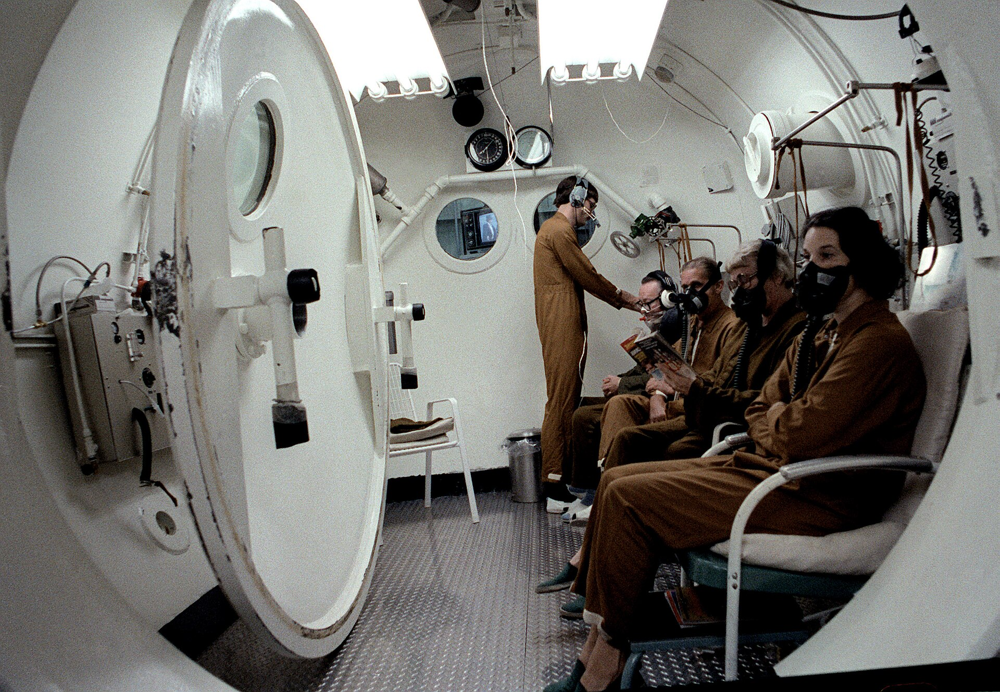
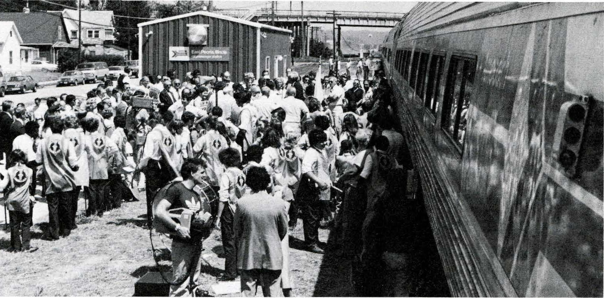
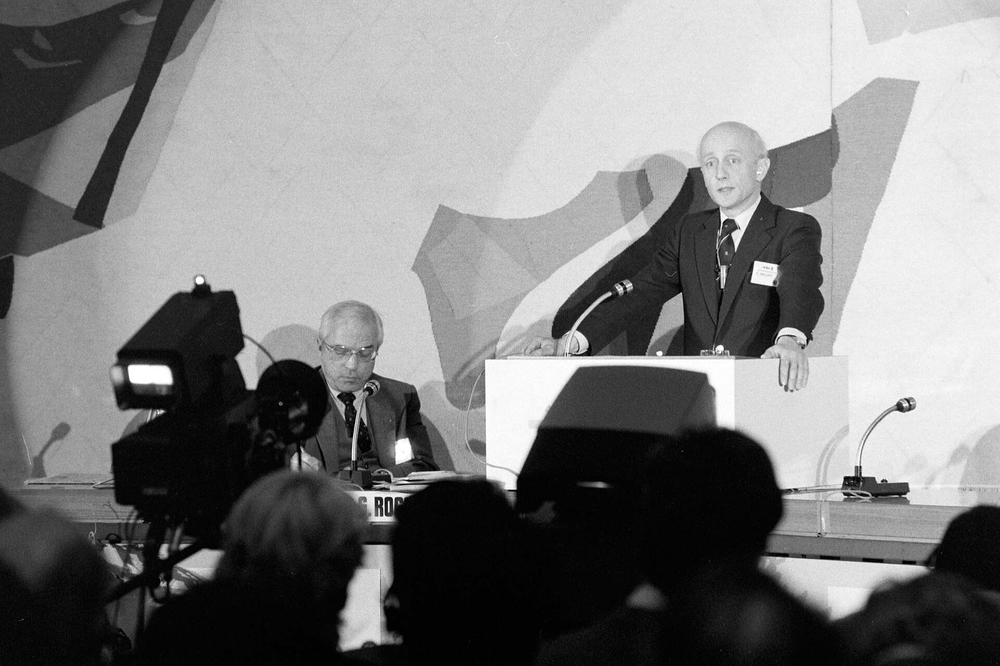

43 years ago today, November 5, 1983, a catastrophic decompression accident aboard the drilling rig Byford Dolphin claimed the lives of five offshore workers in an instant. The incident remains one of the most significant and sobering events in the history of commercial deep-sea diving.

## Life at Nine Atmospheres on the North Sea

The Byford Dolphin was a semi-submersible, column-stabilised drilling rig built in 1974 at the Aker Verdal shipyard. Operating in the Norwegian sector of the North Sea at the Frigg gas field, the rig relied on commercial saturation divers to perform critical underwater construction and maintenance. To prevent decompression sickness, divers lived for weeks inside pressurized hyperbaric chambers on the deck of the rig. In November 1983, the living chamber was maintained at a pressure of 9 atmospheres, simulating the crushing ambient pressure of the deep sea.

## The 4:00 AM Crew Transfer

At 4:00 a.m. on November 5, two Norwegian divers, 29-year-old Bjørn Giæver Bergersen and 34-year-old Truls Hellevik, were returning to the deck chamber after completing work on the seabed. They had been transported to the surface inside a closed diving bell. Waiting inside the living quarters were two British divers, 35-year-old Edwin Arthur Coward and 38-year-old Roy P. Lucas, who were resting between shifts. Outside the chamber, two dive tenders, 32-year-old William Crammond and Martin Saunders, managed the transfer operations on the rig deck.

*Patients are being treated in the hyperbaric chamber in the Hyperbaric Medicine Division, School of Aerospace Medicine - DPLA - 82d890046918b75a8952a348c0425db6 — Photo: Department of Defense. American Forces Information Service.  / Public domain*

## A Fatal Sequence on the Rig Deck

Standard procedure required five distinct steps to safely uncouple the diving bell from the living chamber. First, the bell door had to be closed, and its internal pressure slightly increased to create an airtight seal. Next, the living chamber door had to be fully secured, followed by slowly depressurizing the intermediate trunk passage down to 1 atmosphere. Only after the trunk reached normal atmospheric pressure could the clamp connecting the bell to the chamber be released. Bergersen and Hellevik passed into the chamber through the connecting trunk, but before the chamber hatch could be sealed shut, the clamp securing the bell was suddenly opened.

*Scene of the era (not a photo of this event) — Photo: John Kuehl / Public domain*

## The Blast of Explosive Decompression

The moment the clamp was undone, the trapped air inside the living chamber exploded outward, dropping from 9 atmospheres to the ambient deck pressure of 1 atmosphere in a fraction of a second. The tremendous force blew the diving bell away and struck both tenders working outside, killing William Crammond instantly and severely injuring Martin Saunders. Inside the chamber, the sudden drop in pressure proved instantly fatal to all four divers: Bergersen, Hellevik, Coward, and Lucas. Postmortem investigations later revealed that the rapid pressure release instantly stopped their blood circulation.

*13. Internationales Management-Gespräch-Ministerpräsident von Norwegen Kaare Willoch mit Chairman Peter G. Rogge-HSGN 028-00549 — Photo: Regina Kühne / CC BY-SA 4.0*

## Communication Breakdowns and Extreme Fatigue

The initial investigation attributed the catastrophe to human error, suggesting that the clamp had been opened prematurely by the tender. However, investigators also noted the severe operational challenges facing the crew. The tenders on the outside had no electronic headsets or intercoms; their only line of communication was a wall-mounted megaphone. Heavy noise from the rig machinery and rough sea conditions made verbal confirmation nearly impossible. Furthermore, crew members had been on duty for more than 12 hours, raising serious concerns regarding physical exhaustion.

## The Long Campaign for Systemic Safety

Critics and labor unions quickly challenged the official findings, arguing that engineering failures had been overlooked. The Byford Dolphin diving system, originally installed in 1975, was not equipped with basic fail-safe mechanisms, outboard pressure gauges, or mechanical interlocks that would make opening the clamp physically impossible while pressurized. Relatives of the victims formed the North Sea Divers Alliance and spent decades demanding transparency. In February 2008, a comprehensive report confirmed that faulty equipment and regulatory dispensations were the primary drivers of the disaster, finally shifting the historical record away from individual blame and toward systemic industrial accountability.

### Sources

- <https://en.wikipedia.org/wiki/Byford_Dolphin>
- <https://commons.wikimedia.org/wiki/File:Friggfeltet_-_oljeplattformer_(DEX_KF_000670).jpg>
- <https://commons.wikimedia.org/wiki/File:Patients_are_being_treated_in_the_hyperbaric_chamber_in_the_Hyperbaric_Medicine_Division,_School_of_Aerospace_Medicine_-_DPLA_-_82d890046918b75a8952a348c0425db6.jpeg>
- <https://commons.wikimedia.org/wiki/File:Crowd_with_Prairie_Marksman_inaugural_train_at_East_Peoria,_August_1980.jpg>
- <https://commons.wikimedia.org/wiki/File:13._Internationales_Management-Gespr%C3%A4ch-Ministerpr%C3%A4sident_von_Norwegen_Kaare_Willoch_mit_Chairman_Peter_G._Rogge-HSGN_028-00549.jpg>
