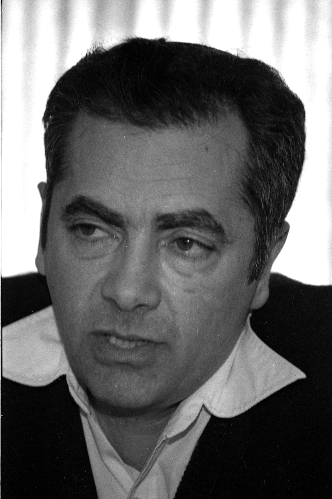
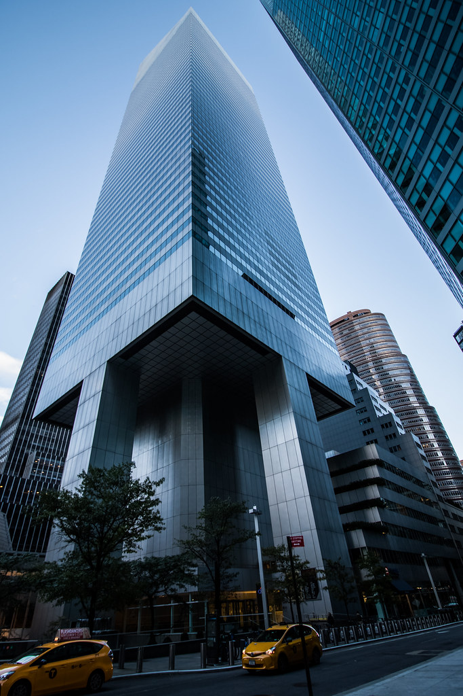
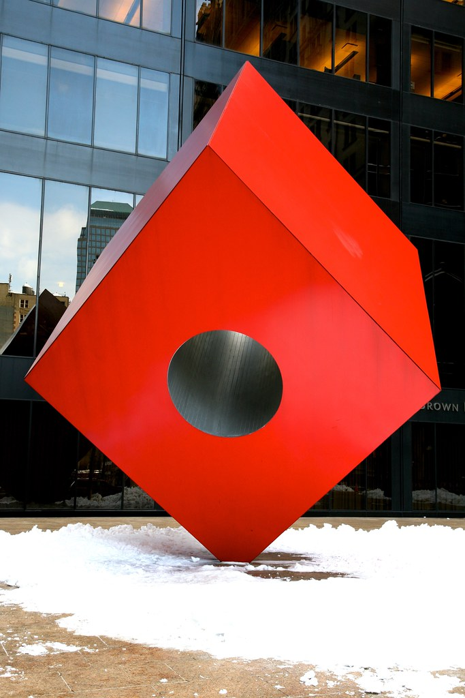

36 years ago today, on November 5, 1990, Rabbi Meir Kahane was gunned down on the second floor of a Midtown Manhattan hotel following an evening lecture. The murder of the controversial ultranationalist leader stunned New York and Israel alike, triggering a chaotic street shootout and exposing what would eventually be recognized as an early warning of organized militant jihadism inside the United States.

## The Rise of a Polarizing Figure in Brooklyn

Born in Brooklyn in 1932 to an established rabbinic family, Meir Kahane received his ordination from the Mir Yeshiva and earned degrees in political science and international relations. In 1968, he founded the Jewish Defense League in New York City, arguing that militant self-defense was necessary to combat antisemitism. Within a few years, Kahane and several group members faced federal scrutiny and convictions for domestic terror acts, including attacks aimed at Soviet diplomatic personnel and conspiracies involving foreign embassies.

## From Ramla Prison to the Israeli Knesset

Kahane moved to Israel in September 1971, where he immediately launched a political movement advocating the total expulsion of Palestinians from Israel and the occupied territories. His aggressive tactics and provocative rallies led to repeated legal battles; by 1980, he had been arrested 62 times since his arrival and served six months in Ramla prison, where he authored his manifesto 'They Must Go.' That same radical message propelled his Kach party into the Israeli parliament, winning a seat in the Knesset in 1984 before the Israeli Supreme Court and Central Elections Committee banned the party from running in 1988 under newly amended laws against racist incitement.

*Head of Kach, the radical right wing movement Rabbi Meir Kahane came to Israel from the US (FL45826209) — Photo: Danny Gotfried / CC BY 4.0*

## A Deadly Evening at the Marriott East Side

Despite his political ban in Israel, Kahane maintained an active travel schedule across the United States to fundraise and urge American Jews to make aliyah. On the night of November 5, 1990, he spoke before an audience largely composed of Brooklyn Orthodox Jews in a second-floor conference room at the New York Marriott East Side hotel, located at 525 Lexington Avenue. Kahane had just concluded his remarks, and a circle of listeners had pressed forward to ask him questions and shake his hand. Shortly after 9:00 p.m., an Egyptian-American national named El Sayyid Nosair, who had blended into the crowd, approached the podium.

*Citigroup Center at 601 Lexington Avenue (1977) — Photo: andryn2006 / CC BY-SA 2.0*

## The Gunfire and the Lexington Avenue Chase

Nosair pulled a .357-caliber pistol from beneath his clothing and fired at point-blank range, striking Kahane squarely in the neck. Panic erupted inside the lecture hall as the rabbi collapsed and the gunman darted toward the stairwell, fleeing into the cool evening air on Lexington Avenue. Outside near a post office, Nosair attempted to commandeer a taxi at gunpoint to make his escape. Carlos Acosta, an on-duty officer with the United States Postal Inspection Service, witnessed the attempted carjacking, drew his service weapon, and ordered the suspect to freeze.

*New York City, Lower Manhattan, Marine Midland Building ( HSBC Bank Building ), 1967 : Noguchi's Red Cube — Photo: (vincent desjardins) / CC BY 2.0*

## The Shootout with Officer Carlos Acosta

Instead of dropping his weapon, Nosair pivoted and shot Acosta directly in the chest. Acosta, wearing protective gear, remained on his feet and immediately returned fire, striking Nosair in the chin. Acosta brought the wounded gunman to the pavement and arrested him on the spot. Kahane was rushed to a nearby hospital but succumbed to his injuries shortly after arrival, later being transported to West Jerusalem for burial.

## The Trial and Uncovering the Terror Cell

During his subsequent state court trial, Nosair denied taking part in the assassination, and because Kahane's family opposed an autopsy on religious grounds, prosecutors were unable to extract the fatal bullets. While Nosair was acquitted of Kahane's actual homicide, the jury found him guilty of criminal assault, weapons possession, and shooting Officer Acosta, resulting in a maximum sentence of 22 years in prison. The murder, initially treated by authorities primarily as an isolated hate crime, took on far more ominous significance three years later. Federal investigations following the 1993 World Trade Center bombing uncovered that Nosair was operating under the guidance of Omar Abdel-Rahman, the 'Blind Sheikh,' whose cell had conducted surveillance on Attica prison in a foiled plot to stage a truck-bomb jailbreak for Nosair.

## An Enduring and Troubled Legacy

The assassination marked the violent end of one of the twentieth century's most divisive political provocateurs. In 1994, the Israeli government officially outlawed both Kach and its breakaway faction Kahane Chai under anti-terrorism laws, following an extremist mass shooting in Hebron carried out by a Kach follower. For law enforcement and intelligence agencies, the November 1990 Lexington Avenue shooting remains a landmark event: a moment when the emerging machinery of international terror struck inside an American city years before the world grasped the full scale of the threat.

### Sources

- <https://en.wikipedia.org/wiki/Meir_Kahane>
- <https://commons.wikimedia.org/wiki/File:Head_of_Kach,_the_radical_right_wing_movement_Rabbi_Meir_Kahane_came_to_Israel_from_the_US_(FL45826187).jpg>
- <https://commons.wikimedia.org/wiki/File:Head_of_Kach,_the_radical_right_wing_movement_Rabbi_Meir_Kahane_came_to_Israel_from_the_US_(FL45826209).jpg>
- <https://www.flickr.com/photos/84985982@N00/22221696243>
- <https://www.flickr.com/photos/44613506@N07/5421866932>
