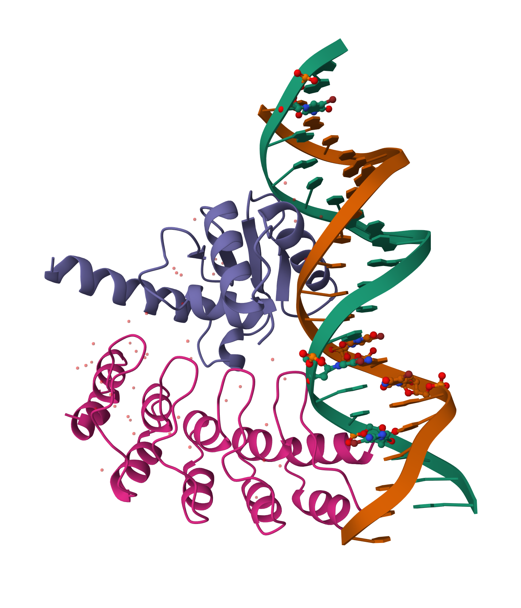
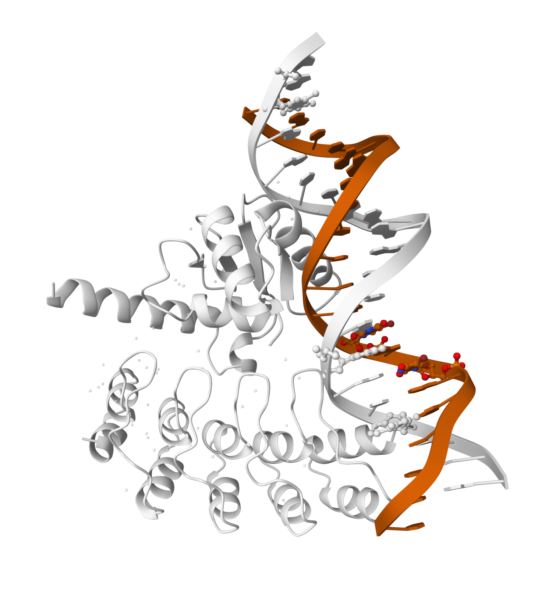
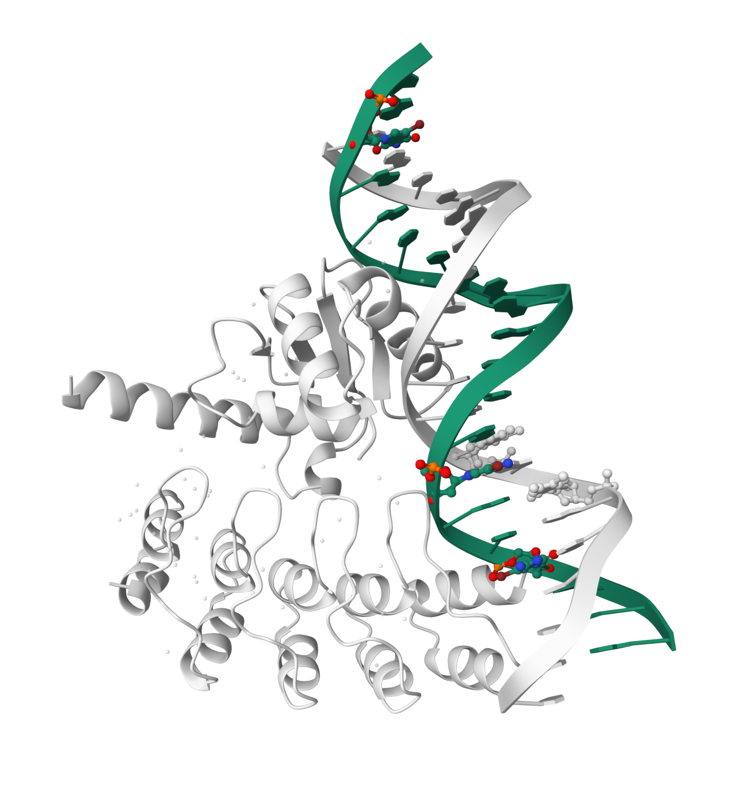

28 years ago today, on November 5, 1998, the scientific world delivered a historic breakthrough that fundamentally reshaped how the United States views one of its most revered Founding Fathers. The British scientific journal Nature published a landmark genetic study offering compelling proof that Thomas Jefferson had fathered a son with Sally Hemings, an enslaved woman owned by his household. The report brought empirical certainty to rumors and oral histories that had circulated for nearly two hundred years.

## An Enslaved Woman at Monticello

Sally Hemings, whose given name may have been Sarah, was born into bondage around 1773. She was the daughter of Elizabeth 'Betty' Hemings and John Wayles, a wealthy planter who held Betty in slavery. Because Wayles was also the father of Jefferson's wife, Martha Wayles, Sally Hemings was Martha's half-sister. Following Wayles's death, Sally was inherited by Jefferson among many other enslaved people. According to her son Madison Hemings, her maternal grandmother was an enslaved African woman, while her grandfather was John Hemings, an English sea captain. Historical accounts described Sally Hemings as light-colored, with long straight hair down her back.

## The Paris Agreement and the Return to Virginia

In 1787, Sally Hemings traveled across the Atlantic to Paris, France, accompanying Jefferson's young daughter Martha Jefferson Randolph. Jefferson was already in Paris serving as the American minister to France following the Confederation Congress's appointment. Under French law, slavery was illegal, which meant that Hemings was legally a free individual during her 26 months living in the French capital. Jefferson, a widower in his mid-forties, began an intimate relationship with Hemings while she was an adolescent between 14 and 16 years old. According to Madison Hemings, Sally initially declined to return to America, but agreed to return to Virginia and resume her status as an enslaved servant only after Jefferson promised that each of her future children would be freed upon reaching adulthood.

*NOT FROM THE EVENT · 1998 — Photo: Batchelor AH, Piper DE, de la Brousse FC, McKnight SL, Wolbe / CC0*

## The Contradictions of an American Founder

Thomas Jefferson was the visionary author who drafted the Declaration of Independence in 1776 as part of the Committee of Five. He served as the first U.S. Secretary of State under George Washington, served as vice president under John Adams, and became the third president in 1801, securing the Louisiana Purchase and advancing democratic ideals. Yet alongside his advocacy of civil liberties and individual rights, Jefferson remained a lifelong owner of hundreds of enslaved people at his Monticello estate. Because Jefferson maintained near-total legal and physical authority over Hemings within chattel slavery, modern scholars note that meaningful consent was impossible under such absolute power imbalances.

*NOT FROM THE EVENT · 1998 — Photo: Batchelor AH, Piper DE, de la Brousse FC, McKnight SL, Wolbe / CC0*

## A Genetic Breakthrough Published in Nature

For generations, mainstream historians treated allegations regarding Jefferson's paternity as unproven rumors or partisan attacks. That posture changed definitively on November 5, 1998. Nature, an international journal founded in 1869 by Norman Lockyer and Alexander MacMillan, published a peer-reviewed genetic study that applied cutting-edge DNA analysis to the controversy. Because Nature enforces stringent review standards and accepts fewer than 8 percent of submitted manuscripts, its reports carry extraordinary authority. The researchers examined the Jefferson male chromosome profile and compared it against living descendants of Sally Hemings's youngest son, Eston Hemings Jefferson. The testing demonstrated a conclusive genetic match, confirming that a male of the Jefferson family line had fathered Eston.

*NOT FROM THE EVENT · 1998 — Photo: Batchelor AH, Piper DE, de la Brousse FC, McKnight SL, Wolbe / CC0*

## A Settled Truth in American History

Following the 1998 findings, the historical establishment moved decisively to update the national narrative. The Thomas Jefferson Foundation, which has owned and operated Monticello since 1923, empaneled a special commission of scholars and scientists to evaluate the evidence. Working with the 1998 genetic data and detailed genealogical records, the Foundation concluded that Jefferson was the father of Eston Hemings Jefferson and likely fathered all of Sally Hemings's known children. Jefferson or his estate fulfilled the promise made in Paris, freeing her surviving sons, Madison and Eston, as they came of age. Sally Hemings spent her final years living in Charlottesville, Virginia, in the home of her freed sons until her death in 1835.

### Sources

- <https://en.wikipedia.org/wiki/Nature_(journal)>
- <https://commons.wikimedia.org/wiki/File:Jean_Blassie_(Right)_and_her_son_George_Blassie,_brother_of_USAF_First_Lieutenant_Michael_Blassie,_gather_at_his_gravesite_in_Jefferson_Barracks_National_Cemetery_in_St._Louis,_Miss_-_DPLA_-_e73d16fae6acdbb50073403c58615d97.jpeg>
- <https://commons.wikimedia.org/wiki/File:Mouse_GABP_ALPHA_and_BETA_domain_bound_to_DNA_-_1AWC.png>
- <https://commons.wikimedia.org/wiki/File:Mouse_GABP_ALPHA_and_BETA_domain_bound_to_DNA_-_DNA_-_1AWC.png>
- <https://commons.wikimedia.org/wiki/File:Mouse_GABP_ALPHA_and_BETA_domain_bound_to_DNA_-_DNA_1AWC.png>
