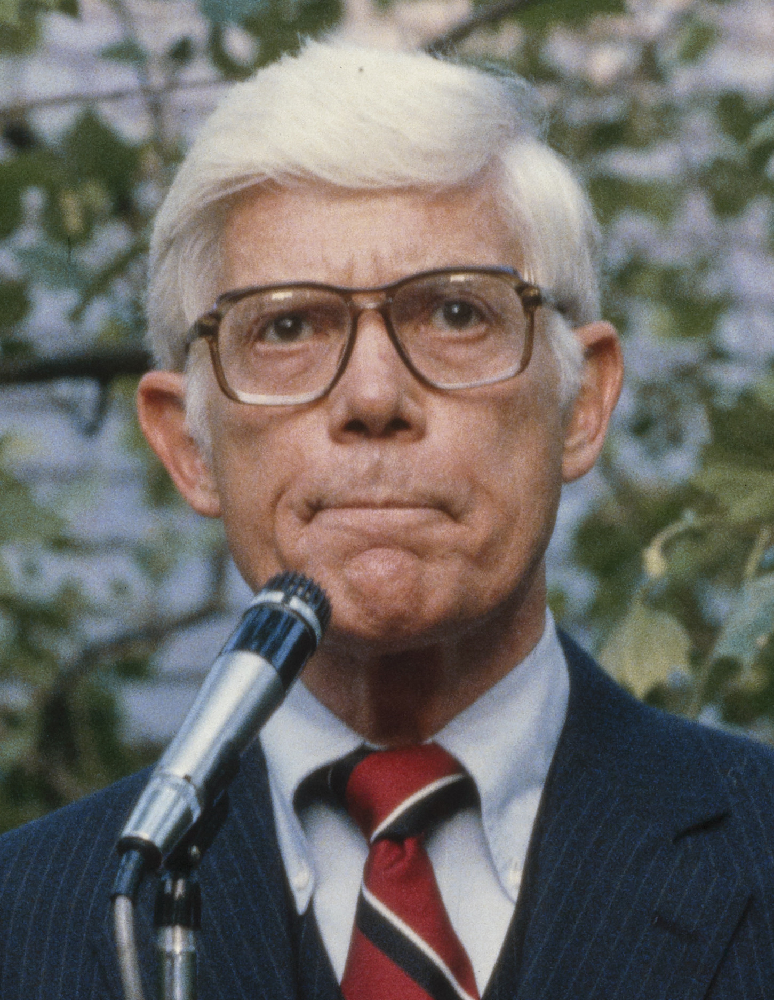
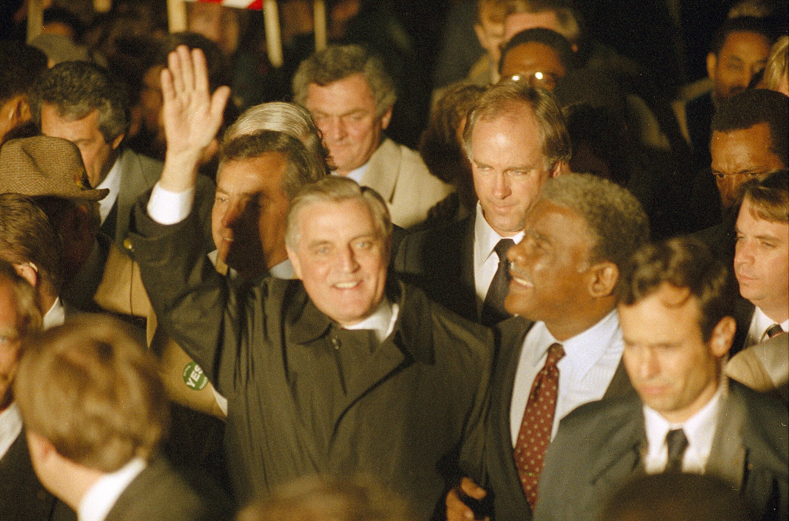
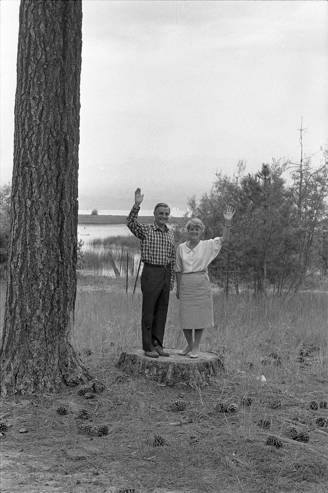

42 years ago today, November 6, 1984, incumbent Republican president Ronald Reagan won re-election to a second term in one of the most overwhelming landslides in American history. Defeating the Democratic ticket of former vice president Walter Mondale and New York congresswoman Geraldine Ferraro, Reagan carried 49 out of 50 states and secured 525 electoral votes.

## A Rocky First Term and an Economic Turnaround

Ronald Reagan entered the White House in 1981 facing severe stagflation, cutting taxes and government regulations while sharply raising defense spending. The early years of his presidency were defined by economic hardship; by December 1982, unemployment peaked at 10.6 percent, and the nation suffered negative GDP growth. In the 1982 midterm elections, Republicans lost 26 seats in the House of Representatives and seven governorships, causing Reagan's public approval rating to drop to 35 percent by January 1983. However, an economic recovery took hold as inflation dropped significantly and unemployment fell to 7.7 percent by March 1984. By early 1984, public polling showed Reagan's approval rating recovering to 54 percent, giving his campaign powerful momentum heading into the autumn contest.

## The Contenders and the Campaign Debate

The Democratic Party nominated former vice president Walter Mondale after a competitive primary against Colorado senator Gary Hart and activist Jesse Jackson. In a historic move, Mondale selected New York representative Geraldine Ferraro as his running mate, marking the first time a major political party placed a woman on a presidential ticket. Mondale focused his platform on fiscal responsibility, calling for tax increases to reduce the expanding federal budget deficit, while also endorsing a nuclear freeze and ratification of the Equal Rights Amendment. Reagan, meanwhile, campaigned on economic deregulation, tax relief, and a revived sense of national strength, successfully countering concerns regarding his age as the 73-year-old incumbent.

*Archive, 1980 — Photo: Bernard Gotfryd / Public domain*

## The Results of November 6, 1984

When Americans cast their ballots on November 6, 1984, the outcome quickly turned into an unprecedented electoral wave. Reagan won 58.8 percent of the popular vote—the highest percentage achieved by any presidential candidate since Richard Nixon's 1972 victory. State after state fell into Reagan's column across every region of the nation, from California to the New England states. Mondale captured only the District of Columbia, with its three electoral votes, and his home state of Minnesota, with its ten electoral votes. Even in Minnesota, the race came down to a razor-thin margin of just 3,761 votes, or 0.18 percent, leaving Mondale with a final total of 13 electoral votes against Reagan's 525.

*Walter Mondale with Harold Washington — Photo: Chick Harrity / Public domain*

## A Second Term of Global Negotiations and Domestic Realignment

Reagan's decisive victory established a strong mandate for his second administration, which saw foreign policy take center stage. His second term featured key diplomatic summits with Soviet leader Mikhail Gorbachev, culminating in the signing of the Intermediate-Range Nuclear Forces Treaty. Domestically, the nation experienced what was at that time the longest peacetime economic expansion in modern American history, alongside continuing declines in unemployment and inflation. However, large increases in military spending combined with tax cuts caused the national debt to nearly triple between 1981 and 1989, and his administration confronted major political controversy during the secret sale of weapons to Iran.

*Walter Mondale and Geraldine Ferraro posing on a stump — Photo: Joe Kennedy, Los Angeles Times / CC BY 4.0*

## The Legacy of the 1984 Electoral Map

The 1984 election remains an exceptional benchmark in modern American electoral politics. Reagan's haul of 525 electoral votes stands as the highest raw total ever achieved by a presidential nominee, and the second-largest share of the Electoral College since 1820, trailing only Franklin D. Roosevelt's 1936 victory. It also marks the last time a Republican candidate swept every New England state, as well as the most recent presidential election where any candidate surpassed 500 electoral votes or carried 49 states. More than four decades later, the nearly unbroken map of 1984 stands as an enduring symbol of American political history.

### Sources

- <https://en.wikipedia.org/wiki/Ronald_Reagan>
- <https://commons.wikimedia.org/wiki/File:President_Ronald_Reagan_and_Nancy_Reagan_Receive_a_Concession_Telephone_Call_from_Walter_Mondale_While_at_The_Jorgensen_Residence_in_Los_Angeles_California_-_DPLA_-_3bfd79d380506c398b96a20baa2e2af4.jpg>
- <https://commons.wikimedia.org/wiki/File:John_B._Anderson_in_New_Jersey_(cropped).jpg>
- <https://commons.wikimedia.org/wiki/File:Walter_Mondale_with_Harold_Washington.jpg>
- <https://commons.wikimedia.org/wiki/File:Walter_Mondale_and_Geraldine_Ferraro_posing_on_a_stump.jpg>
