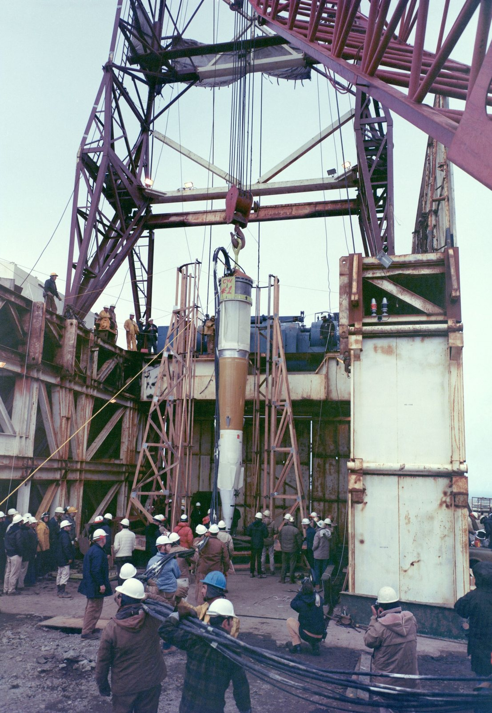
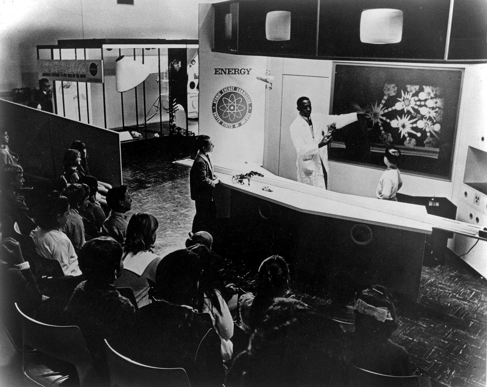
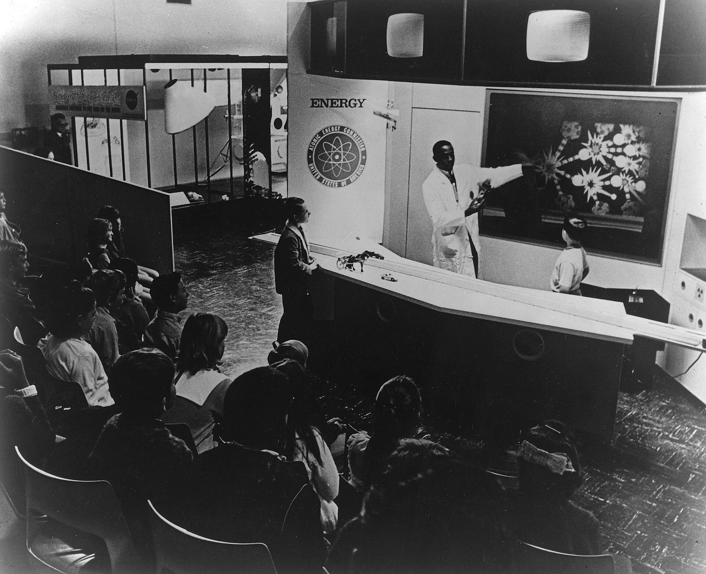

Fifty-five years ago today, on November 6, 1971, the United States Atomic Energy Commission carried out Project Cannikin on Amchitka Island in southwest Alaska. Detonated deep beneath the remote subarctic tundra, the five-megaton thermonuclear weapon was the largest underground nuclear blast ever executed by the United States.

## A Volcanic Outpost in the Aleutians

Amchitka Island is a narrow, forty-two-mile-long strip of land in the Rat Islands group of the Aleutian chain, bordered by the Bering Sea to the north and the Pacific Ocean to the south. With cloud cover present nearly ninety-eight percent of the time, the island features a harsh maritime climate characterized by frequent storms, rolling plateaus of tundra mosses, and rugged volcanic mountains. While the Aleut people lived on Amchitka for more than 2,500 years, the island had lacked a permanent civilian population since 1832. During World War II, the United States military constructed airfields on the island to stage operations against Japanese forces occupying the western Aleutians, with troop occupancy reaching 15,000 before the facilities were eventually abandoned in 1950.

## The Search for an Underground Proving Ground

The Department of Defense first considered Amchitka for nuclear cratering experiments as early as 1951 under Operation Windstorm, though initial drilling caused planners to relocate those tests to Nevada. By the late 1950s, federal officials recognized the need to study seismic detection methods for underground detonations through programs like Vela Uniform. Because Nevada could not easily accommodate the most powerful thermonuclear designs, the Atomic Energy Commission turned its attention back to Amchitka's remote terrain. In 1965, the agency detonated Long Shot, an 80-kiloton underground test. Four years later, in 1969, it detonated Milrow, a one-megaton calibration blast intended to evaluate whether larger subterranean detonations could be safely conducted without initiating seismic disasters.

*Archive, 1971 — Photo: United States Atomic Energy Commission / Public domain*

## The Cannikin Detonation and Public Outcry

The third and final test, code-named Cannikin, was scheduled for November 6, 1971. Cannikin utilized a full-scale hydrogen bomb yield of five megatons, releasing twenty-one petajoules of explosive energy. Geologically, Amchitka sat on an active subduction zone described by scientists as one of the least stable tectonic environments in the United States. Environmental organizations, citizens, and scientists raised intense objections across North America. Opponents argued that releasing five megatons of energy inside an active fault zone could trigger severe tectonic earthquakes and send destructive tsunamis racing across the Pacific Rim. Despite legal challenges and public demonstrations, federal authorities authorized the test to proceed on schedule.

*NOT FROM THE EVENT · 1970 — Photo: ENERGY.GOV / Public domain*

## The Explosion and Its Aftermath

When the detonation occurred deep beneath Amchitka on November 6, the massive shock wave lifted the island's surface and fractured the surrounding rock formations. While the cataclysmic regional earthquakes and tsunamis feared by critics did not materialize, the explosion dramatically altered the immediate subterranean landscape. Cannikin proved to be the ultimate peak of American high-yield underground testing. The blast generated intense national scrutiny regarding environmental protection and federal oversight of nuclear weaponry, permanently shifting the debate surrounding atomic testing in sensitive wilderness regions.

*NOT FROM THE EVENT · 1970 — Photo: ENERGY.GOV / Public domain*

## The Downfall of the Atomic Energy Commission

The controversy surrounding Cannikin added to a growing wave of criticism that had pursued the Atomic Energy Commission throughout the late 1960s and early 1970s. Established by President Harry S. Truman under the Atomic Energy Act of 1946, the AEC held sweeping, centralized control over the development and regulation of nuclear weapons and atomic power. Critics increasingly argued that an agency tasked with promoting and testing nuclear devices could not impartially regulate radiation safety and environmental protection. In 1974, Congress passed the Energy Reorganization Act, officially abolishing the AEC and separating its duties into independent regulatory and research agencies.

## Amchitka Today: A Monitored Wildlife Refuge

Cannikin was the final nuclear test ever conducted in the Aleutians. Nuclear testing on Amchitka ceased permanently after 1971, and the island was later integrated into the Alaska Maritime National Wildlife Refuge. Although the island remains uninhabited and free of military installations, government agencies continue to periodically survey and monitor the test shafts and surrounding waters for any leakage of radioactive materials. More than half a century after the ground shook beneath the Bering Sea, the silent island stands as a stark monument to the technological reach and environmental tensions of the Cold War arms race.

### Sources

- <https://en.wikipedia.org/wiki/November%206>
- <https://commons.wikimedia.org/wiki/File:HD.6D.709_(12365761173).jpg>
- <https://commons.wikimedia.org/wiki/File:1971-CANNIKIN-2.jpg>
- <https://commons.wikimedia.org/wiki/File:HD.6C.078_(12000168124).jpg>
- <https://commons.wikimedia.org/wiki/File:HD.6C.078_(13452280243).jpg>
