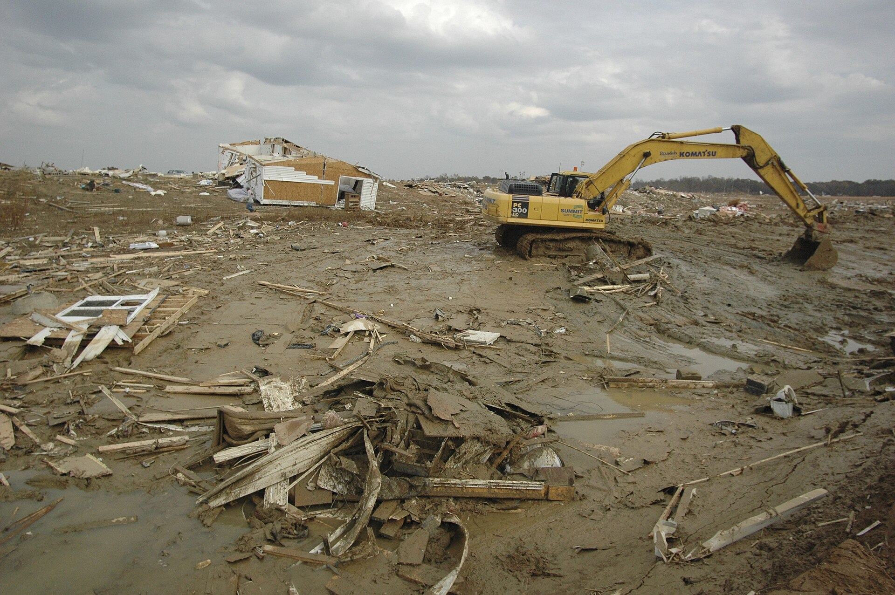
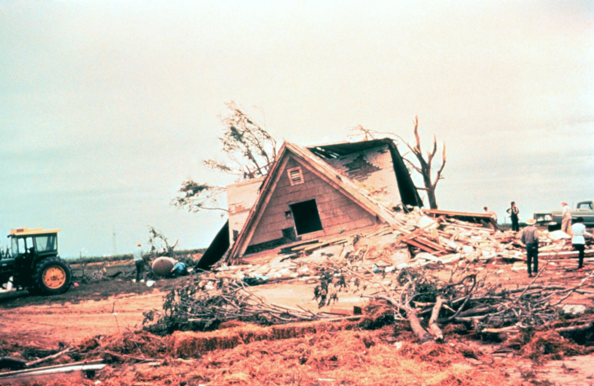

21 years ago today, November 6, 2005, an intense nocturnal tornado struck western Kentucky and southwestern Indiana, carving an 8-county path of destruction through the Ohio Valley. Touching down shortly before two in the morning, the violent vortex killed 24 people and destroyed or damaged hundreds of buildings.

## An Unexpected Nocturnal Outbreak

During the overnight hours of November 5 into November 6, 2005, an unseasonably warm front pushed through the American Midwest, stretching all the way from the Great Lakes into Tennessee. Strong upper-level winds collided with humid air, creating severe squall lines. Meteorologists initially anticipated that straight-line winds would be the primary threat, as the atmosphere was projected to stabilize later into the night.

However, around 1:30 am Central Time, the squall line fractured over the Ohio Valley. A localized low-level jet surged, feeding two discrete supercell storms that rapidly developed embedded rotation. A localized outbreak of nine tornadoes ensued, but one particular funnel would soon become the deadliest tornado Indiana had ever seen in the month of November.

## Touching Down in Henderson County

At approximately 1:39 am, the high-end F3 tornado touched down about two miles north-northwest of Smith Mills in Henderson County, Kentucky. The vortex quickly demonstrated immense power, snapping trees, destroying a farmhouse, and tossing a pickup truck into an open field.

The tornado surged northeast and crossed the Ohio River into a rural peninsula in Vanderburgh County, Indiana. There, it tore the roof off a historic two-story home built in 1875, driving tree limbs into exterior walls and overturning a 10,000-pound truck before crossing the Ohio River back into Kentucky territory. Aerial surveys later documented distinctive spiral scour marks etched into the muddy farm ground along its path.

*FEMA - 19713 - Photograph by Leif Skoogfors taken on 11-26-2005 in Indiana — Photo: Leif Skoogfors / Public domain*

## Catastrophe at Ellis Park and Eastbrook

After crossing the Ohio River a third time, the tornado battered the Ellis Park horse racing facility on the river's north bank. The grandstands and jockey housing suffered severe destruction, and several racehorses were killed. The tornado then entered the southern fringes of the city of Evansville, where it encountered the Eastbrook Mobile Home Park.

The impact at Eastbrook was catastrophic. Of the approximately 350 mobile homes situated in the park, 100 were completely destroyed and another 125 suffered severe damage. Twenty residents lost their lives in that community alone. The county coroner reported that most victims died instantly from skull and spinal injuries as homes were obliterated and debris was carried hundreds of yards into neighboring fields.

*Archive, 2005 — Photo: Leif Skoogfors / Public domain*

## Path Across Warrick and Spencer Counties

The tornado maintained its destructive force as it crossed into Warrick County, striking near the Angel Mounds State Historic Site and damaging subdivisions north of Newburgh. It reached its peak intensity near Paradise, where several commercial structures inside an industrial park were leveled.

Continuing northeast toward Boonville, the tornado claimed another life in a mobile home. It then swept into the community of DeGonia Springs, where multiple residences were completely leveled and three people were killed, including a woman who was eight months pregnant. The storm finally weakened near Tennyson and dissipated near Gentryville in Spencer County, having traveled across dozens of miles, injuring 238 people, and damaging or destroying roughly 500 structures.

*Tornado Damage May 24 1973 — Photo: NOAA Photo Library, NOAA Central Library; OAR/ERL/National S / Public domain*

## The Failure to Awaken Residents

The National Weather Service had issued tornado warnings approximately 30 minutes before the twister struck the Evansville area. Despite this advance notice, very few residents ever heard the alert. Because the storm struck in the early morning hours, the vast majority of victims were sound asleep.

Compounding the danger, the local NOAA Weather Radio transmitter was experiencing technical difficulties that night, preventing specialized indoor weather alarms from sounding in many homes. The disaster exposed a critical flaw in emergency communication: an alert system that relies solely on daytime broadcasts or outdoor sirens is ineffective when a twister strikes sleeping neighborhoods in the dead of night.

## Rebuilding and CJ's Law

In the months following the tragedy, the community mobilized to protect vulnerable residents. State Representative Phil Hoy introduced CJ's Law, named in memory of two-year-old victim C.J. Martin. The legislation sought to require manufacturers of mobile homes to install operational, dedicated weather radios with backup power sources. Vanderburgh County officials also enacted stricter anchorage regulations for its 3,100 mobile homes, mandating heavier straps and ground bracing.

Recovery efforts also took root in physical form. On August 12, 2006, a granite memorial and playground were dedicated to the young victims at Eastbrook. Ellis Park rebuilt its grandstands, reopening for training in June 2006. Nearby, Habitat for Humanity constructed the New Haven Subdivision, providing 55 permanent homes for storm survivors along streets appropriately named Inspiration, Healing, Promise, and Belief.

### Sources

- <https://en.wikipedia.org/wiki/Kentucky>
- <https://commons.wikimedia.org/wiki/File:Tornado.Indiana.L5.2005-11-10.jpg>
- <https://commons.wikimedia.org/wiki/File:FEMA_-_19713_-_Photograph_by_Leif_Skoogfors_taken_on_11-26-2005_in_Indiana.jpg>
- <https://commons.wikimedia.org/wiki/File:FEMA_-_18686_-_Photograph_by_Leif_Skoogfors_taken_on_11-08-2005_in_Indiana.jpg>
- <https://commons.wikimedia.org/wiki/File:Tornado_Damage_May_24_1973.jpg>
