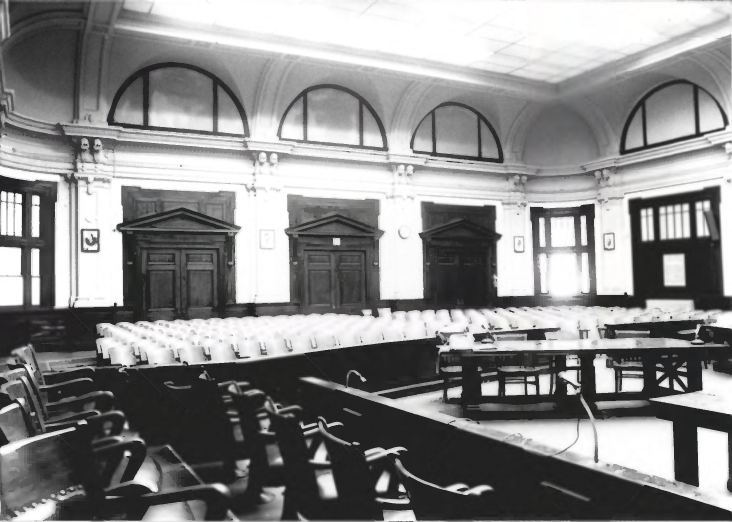
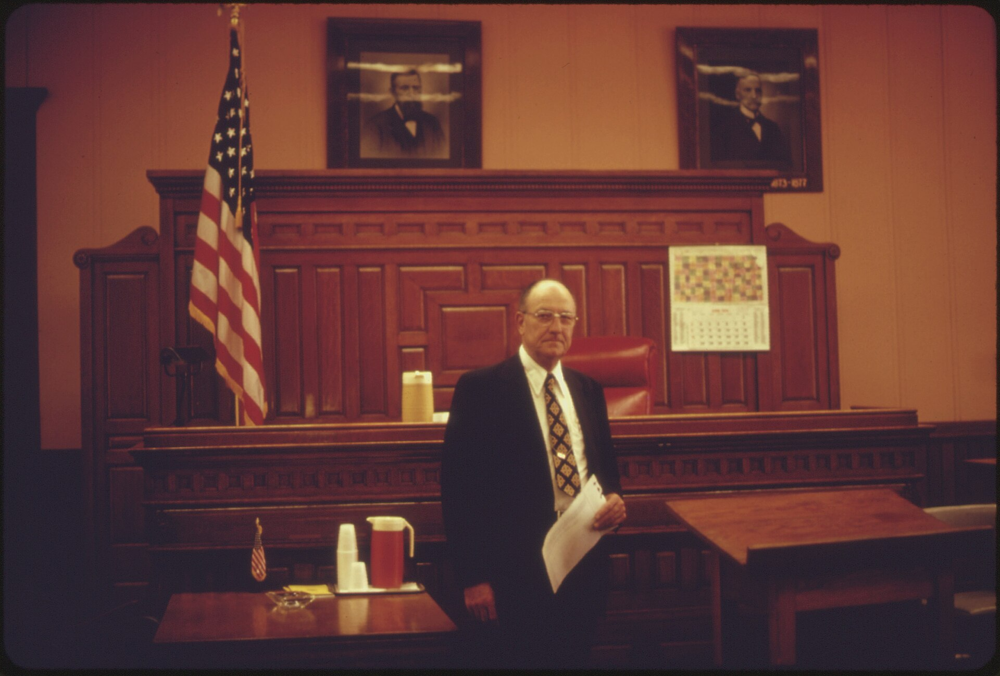

26 years ago today, November 6, 2000. Just after 9:15 at night, a toxicologist in San Diego called 911 to report that her husband had taken his own life. What initially appeared to be a tragic personal loss soon unraveled into one of California's most chilling premeditated crimes.

## A Promising Career Shrouded in Secrets

Kristin Margrethe Rossum grew up the eldest child of an academic family, with her father serving as a professor and college president. Despite early struggles with methamphetamine addiction in the early 1990s, she appeared to have turned her life around after moving back to California. She enrolled at San Diego State University, graduated with honors in 1998, and secured a respected position as a toxicologist at the San Diego County medical examiner's office.

In 1999, Rossum married Gregory T. de Villers, a man who had supported her recovery. However, within a year of marriage, Rossum's stability began to crack. She resumed her methamphetamine habit and began an extramarital affair with her direct supervisor at the morgue, Dr. Michael Robertson.

## An Ultimatum in the San Diego Suburbs

By late 2000, Gregory de Villers had discovered both his wife's infidelity and her renewed drug abuse. Concerned and betrayed, de Villers confronted Rossum directly. He issued an ultimatum: she had to resign from the medical examiner's office immediately, or he would report her illicit drug use and workplace affair to the county coroner.

Both Rossum and her lover, Robertson, were aware that de Villers held the power to destroy their professional reputations. Rather than stepping down or seeking help, Rossum turned to the very substances under her care at the county drug lab, where powerful narcotics were stored.

*Calcasieu Parish Courthouse 09 — Photo: Donna Fricker / Public domain*

## The Tragic 911 Call on November 6, 2000

Just after 9:15 p.m. on November 6, 2000, Rossum dialed 911 to report that her husband had taken his own life. When paramedics arrived at the apartment, they found de Villers lying unresponsive on the couple's bed. The bed was dramatically strewn with crumpled red rose petals, evoking a well-known sequence from the hit film American Beauty.

De Villers was rushed to the hospital but was pronounced dead on arrival. Rossum claimed to investigators that her husband had been battling severe depression and chose to end his life. However, his family, particularly his brother Jerome, strongly refuted the suicide claim, pointing out that de Villers abhorred recreational drugs and had shown no signs of suicidal intent.

*AN OFFICIAL IN THE ATCHISON COUNTY COURTHOUSE IN ATCHISON KANSAS, STANDS IN THE BUILDING'S COURTROOM. STILL USED, IT... - NARA - 557086 — Photo: Patricia DuBose Duncan / Public domain*

## Toxicology and the Store Receipt That Broke the Case

Because Rossum worked for the San Diego medical examiner, officials transferred the autopsy to an outside laboratory in Los Angeles to prevent any conflict of interest. The toxicology screen revealed that de Villers had died with seven times the lethal dose of fentanyl in his system. Fentanyl was a controlled substance kept in the county toxicology lab where Rossum worked.

Within a month, both Rossum and Robertson were dismissed from their jobs. Investigators then uncovered critical physical evidence: a Vons grocery store receipt showing Rossum had purchased a single red rose on the day of the murder. The receipt was timestamped at 12:42 p.m., directly contradicting Rossum's sworn statement that she was at home caring for her bedridden husband during that exact lunch hour.

*San Diego State University — Photo: StuSeeger / CC BY 2.0*

## A Landmark Trial and Life Behind Bars

On June 25, 2001, police arrested Rossum and charged her with first-degree murder. During the 2002 trial, prosecutors demonstrated that de Villers, incapacitated by the massive opioid dose, could never have arranged the rose petals on himself as the defense claimed.

On November 12, 2002, the jury found Rossum guilty of first-degree murder. A month later, she received a sentence of life imprisonment without the possibility of parole, alongside a $10,000 fine. She was transferred to the Central California Women's Facility in Chowchilla, where she remains incarcerated today. Meanwhile, Dr. Robertson fled to Australia shortly after his dismissal, remaining abroad while facing unsealed conspiracy charges in the United States.

### Sources

- <https://en.wikipedia.org/wiki/San_Diego>
- <https://commons.wikimedia.org/wiki/File:Grand_Isle_County_Courthouse_06.jpg>
- <https://commons.wikimedia.org/wiki/File:Calcasieu_Parish_Courthouse_09.jpg>
- <https://commons.wikimedia.org/wiki/File:AN_OFFICIAL_IN_THE_ATCHISON_COUNTY_COURTHOUSE_IN_ATCHISON_KANSAS,_STANDS_IN_THE_BUILDING%27S_COURTROOM._STILL_USED,_IT..._-_NARA_-_557086.jpg>
- <https://www.flickr.com/photos/50203533@N00/9190187882>
