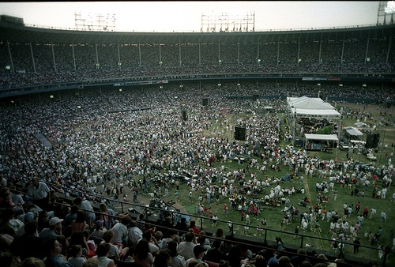
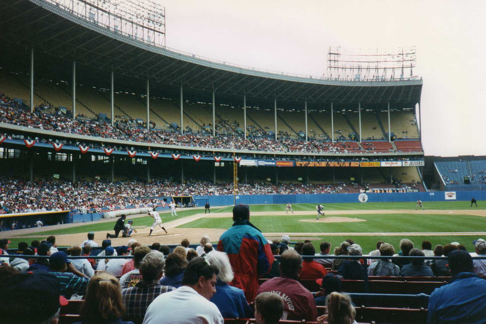
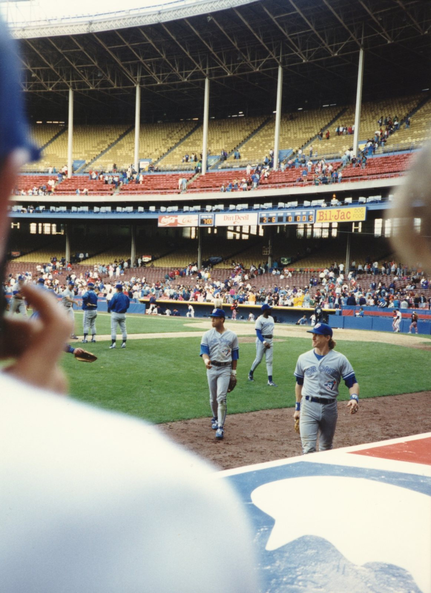

31 years ago today, November 6, 1995, Cleveland Browns owner Art Modell announced that he had signed a deal to move his franchise to Baltimore. The announcement blindsided the city of Cleveland and sent shockwaves through the National Football League. For millions of loyal supporters, it felt like an unfathomable betrayal by an owner who had spent decades pledging his loyalty to Northeast Ohio.

## A Storied Franchise and a Sacred Bond

The Cleveland Browns were not just any football team; they were an institution embedded in the fabric of their city. The franchise was founded in 1944 by Arthur B. McBride and legendary coach Paul Brown, beginning play in 1946 in the All-America Football Conference. In those early years, the Browns dominated the competition, compiling a 47–4–3 record over four seasons and capturing the league championship in every single one.

When the AAFC folded after the 1949 season, the Browns entered the NFL alongside the San Francisco 49ers and the original Baltimore Colts. Cleveland immediately proved its dominance by winning the league championship in its inaugural NFL season, followed by titles in 1954, 1955, and 1964. Remarkably, the Browns appeared in their league championship game in each of their first 10 seasons of existence, winning seven of them. Through the decades, Cleveland Stadium became a cathedral for passionate supporters who endured bitter lakefront weather to back their beloved team.

## Stadium Troubles and Miscalculated Bets

Art Modell, an entrepreneur with a background in advertising and television production, purchased the Browns in 1961. His purchase was heavily leveraged with borrowed funds, setting up financial challenges that persisted for decades. In 1975, Modell signed a 25-year lease for Municipal Stadium, agreeing to incur operating expenses of more than $300,000 annually in exchange for quasi-ownership and suite revenues. His company, Stadium Corporation, paid the city rents of $150,000 for the first five years and $200,000 annually thereafter.

A pivotal turning point arrived in 1990, when local voters approved a ballot measure to construct the Gateway Sports and Entertainment Complex. This project created Jacobs Field for the Cleveland Indians and Gund Arena for the Cleveland Cavaliers. Modell assumed his football revenues were secure and chose not to participate in the Gateway Project. That assumption proved disastrous. When the Indians moved to Jacobs Field in 1994, Modell's suite revenues collapsed, leaving him to absorb massive stadium expenses alongside soaring player salaries. Modell claimed to have lost $21 million between 1993 and 1994.

*NOT FROM THE EVENT · 1994 — Photo: Escapedtowisconsin Photo/Paul M. Walsh / CC BY-SA 3.0*

## The Announcement That Stunned the Nation

Modell had spent years reassuring the public that he would never uproot the team. He had openly criticized the Baltimore Colts when they departed for Indianapolis, and he had even testified in court on behalf of the NFL to prevent other owners from relocating franchises. Fans took him at his word, believing the Browns were permanently anchored to Cleveland.

That trust evaporated on November 6, 1995. Standing before reporters in Baltimore, Modell announced that he had signed a formal deal to relocate the Browns to Maryland for the 1996 NFL season. The reaction across Ohio was incandescent rage. Fans organized protests, burned memorabilia, and directed bitter scorn toward Modell. City officials and season ticket holders immediately launched legal actions to block the move and enforce the terms of the stadium lease.

*NOT FROM THE EVENT · 1993 — Photo: Wasted Time R (talk) / CC BY 3.0*

## Saving the Browns' Heritage

Faced with escalating lawsuits and public uproar, the NFL intervened to broker a resolution. Under the agreement, Modell agreed to relinquish the Browns franchise name, colors, records, and intellectual property to the league, ensuring that the team's history remained in Cleveland. In return, the NFL granted Modell a new franchise in Baltimore, which took the field as the Ravens in 1996.

Because holding separate dispersal and expansion drafts was impractical, the NFL allowed Modell to transfer his existing football organization and player contracts to Baltimore. Officially, however, the NFL recognized the Ravens as a 1996 expansion team. Meanwhile, the Browns franchise was deactivated in February 1996 while the city prepared to replace the aging Cleveland Stadium with an NFL-caliber venue.

*NOT FROM THE EVENT · 1992 — Photo: Striderv / CC BY 2.0*

## A New Era and a Sports Precedent

The NFL committed to reactivating the Browns by 1999, ruling out relocating another franchise and deciding instead to stock the team through an expansion draft. In 1998, the league sold the franchise for $530 million to Al Lerner, a former minority owner under Modell. In 1999, the reactivated Browns returned to the field at a brand-new stadium erected on the site of the demolished Municipal Stadium.

This unique settlement created a legal template that reshaped North American sports. A virtually identical compromise occurred when Major League Soccer suspended the San Jose Earthquakes from 2006 to 2007 while their staff moved to create the Houston Dynamo, and again when the NHL suspended the Arizona Coyotes in 2024 while transferring the organization to the Utah Mammoth. For Clevelanders, the wound from November 6, 1995, never entirely closed, serving as a reminder of how fan passion and legal resolve preserved the identity of their team.

### Sources

- <https://en.wikipedia.org/wiki/Cleveland_Browns_relocation_controversy>
- <https://commons.wikimedia.org/wiki/File:Cleveland_Municipal_Stadium_last_game_played_in_the_stadium_December_17,_1995.jpg>
- <https://commons.wikimedia.org/wiki/File:Graham_Crusade.JPG>
- <https://commons.wikimedia.org/wiki/File:ClevelandMunicipalStadium1993Interior.jpg>
- <https://commons.wikimedia.org/wiki/File:Henke,_Winfield,_%26_Gruber_leaving_the_Field_in_Cleveland.jpg>
