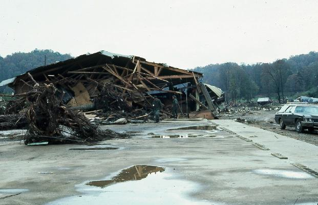
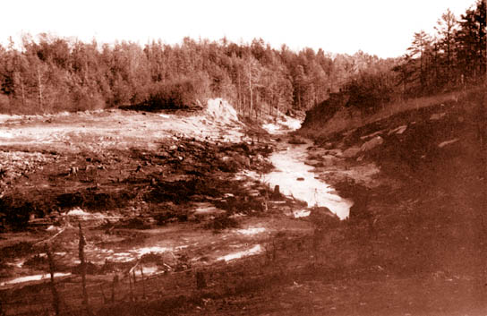
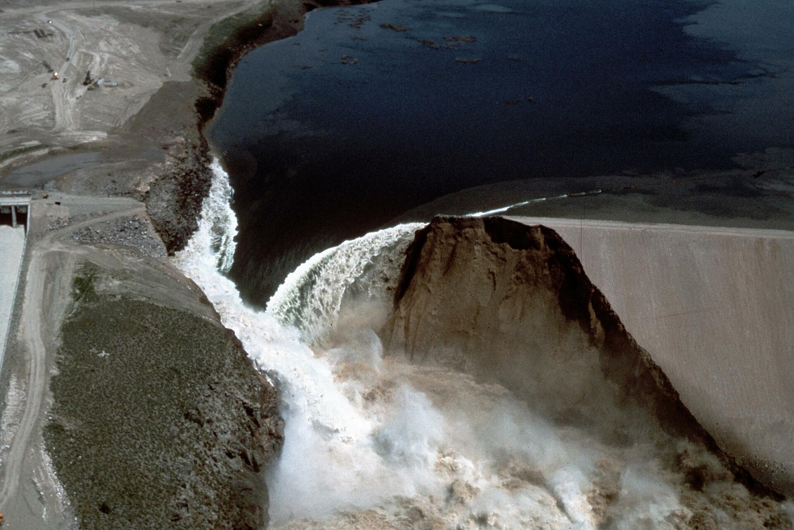

49 years ago today, November 6, 1977, one of the deadliest dam failures in modern American history struck northeast Georgia. In the early morning hours, the earthen Kelly Barnes Dam gave way, sending a devastating wave of water over Toccoa Falls and straight into the sleeping campus of Toccoa Falls College. By sunrise, 39 people had died, dozens were injured, and an entire community was left in shock.

## An Aging Structure Above the Falls

The origins of the Kelly Barnes Dam dated back to the late nineteenth century. In 1899, E. P. Simpson constructed a rock crib dam across Toccoa Creek to power a small 200-kilowatt hydroelectric plant for the nearby town of Toccoa. The plant and property were transferred to the Toccoa Falls Institute in 1933. Seeking a more dependable power source, the institute built an earthen embankment dam directly over the original rock crib between 1939 and 1940.

Following World War II, the dam was enlarged once more. The final embankment stood 38 feet high, stretched 400 feet long, and measured 20 feet wide at its crest, creating a 40-acre reservoir known as Barnes Lake. Hydroelectric power generation was halted entirely in 1957. From that point on, the lake was maintained purely for recreation, perched about 2,000 feet upstream from the dramatic 186-foot drop of Toccoa Falls.

## Four Days of Relentless Autumn Rain

Trouble began during the first week of November 1977, when a severe weather system stalled over northeast Georgia. Between November 2 and November 5, meteorological stations recorded seven inches of precipitation across Stephens County. The storm reached its peak intensity on Saturday evening, November 5, when three and a half inches of rain fell in a six-hour window between 6:00 pm and midnight.

Barnes Lake typically held roughly 17.86 million cubic feet of water. Under the deluge, runoff overwhelmed the two uncontrolled earthen spillways. By late night, the swollen lake had expanded to an estimated volume of 27,442,800 cubic feet. The saturated earthen walls could no longer support the immense pressure of the surging water.

*Archive, 1977 — Photo: Vernon B. Sauer (member of the Federal Investigative Board t / Public domain*

## The 1:30 AM Breach

At approximately 1:30 am on Sunday, November 6, a 200-foot section of the dam gave way without warning. Millions of cubic feet of water plunged out of the reservoir at a maximum peak discharge of 24,000 cubic feet per second. The deluge roared down Toccoa Creek, crested the 186-foot natural waterfall, and crashed onto the lower campus below.

Most residents were asleep when the flood struck. The rushing waters swept away married student housing, demolished 18 mobile homes, and leveled nine houses. Two college buildings were completely destroyed, while five other campus structures and five nearby homes suffered severe structural damage. In addition, two bridges along Toccoa Falls Drive and a culvert on County Farm Road were washed away. Along Georgia State Route 17, the road embankments on both sides of the bridge collapsed.

*Archive, 1977 — Photo: Photo courtesy of Federal Investigative Board, Kelly Barnes  / Public domain*

## The Cost in Lives and Infrastructure

The human toll was immediate and devastating. Search and rescue crews worked through mud and debris, ultimately confirming that 39 people had lost their lives and 60 others were injured. Students, faculty members, and young children living in the campus residential quarters were among the casualties.

The floodwaters also crippled local municipal infrastructure. The main water-supply pipeline for the city of Toccoa was fractured during the surge, leaving the city's drinking water contaminated for several days. Total physical property damage from the disaster was estimated at $2.8 million.

*Archive, 1976 — Photo: WaterArchives.org from Sacramento, California, USA / CC BY-SA 2.0*

## The Federal Investigation Findings

In the immediate aftermath of the tragedy, Georgia Governor George Busbee ordered a thorough state and federal investigation. The inquiry was led by a Federal Investigative Board assembled by the United States Geological Survey, which published its final findings on December 21, 1977. Investigators faced an unusual hurdle: no original engineering blueprints or official construction records existed for the dam, forcing them to reconstruct its history using photographs, news clippings, and eyewitness accounts.

While the report did not pinpoint a single definitive trigger, it highlighted multiple structural vulnerabilities. Investigators noted that the dam lacked proper modern engineering design and was in generally poor condition. Furthermore, a 1973 photograph uncovered by researchers showed that a 12-foot-high, 30-foot-wide earth slide had occurred on the downstream slope years before the disaster, signaling progressive instability that ultimately failed under the weight of the 1977 storm.

## A Permanent Memorial by the Falls

State authorities and college leadership resolved that the Kelly Barnes Dam would never be rebuilt. With the dam dismantled and Barnes Lake drained, engineers eliminated the possibility of a second failure along Toccoa Creek. The campus rebuilt its lost facilities over the ensuing decades, continuing its operations beside the natural falls.

Today, visitors walking the grounds near the base of Toccoa Falls will find a permanent memorial monument inscribed with the names of the 39 victims. The stone marker stands in quiet tribute to the lives lost in the early hours of that November morning, preserving the memory of a tragedy that reshaped dam safety oversight across the nation.

### Sources

- <https://en.wikipedia.org/wiki/Toccoa%2C_Georgia>
- <https://commons.wikimedia.org/wiki/File:Middletown,_CT_-_March_1977_flood_02.jpg>
- <https://commons.wikimedia.org/wiki/File:Kelleybarnesdamdamage.jpg>
- <https://commons.wikimedia.org/wiki/File:Kelleybarnesdambreach2.jpg>
- <https://commons.wikimedia.org/wiki/File:(IDAHO-L-0010)_Teton_Dam_Flood_-_Newdale.jpg>
