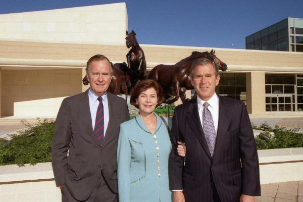
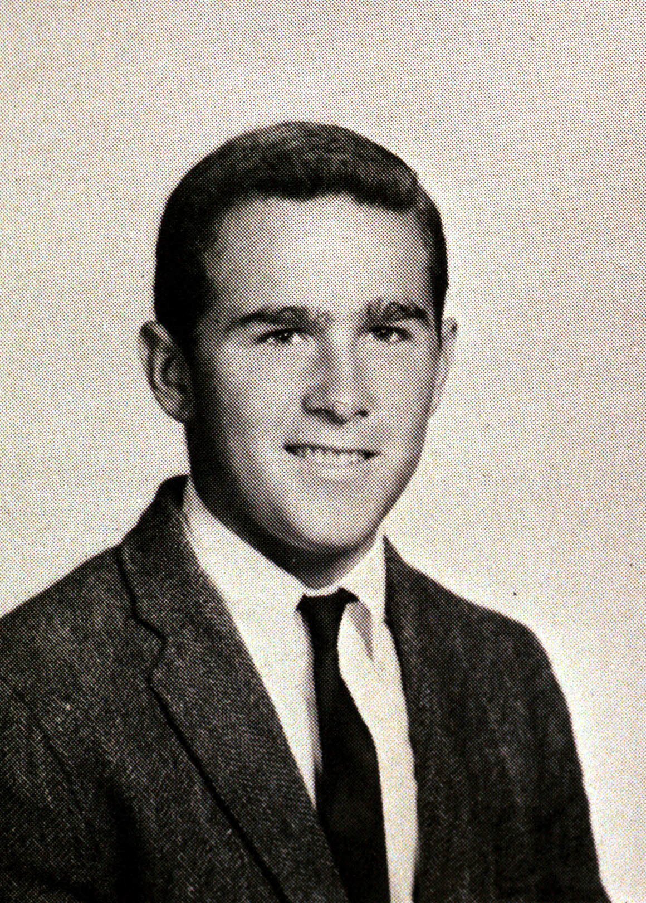
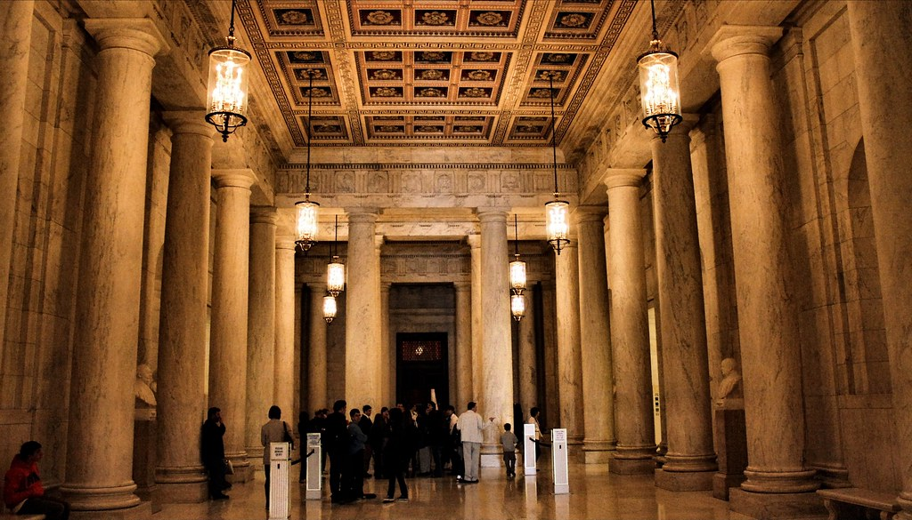

26 years ago today, on November 7, 2000, voters across the United States went to the polls in what became the closest and most fiercely contested presidential election in modern history. The race between Republican Texas governor George W. Bush and Democratic vice president Al Gore ultimately hinged on a microscopic margin in a single state.

## Two Nominees in a Divided Nation

President Bill Clinton was ineligible to seek a third term under the Twenty-second Amendment, leaving the Democratic field open for Vice President Al Gore. Gore secured the nomination and chose Connecticut junior senator Joe Lieberman as his running mate. On the Republican side, Texas governor George W. Bush, the eldest son of former president George H. W. Bush, emerged from a competitive primary contest and selected former secretary of defense Dick Cheney. Both campaigns focused heavily on domestic issues such as the federal budget, tax relief, and federal social insurance programs.

## An Election Night Without a Winner

When the polls closed on November 7, 2000, television networks and election observers found themselves unable to declare a definitive winner. State after state fell along narrow party lines, leaving neither candidate with the 270 electoral votes required to secure the presidency. Bush flipped 11 states that had voted Democratic in 1996, including Arkansas, Arizona, Kentucky, Louisiana, Missouri, Nevada, New Hampshire, Ohio, Tennessee, and West Virginia. Yet the decisive battle came down entirely to Florida and its 25 electoral votes.

*George H. W. Bush, Laura Bush, George W. Bush 1997 — Photo: Unknown authorUnknown author / Public domain*

## The 537-Vote Margin in Florida

Florida saw 5.96 million ballots cast, but the initial machine tally showed an astonishingly narrow gap between the candidates. Without a full manual recount, Bush held a lead of just 537 votes, a razor-thin margin of 0.009 percent. Because the margin was so small, state law triggered automatic machine recounts and sparked weeks of bitter legal challenges over uncounted ballots, punch-card machines, and differing county standards.

*George W. Bush in 1964 Pot Pourri — Photo: Phillips Academy Andover / Public domain*

## The Recount Battle Reaches the Courts

For more than a month, the election remained unresolved as local election boards examined contested ballots. On December 8, 2000, the Florida Supreme Court ordered a statewide manual recount of all undervotes, covering over 61,000 ballots that vote tabulation machines had missed. The Bush campaign immediately appealed to the United States Supreme Court to stay the ruling and halt the recount. The federal high court granted certiorari and stayed the recount on December 9, hearing oral arguments on December 11.

*Supreme Court of the United States — Photo: Phil Roeder / CC BY 2.0*

## The Supreme Court Decision in Bush v. Gore

On December 12, 2000, the United States Supreme Court issued its landmark per curiam ruling in Bush v. Gore. By a 5 to 4 vote, the Court concluded that no constitutional recount could be completed prior to the federal safe harbor deadline of December 12. Seven justices found that the varying standards used by Florida counties to discern voter intent violated the Equal Protection Clause of the Fourteenth Amendment, but the 5-to-4 majority ruled that time had run out to implement an alternative statewide standard.

## The Final Tally and Lasting Impact

The Supreme Court's ruling allowed Florida secretary of state Katherine Harris's vote certification to stand, awarding Florida's 25 electoral votes to Bush. This gave Bush 271 electoral votes, exactly one vote more than the 270 needed to win, while Gore received 266 electoral votes. Gore had won the national popular vote by 543,895 votes, a margin of 0.52 percent. It was the first presidential election since 1888 in which the winning candidate lost the popular vote, leaving a profound and lasting mark on American electoral history.

### Sources

- <https://en.wikipedia.org/wiki/2000_United_States_presidential_election>
- <https://commons.wikimedia.org/wiki/File:George_Bush_45_(49492156502).jpg>
- <https://commons.wikimedia.org/wiki/File:George_H._W._Bush,_Laura_Bush,_George_W._Bush_1997.jpg>
- <https://commons.wikimedia.org/wiki/File:George_W._Bush_in_1964_Pot_Pourri.jpg>
- <https://www.flickr.com/photos/88876166@N00/5554026789>
