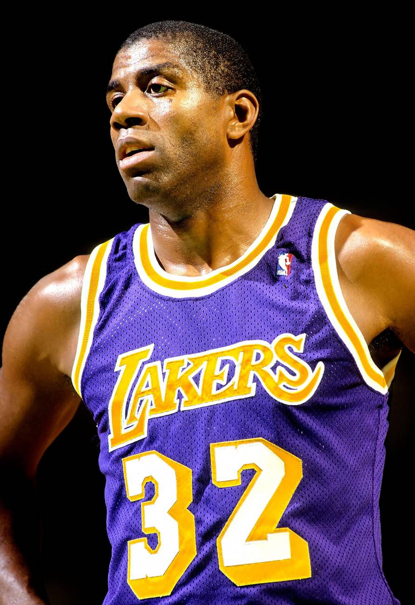
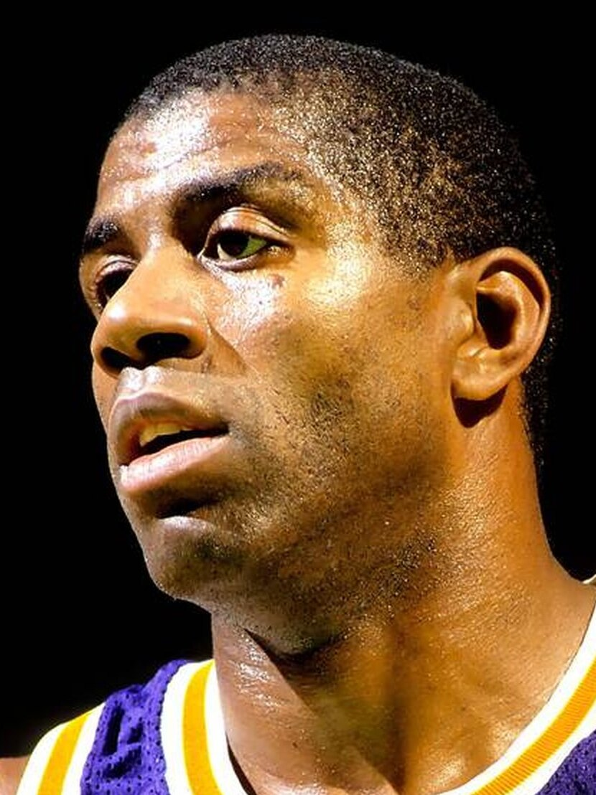
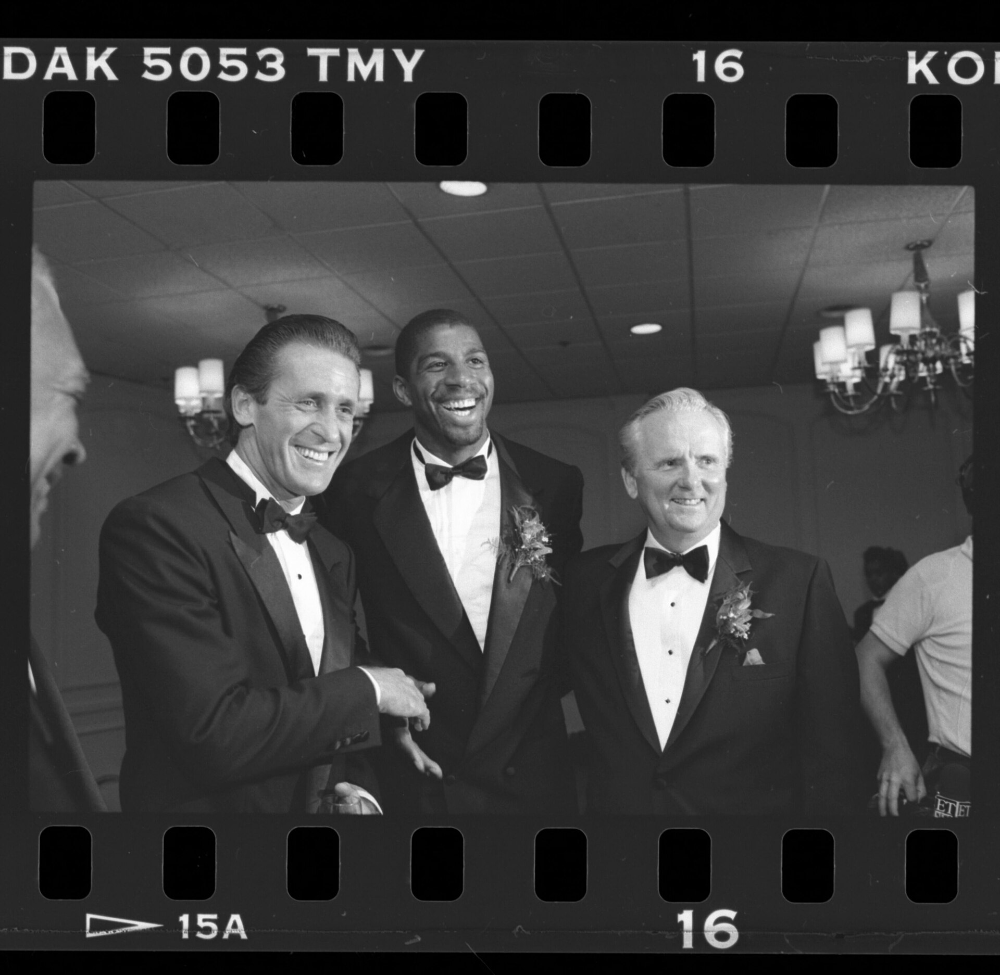

35 years ago today, November 7, 1991, Los Angeles Lakers superstar point guard Earvin "Magic" Johnson announced he had contracted HIV and was retiring from professional basketball immediately. The unexpected revelation from one of the most beloved athletes in American history sent shockwaves through sports and transformed the national conversation on HIV and AIDS.

## The Undisputed King of Showtime

By 1991, Earvin Johnson Jr. was widely recognized as the greatest point guard of all time. After winning an NCAA national championship with Michigan State in 1979, he was drafted first overall by the Los Angeles Lakers. Johnson instantly revitalized the franchise under new owner Jerry Buss, ushering in the "Showtime" era defined by fast-break entertainment, flamboyant passing, and championship success.

Alongside dominant center Kareem Abdul-Jabbar and forward James Worthy, Johnson steered the Lakers to five NBA championships during the 1980s. Over that decade, he collected three NBA Most Valuable Player awards, three Finals MVP honors, and twelve All-Star selections. His career regular-season average of 11.19 assists per game and playoff average of 12.35 assists per game set records that remain unmatched in league history.

## A Stunned Nation and a Somber Podium

On November 7, 1991, Johnson stepped up to a bank of microphones in Los Angeles. At just 32 years of age and still at the height of his athletic powers, he delivered the unimaginable news: routine testing had revealed he had contracted the Human Immunodeficiency Virus (HIV). Because of the diagnosis, he announced he was stepping away from the game of basketball immediately.

In 1991, an HIV diagnosis was widely viewed by the public as an immediate death sentence. Misinformation, fear, and deep social stigma surrounded the virus. Yet Johnson spoke with remarkable poise and courage, smiling despite the gravity of the moment and reassuring the world that he planned to live a long life and dedicate his future to educating the public.

*Archive, 1987 — Photo: [copyright held by Steve Lipofsky] / CC BY-SA 3.0*

## Challenging Misconceptions and Returning to the Court

Johnson’s announcement immediately shifted global awareness. Up until that point, many Americans incorrectly believed HIV affected only specific marginalized communities. Seeing a world-famous, heterosexual sports idol disclose his diagnosis forced the public to realize that anyone could contract the virus.

Despite his retirement, fans voted Johnson into the 1992 NBA All-Star Game in Orlando. Facing skepticism from some players about competing alongside an HIV-positive athlete, Johnson put on an unforgettable performance, scoring 25 points and winning the All-Star Game MVP award. Later that summer, he served as co-captain of the famed United States men's Olympic "Dream Team," winning a gold medal at the Barcelona Olympics.

*NOT FROM THE EVENT · 1987 — Photo: [copyright held by Steve Lipofsky] / CC BY-SA 3.0*

## A Brief Comeback and Hall of Fame Legacy

Johnson's basketball journey was not quite finished. After touring with his barnstorming Magic Johnson All-Stars exhibition squad, he returned to the Lakers during the 1995–96 season at age 36, playing 32 games before retiring for the final time. In 1996, the NBA honored him as one of the 50 Greatest Players in NBA History, and he was later named to the NBA 75th Anniversary Team in 2021.

He was inducted into the Naismith Memorial Basketball Hall of Fame twice: first in 2002 for his historic individual playing career, and again in 2010 as a member of the 1992 Dream Team. Beyond the court, his historic rivalry and enduring friendship with Boston Celtics star Larry Bird remained one of sports' defining partnerships.

*NOT FROM THE EVENT · 1989 — Photo: Lacy Atkins / CC BY 4.0*

## A Lasting Impact Beyond Basketball

In the decades following his diagnosis, Johnson fulfilled the promise he made on that November afternoon. He established himself as an influential advocate for HIV and AIDS prevention, education, and safe sex practices, proving that modern medical treatments could allow people living with HIV to lead healthy, active lives.

He also built an extraordinary career as an entrepreneur, philanthropist, and team executive, eventually holding ownership stakes in the Los Angeles Dodgers, Los Angeles Sparks, Los Angeles FC, Washington Commanders, and Washington Spirit. Across his career as a player and owner, Johnson has won 16 championships, and in 2025, he received the Presidential Medal of Freedom. His disclosure on November 7, 1991, remains one of the most defining and courageous moments in American cultural history.

### Sources

- <https://en.wikipedia.org/wiki/Los_Angeles_Lakers>
- <https://commons.wikimedia.org/wiki/File:Pat_Riley_and_Earvin_%22Magic%22_Johnsonat_the_Century_Plaza_(cropped).jpg>
- <https://commons.wikimedia.org/wiki/File:Magic_Johnson_Steve_Lipofsky.jpg>
- <https://commons.wikimedia.org/wiki/File:Magic_Johnson_Steve_Lipofsky_(cropped).jpg>
- <https://commons.wikimedia.org/wiki/File:Pat_Riley,_Earvin_%22Magic%22_Johnson_and_Jerry_West_at_the_Century_Plaza.jpg>
