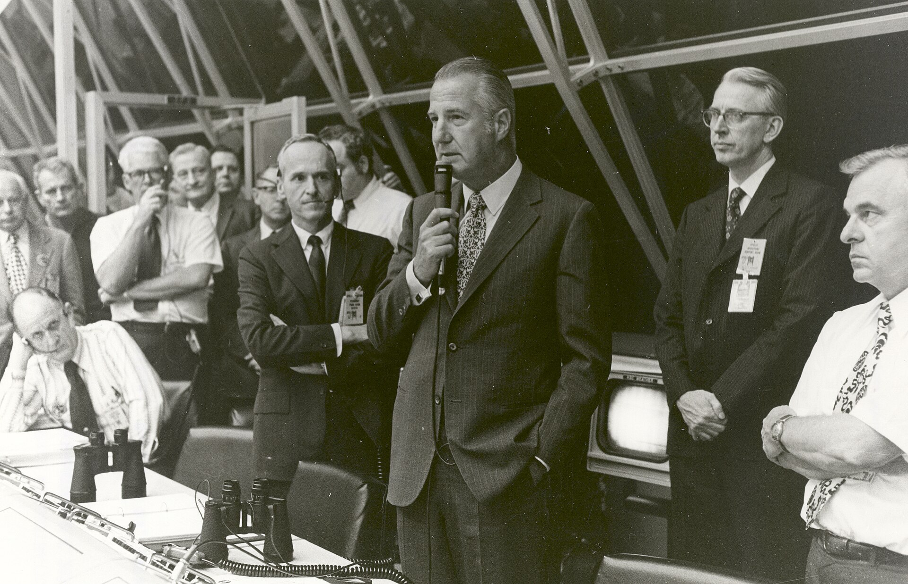
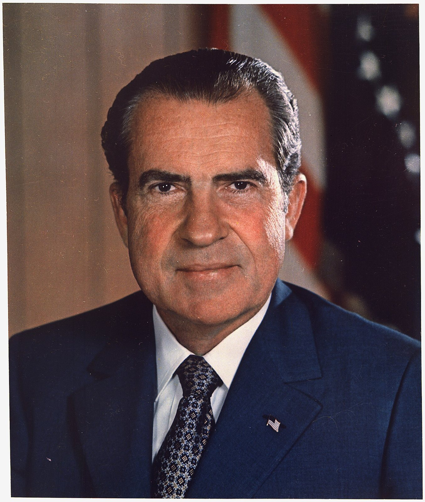
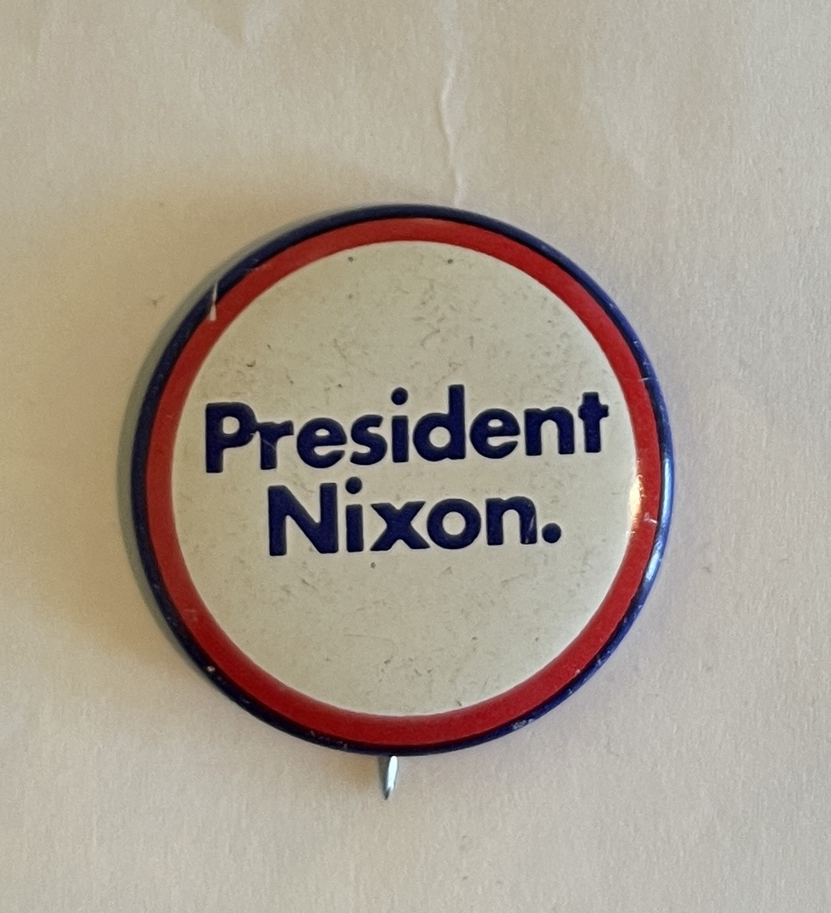

54 years ago today, on November 7, 1972, incumbent Republican President Richard Nixon achieved one of the most commanding electoral triumphs in American history. Defeating Democratic challenger Senator George McGovern, Nixon secured 60.7 percent of the popular vote and won 49 out of 50 states. It marked the absolute peak of Nixon's political fortunes, providing a historic mandate that would be dramatically overturned less than two years later.

## An Incumbent Riding Diplomatic Momentum

Richard Nixon entered the 1972 campaign season with major accomplishments to present to the electorate. During his first term, he oversaw a dramatic recalibration of American foreign policy. His historic trip to Beijing in early 1972 initiated diplomatic relations with the People's Republic of China, transforming Cold War dynamics. Shortly afterward, he traveled to Moscow to finalize the Anti-Ballistic Missile Treaty with the Soviet Union, inaugurating an era of détente. On the domestic front, his administration established the Environmental Protection Agency and the Occupational Safety and Health Administration, while guiding the nation through the Apollo 11 Moon landing.

## Trouble and Turmoil on the Democratic Ticket

The Democratic Party faced intense internal divisions heading into the general election. Senator George McGovern mobilized anti-Vietnam War activists and grassroots liberals to secure the nomination, overcoming establishment candidates including Edmund Muskie, Hubert Humphrey, and George Wallace. McGovern ran on a bold platform calling for an immediate withdrawal of American forces from Vietnam and the establishment of a guaranteed minimum income. However, his campaign was crippled almost immediately after the Democratic convention. Reports surfaced that his vice-presidential nominee, Senator Thomas Eagleton, had previously undergone electroconvulsive therapy for depression. After nineteen days of political fallout, Eagleton stepped down and was replaced by former ambassador to France Sargent Shriver, leaving the ticket severely weakened.

*Spiro Agnew Congratulates Launch Control After Launch of Apollo 17 - GPN-2002-000058 — Photo: NASA / Public domain*

## A Changed Electorate and the Youth Vote

The 1972 presidential election also marked a fundamental structural shift in American democracy. It was the first presidential contest held following the ratification of the Twenty-sixth Amendment, which lowered the minimum voting age from 21 to 18. While McGovern's campaign had hoped that the influx of millions of newly enfranchised young voters would turn the tide in favor of his anti-war message, Nixon held commanding leads in nationwide polling throughout the summer and autumn. Voters favored Nixon's handling of the economy and foreign affairs over McGovern's platform, which critics characterized as overly radical.

*Richard M. Nixon, ca. 1935 - 1982 - NARA - 530679 — Photo: Unknown authorUnknown author or not provided / Public domain*

## The Forty-Nine State Sweep

When the polls closed on November 7, 1972, the results confirmed a landslide of unprecedented proportions. Nixon and his running mate, Vice President Spiro Agnew, won 60.7 percent of the popular vote, recording the largest share ever received by a Republican ticket in any presidential election. McGovern garnered only 37.5 percent. In the Electoral College, Nixon carried 49 states, winning across every region of the nation and becoming the first Republican candidate to sweep the American South. The victory also marked the last time a Republican presidential candidate carried the state of Minnesota.

*Richard Nixon President Campaign Button 1972 — Photo: Richard Nixon 1972 President Campaign / CC BY-SA 4.0*

## The Seeds of Downfall

Beneath the euphoric celebration of Nixon's re-election lay an escalating crisis that had already begun in secret. In June 1972, five months before the election, operatives connected to Nixon's re-election committee broke into the Democratic National Committee headquarters inside the Watergate complex in Washington, D.C., attempting to install wiretaps. Although early coverage of the break-in had little impact on voters in November, investigations into the administration's cover-up intensified throughout 1973. Revelation after revelation steadily eroded Nixon's political support in Congress and across the nation.

## From Unmatched Mandate to Resignation

The political capital gained on November 7 vanished with remarkable speed. In late 1973, Spiro Agnew resigned the vice presidency, and Nixon faced near-certain impeachment by the House of Representatives as tape recordings proved his involvement in the Watergate cover-up. On August 9, 1974, just 21 months after winning 49 states, Richard Nixon became the only president in United States history to resign from office. He was subsequently pardoned by his successor, Gerald Ford. Today, the 1972 election remains a striking chapter in American political history: a contest that delivered the greatest Republican popular vote landslide on record, followed by the most dramatic collapse of presidential authority the country has ever seen.

### Sources

- <https://en.wikipedia.org/wiki/1972_United_States_presidential_election>
- <https://commons.wikimedia.org/wiki/File:Richard_Nixon_greeted_by_children_during_campaign_1972.png>
- <https://commons.wikimedia.org/wiki/File:Spiro_Agnew_Congratulates_Launch_Control_After_Launch_of_Apollo_17_-_GPN-2002-000058.jpg>
- <https://commons.wikimedia.org/wiki/File:Richard_M._Nixon,_ca._1935_-_1982_-_NARA_-_530679.jpg>
- <https://commons.wikimedia.org/wiki/File:Richard_Nixon_President_Campaign_Button_1972.jpg>
