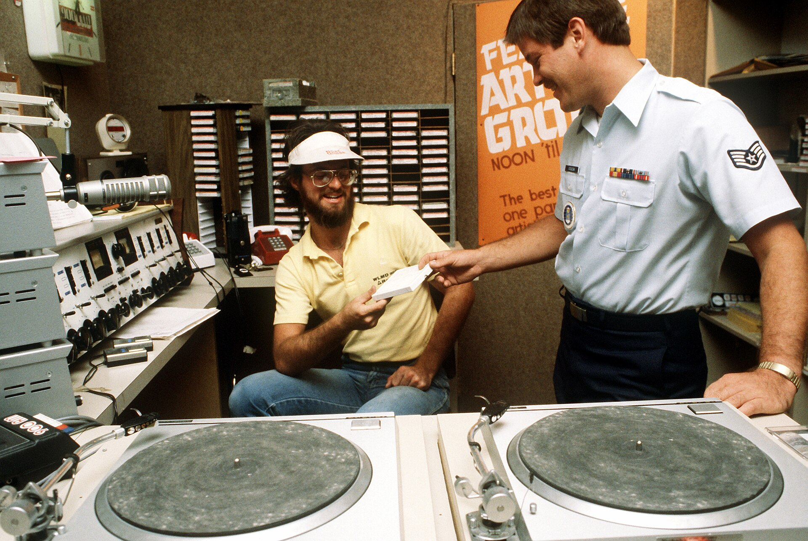
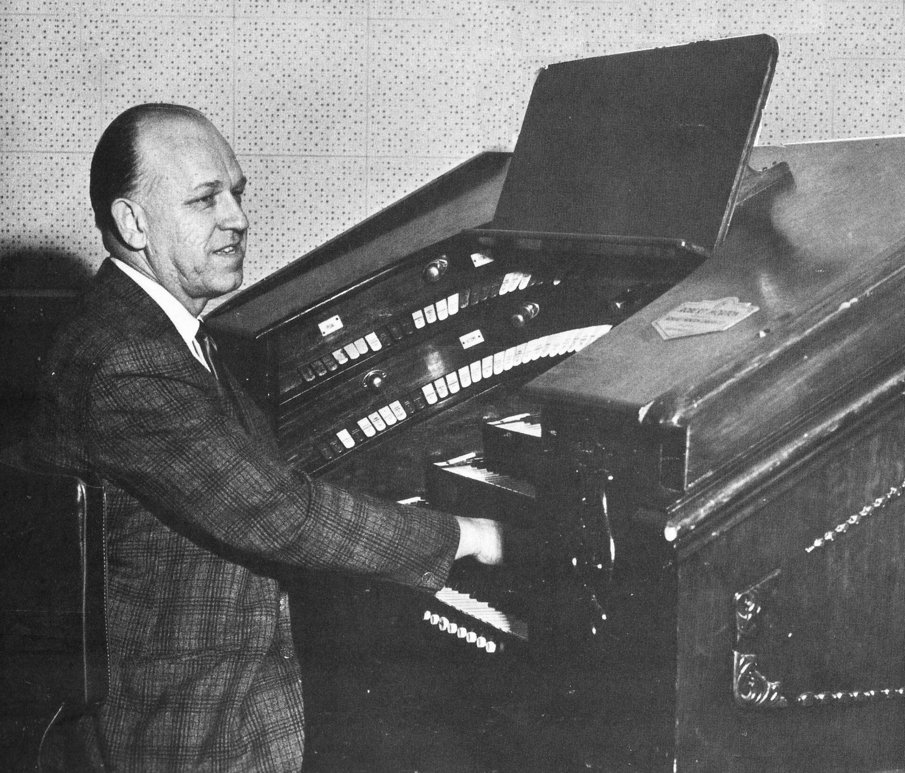

On November 7, 1994, a small student-run radio station in North Carolina made broadcast history. WXYC, operating out of the University of North Carolina at Chapel Hill, launched what is widely recognized as the world's first internet radio broadcast. By taking a traditional FM signal and transmitting it across computer networks, the station demonstrated that live audio could travel far beyond the physical range of a transmission tower.

## The Dormitory Roots of WXYC

Before becoming an FM station, WXYC had humble origins across the campus of the University of North Carolina at Chapel Hill. During the late 1960s, individual residence halls operated their own carrier-current radio stations. Morrison Dormitory operated WMO, Ehringhaus had WSTD, Granville Towers ran WILD, and Hinton James maintained its own station. In the fall of 1969, Hinton James joined with Ehringhaus to form WRSC, known as Radio South Campus. Meanwhile, Morrison and Granville Towers formed WCAR, broadcasting directly from the basement of Granville West.

In January 1970, these competing dormitory stations consolidated into WCAR. With studios situated in the basement of Ehringhaus Dormitory, WCAR broadcast to campus residence halls over an AM carrier-current frequency of 550 kHz. The student managers had bigger ambitions than a closed campus circuit or playing progressive rock. They aimed to secure an FM license from the Federal Communications Commission (FCC) and turn the station into a professional training ground for student broadcasters. To gain support and funding for these plans, numerous WCAR staff members even ran for seats in the UNC Student Legislature.

## An Uncompromising Musical Format

After transitioning to FM as WXYC on 89.3 FM, the station established a reputation for fiercely independent and varied programming. Owned by Student Educational Broadcasting, Inc., the non-commercial station operated 24 hours a day, 365 days a year, completely staffed and directed by students.

WXYC became celebrated for its wide-ranging musical palette. Unlike commercial stations constrained by rigid playlists, WXYC aired an eclectic mix of genres, including jazz, blues, rock, hip hop, zydeco, metal, electronic, bluegrass, country, folk, and classical music. It featured global sounds ranging from traditional Asian and African music to calypso, samba, tejano, and mariachi. While maintaining an emphasis on music from the twentieth century onwards, the station made a conscious effort to spotlight regional musicians from North Carolina, particularly around Chapel Hill, while incorporating material from UNC's Southern Folklife Collection and staging weekly themed shows.

*NOT FROM THE EVENT — Photo: SoilScience.info / CC BY 2.0*

## Breaking Boundaries on November 7, 1994

By 1994, WXYC operated with an effective radiated power of 1,100 watts from an antenna rising 147 meters above average terrain on Jones Ferry Road in Chatham County. Its terrestrial FM signal blanketed approximately 900 square miles of central North Carolina. Its studios and administrative offices were headquartered inside the Frank Porter Graham Student Union on campus.

Although the terrestrial signal reached thousands of listeners across the Triangle area, physical broadcast coverage was inherently limited by distance and terrain. In November 1994, WXYC partnered with ibiblio, an online digital library and archive based at UNC. On November 7, 1994, the station began simulcasting its live 89.3 FM signal over the internet. This marked the first time in world history that a radio station streamed its uninterrupted live broadcast onto the global network, allowing computer users anywhere with internet connectivity to listen in real time.

*Air Force recruiter SSGT Paul Godleski and WLMD Radio News Director Paul Corson prepare to review a public service announcement on tape - DPLA - f8e479840b5b64b4f3080a87b250c475 — Photo: Department of Defense. American Forces Information Service.  / Public domain*

## Innovation at America's Oldest Public University

The breakthrough took place at an institution with a long history of national prominence. Chartered by the North Carolina General Assembly in 1789 and enrolling its first students in 1795, the University of North Carolina at Chapel Hill is one of the oldest public universities in the United States. Located in central North Carolina, UNC-Chapel Hill forms one point of the state's famed Research Triangle, alongside Duke University in Durham and North Carolina State University in Raleigh.

From its historic 760-acre campus spanning Franklin Street and the Morehead Planetarium, UNC had grown into a major research center with hundreds of student organizations. The student broadcasters at WXYC embraced that academic environment, using emerging network infrastructure to reimagine the boundaries of college radio.

*Lorin Whitney — Photo: self-scanned by JGHowes, from LP album in uploader's collect / Public domain*

## From Webcams to Global Audio Streaming

The launch of WXYC's online broadcast represented a major milestone in the evolution of webcasting. Prior to live audio streaming, early web broadcasts were rudimentary and limited to still photographic frames. In 1991, researchers at the University of Cambridge pointed a camera at the Trojan Room coffee pot, transmitting updated images across their local network and later to the wider web.

WXYC transformed this landscape by proving that full-bandwidth streaming audio could be distributed live over computer networks to simultaneous listeners. Unlike pre-recorded digital audio files or later podcast formats, webcasting allowed real-time linear listening without geographic borders. Soon after WXYC's debut, media organizations and radio stations worldwide began exploring internet simulcasting, transforming how audio was delivered to audiences.

## The Lasting Impact of a Student Experiment

WXYC's pioneering 1994 stream laid the foundation for the modern digital audio landscape. Following that historic first transmission, the station maintained its online presence, eventually expanding onto platforms like iTunes, where it attracted dedicated listener followings across the American Northeast and as far away as the United Kingdom.

Today, WXYC remains on the air 24 hours a day at 89.3 FM and across the web, continuing its non-commercial, student-run mission from Chapel Hill. What began in November 1994 as an experimental technical project by college students helped ignite a global streaming revolution that permanently transformed radio broadcasting.

### Sources

- <https://en.wikipedia.org/wiki/University_of_North_Carolina_at_Chapel_Hill>
- <https://commons.wikimedia.org/wiki/File:Melody_Radio_-_Day_1.jpg>
- <https://www.flickr.com/photos/22503286@N06/5094180021>
- <https://commons.wikimedia.org/wiki/File:Air_Force_recruiter_SSGT_Paul_Godleski_and_WLMD_Radio_News_Director_Paul_Corson_prepare_to_review_a_public_service_announcement_on_tape_-_DPLA_-_f8e479840b5b64b4f3080a87b250c475.jpeg>
- <https://commons.wikimedia.org/wiki/File:Lorin_Whitney.jpg>
