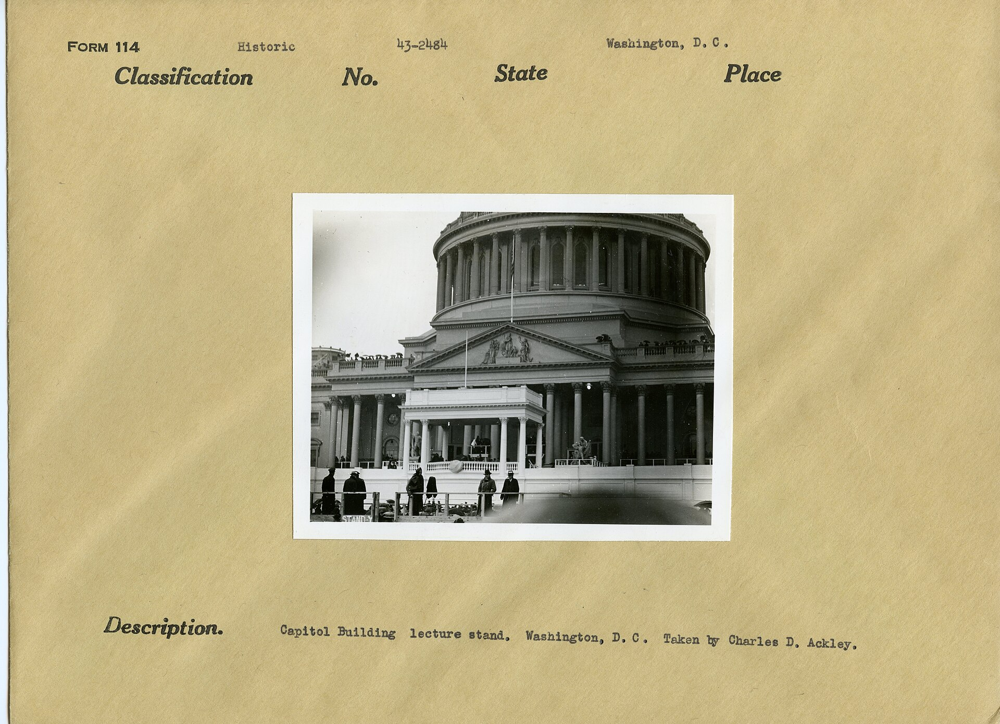
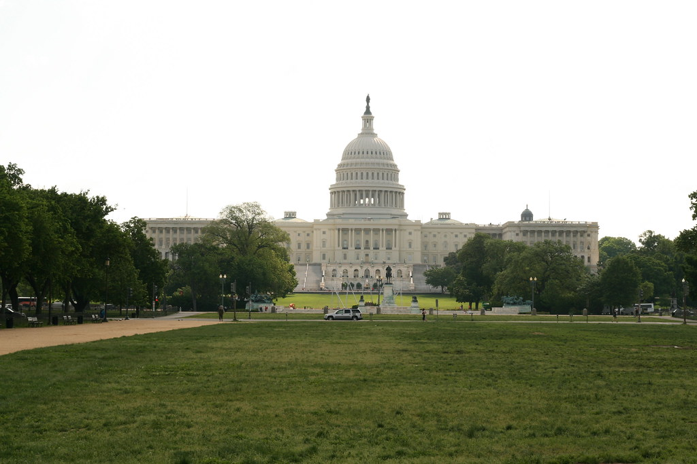
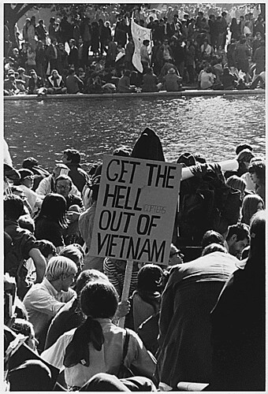

43 years ago today, November 7, 1983. A bomb exploded on the second floor of the United States Capitol, tearing through the corridor right outside the Senate chamber. The late-night explosion shattered an era of open access to the nation's legislative halls.

## Late-Night Phone Calls and a Dire Warning

The evening of November 7, 1983, had proceeded normally on Capitol Hill. The United States Senate concluded its daily business and adjourned at 7:02 p.m. Following adjournment, a well-attended reception took place near the Senate chamber, keeping staff and guests milling through the historic halls for the next two hours.

Shortly before 11:00 p.m., the calm was broken. A recorded telephone message was placed to both the Capitol switchboard and the news desk of The Washington Post. The caller stated that they represented the Armed Resistance Unit, warning that a bomb was set to detonate near the Senate chamber in retaliation for recent U.S. military operations overseas.

## The 10:58 PM Explosion

At 10:58 p.m., the bomb detonated with tremendous force on the second floor of the Capitol's north wing. The device had been concealed underneath a bench placed at the eastern end of the corridor just steps outside the Senate chamber.

Because the reception had ended and the hallways were largely deserted at that late hour, no one was killed or injured. However, the physical concussion tore violently through the surrounding congressional spaces, echoing across Capitol Hill.

*Capitol Building Lecture Stand, Washington, DC - DPLA - adbeddd8b867f7c134cb06e356e7beaa — Photo: Department of Commerce. Bureau of Public Roads. 8/20/1949-4/ / Public domain*

## Shattered Relics and Pulverized Walls

The shock wave caused severe interior devastation. The door leading into Democratic Leader Robert C. Byrd's office was blown completely off its hinges. Senator Byrd had been an outspoken supporter of recent military operations in Grenada and had pressed for responses to attacks on U.S. Marines in Lebanon.

The explosion blasted a hole through a nearby wall partition, showering the Republican cloakroom with crushed brick, plaster, and shattered glass. Wall arches cracked, and glazed tile flooring buckled beneath the blast. A historic grandfather clock that had stood watch by the Senate chamber since 1859 was reduced to wreckage.

Artistic treasures were heavily damaged as well. Six paintings were ripped or scarred, including an iconic portrait of statesman Daniel Webster. Senate members and staff had to collect fragmented pieces from the rubble so that conservators could spend months painstakingly restoring the artwork.

*United States Capitol building — Photo: Bernt Rostad / CC BY 2.0*

## Behind the Attack: Motive and Ideology

The group claiming the blast, the Armed Resistance Unit, was an underground Marxist-Leninist organization operating under the wider May 19th Communist Order, also known as the Resistance Conspiracy. The group claimed responsibility for several bombings of federal and military sites around Washington.

The attack was framed as retaliation against American foreign policy. In October 1983, the United States had invaded Grenada following internal violence and the overthrow of Maurice Bishop's government. Combined with the deployment of American forces to Lebanon, these overseas interventions provoked the radical network to strike directly at the seat of Congress.

*Public Domain: Vietnam War Protest in Washington, D.C. by Frank Wolfe, October 21, 1967 (NARA) — Photo: pingnews.com / Public domain (PDM) 1.0*

## The 1988 Indictments and Federal Response

While the blast caused no structural failure to the Capitol itself, investigators calculated initial damages at roughly 1 million dollars. Law enforcement tracked the clandestine network for nearly five years following the blast.

In May 1988, federal authorities arrested six members of the Resistance Conspiracy. They were formally charged in connection with the Senate explosion, as well as separate bombings that struck Fort McNair in April 1983 and the Washington Navy Yard in April 1984.

## An Era of Open Corridors Comes to an End

Prior to November 1983, visitors, journalists, and staff could walk the halls outside the Senate chamber with relative ease. The bombing brought an abrupt conclusion to that relaxed atmosphere.

In the wake of the explosion, security protocols throughout the Washington metropolitan area were permanently overhauled. Portions of the Senate wing were indefinitely restricted, and strict checkpoints were installed to protect the Capitol's working chambers, forever altering how the American public experienced the Capitol Building.

### Sources

- <https://en.wikipedia.org/wiki/1983_United_States_Senate_bombing>
- <https://commons.wikimedia.org/wiki/File:Capitol_1983_bombing_damage.jpeg>
- <https://commons.wikimedia.org/wiki/File:Capitol_Building_Lecture_Stand,_Washington,_DC_-_DPLA_-_adbeddd8b867f7c134cb06e356e7beaa.jpg>
- <https://www.flickr.com/photos/67975030@N00/3547624867>
- <https://www.flickr.com/photos/39735679@N00/272804879>
