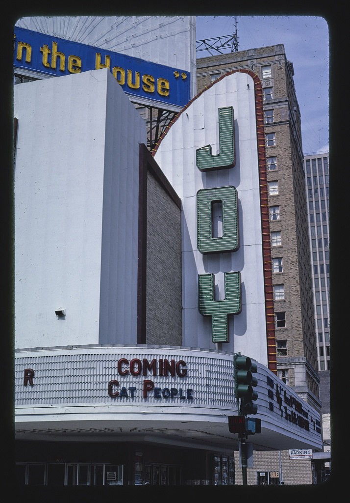
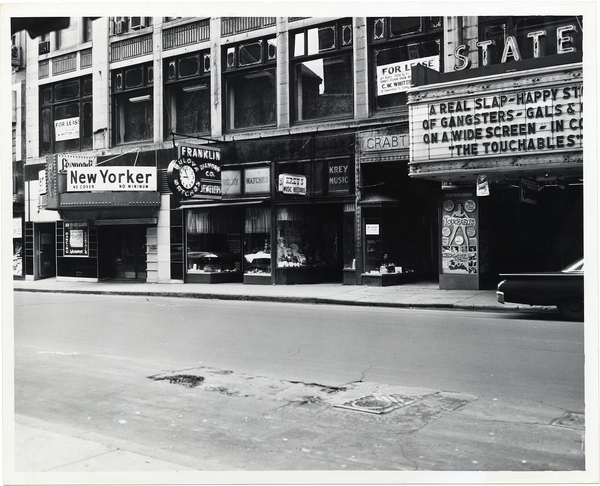

23 years ago today, on November 7, 2003, American movie theaters welcomed the premiere of Elf. Directed by Jon Favreau and starring Will Ferrell in bright yellow tights, the festive family comedy charmed moviegoers nationwide and instantly transformed into an enduring piece of seasonal entertainment.

## Jon Favreau Steps Behind the Camera

Before taking the helm of Elf, Jon Favreau was recognized primarily as an actor and independent filmmaker. Born in Queens, New York, in 1966, Favreau had gained attention performing in improv comedy in Chicago and taking memorable roles in movies like Rudy and PCU. His major breakthrough came as the writer and co-star of the 1996 comedy-drama Swingers alongside Vince Vaughn. Favreau made his feature directorial debut in 2001 with Made, a low-budget crime comedy. Taking on a studio holiday release like Elf represented a major shift in creative scale.

## A Different Kind of Holiday Story

Written by David Berenbaum, Elf presented a delightfully whimsical premise. On one Christmas Eve, a baby at an orphanage crawls into Santa Claus's sack unnoticed and is transported back to Santa's workshop at the North Pole. Named Buddy after the brand of his diaper, the infant is taken in and raised by Papa Elf, played by Bob Newhart. As Buddy grows into a towering adult among small elves, he eventually discovers the truth about his humanity. Santa, portrayed by Ed Asner, reveals that Buddy's biological mother Susan Wells has passed away, while his biological father, Walter Hobbs, is working for a children's book publisher inside the Empire State Building in New York City.

*Rockefeller Center christmas tree — Photo: Lechhansl / CC BY-SA 3.0*

## Bringing Buddy to Manhattan

When Buddy reaches New York, culture shock immediately follows. Dressed in full elf regalia, he encounters his cynical father Walter, played by veteran actor James Caan, who dismisses him as an eccentric messenger. Buddy wanders into a Gimbels department store, falls in love with an employee named Jovie, played by Zooey Deschanel, and later causes chaos when he exposes the store's resident Santa as an imposter. After spending time in jail, a DNA test confirms Walter is indeed Buddy's father, bringing the innocent North Pole resident into the Hobbs family home alongside his stepmother Emily and half-brother Michael.

*Joy Theater marquee, Canal Street, New Orleans, Louisiana (LOC) — Photo: The Library of Congress / Public domain*

## The Climax in Central Park

The film blends slapstick humor with classic holiday sentiment. From a disastrous office meeting involving a short-tempered author named Miles Finch, played by Peter Dinklage, to Buddy wandering off brokenhearted, the plot accelerates toward a snowy climax in Central Park. When Santa's sleigh crashes due to a shortage of global Christmas spirit, Buddy works to repair the vehicle while being pursued by Central Park Rangers. Jovie gathers a crowd to sing Santa Claus Is Comin' to Town, generating enough holiday cheer to power the sleigh into the night sky.

*Street scene of downtown Boston showing the New Yorker Lounge, a Jeweler, and a movie theater marquee (12777786333) — Photo: City of Boston Archives from West Roxbury, United States / CC BY 2.0*

## Box Office Triumph and Cultural Legacy

Produced on a modest budget of 33 million dollars, Elf proved to be a sensational commercial success for New Line Cinema. The film grossed 232.9 million dollars at the global box office and earned glowing critical praise, particularly for Ferrell's exuberant performance as Buddy. The victory established Jon Favreau as a bankable mainstream director, paving the way for him to direct monumental projects including Iron Man in 2008 and The Lion King in 2019.

## An Enduring Tradition for Generations

In the years following its theatrical debut, Elf expanded into a broader cultural brand. It inspired a 2010 Broadway production titled Elf: The Musical, as well as a 2014 stop-motion animated television special, Elf: Buddy's Musical Christmas. Decades after its November 2003 premiere, the story of Buddy finding family and spreading holiday cheer remains an essential seasonal viewing tradition across American households.

### Sources

- <https://en.wikipedia.org/wiki/Jon_Favreau>
- <https://commons.wikimedia.org/wiki/File:6308_New_York_15_USA_1963_(51189585543).jpg>
- <https://commons.wikimedia.org/wiki/File:Rockefeller_Center_christmas_tree.jpg>
- <https://commons.wikimedia.org/wiki/File:Joy_Theater_marquee,_Canal_Street,_New_Orleans,_Louisiana_(LOC).jpg>
- <https://commons.wikimedia.org/wiki/File:Street_scene_of_downtown_Boston_showing_the_New_Yorker_Lounge,_a_Jeweler,_and_a_movie_theater_marquee_(12777786333).jpg>
