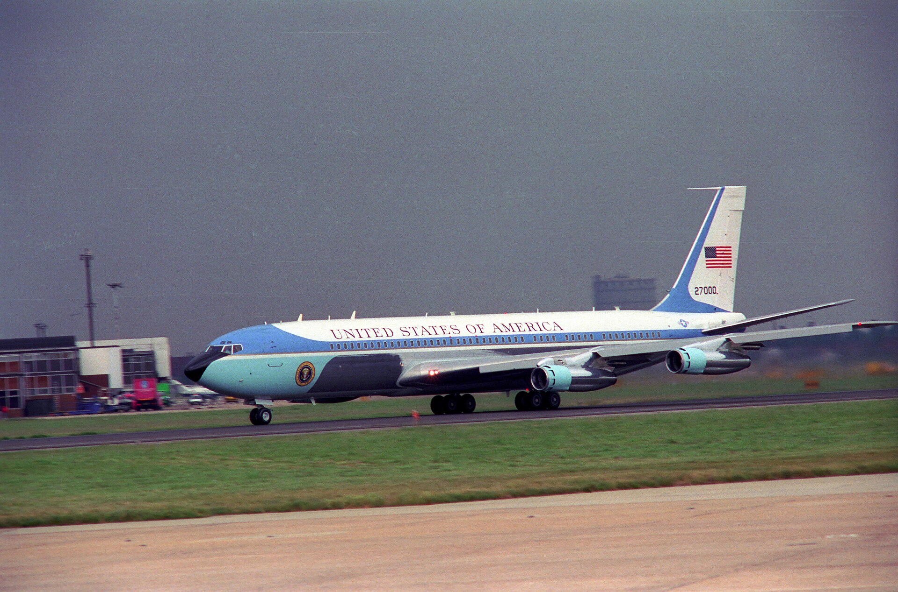
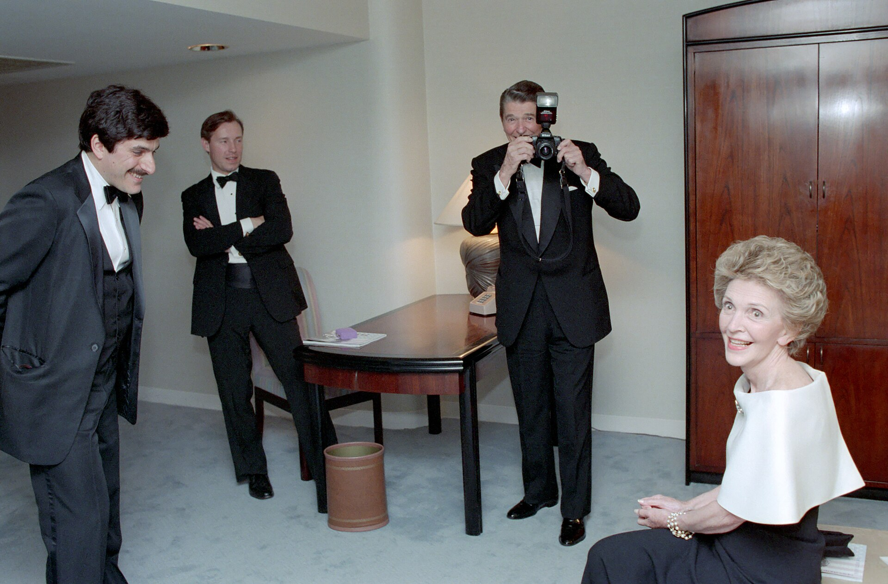
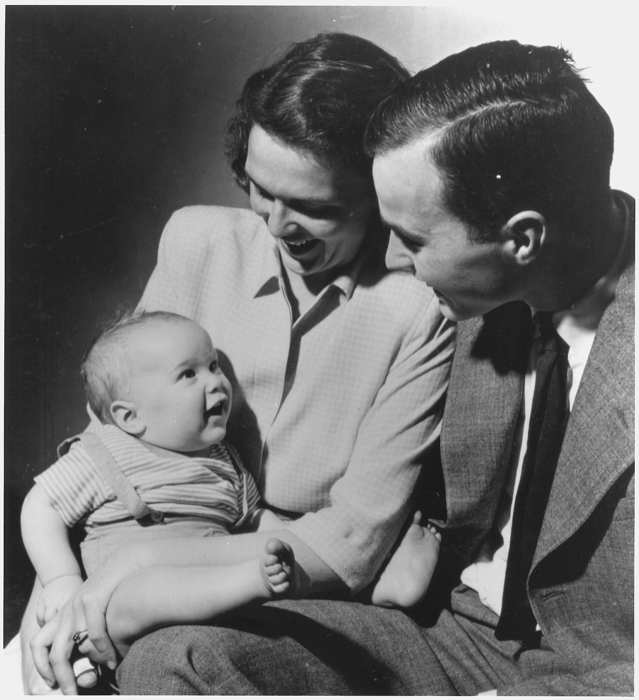

38 years ago today, November 8, 1988, Vice President George H. W. Bush won the United States presidential election, defeating Democratic nominee Michael Dukakis to claim the nation's highest office. The victory secured the Republican Party's third consecutive landslide and made Bush the first sitting vice president to be elected president in more than a century and a half.

## Breaking a 152-Year Historical Drought

Before the 1988 election, American political history had established an unwritten rule: sitting vice presidents simply did not win promotion straight to the Oval Office. The last sitting vice president to accomplish that feat was Martin Van Buren all the way back in 1836. While vice presidents frequently succeeded to the presidency upon the death or resignation of their predecessors under the Tyler Precedent and later the Twenty-fifth Amendment, winning a presidential election while actively serving as second-in-command had eluded generations of political leaders. By carrying the Republican ticket to victory on November 8, Bush broke a 152-year drought that had stood since the Jacksonian era.

## An Open Race to Succeed Ronald Reagan

The 1988 election represented a major political transition for the country. Because incumbent President Ronald Reagan was barred from seeking a third term under the Twenty-second Amendment, the race was the first open-seat presidential contest without an incumbent president on the ballot since 1968. Bush entered the Republican primary season as the clear front-runner, overcoming challenges from Kansas Senator Bob Dole and televangelist Pat Robertson before securing the nomination. To balance the ticket, Bush selected Dan Quayle, a junior senator from Indiana. On the Democratic side, Massachusetts Governor Michael Dukakis emerged victorious from a crowded field after Gary Hart withdrew and Ted Kennedy opted not to run, choosing Texas Senator Lloyd Bentsen as his running mate.

*Air Force One Departing Heathrow Airport in London United Kingdom - DPLA - 41d78b7dd831019e71368f0db8f019eb — Photo: President (1981-1989 : Reagan). White House Photographic Off / Public domain*

## From Polling Deficit to Relentless Campaign

The general election contest did not start smoothly for Bush. In the early stages of the race, Dukakis took a commanding lead in national public opinion polls, campaigning heavily on the economic success of Massachusetts. To erase that gap, Bush launched an aggressive and focused campaign that centered on three pillars: maintaining the strong national economy, reducing crime, and preserving Reagan's popular domestic and foreign policy direction. The Bush campaign effectively framed Dukakis as an elitist Massachusetts liberal who was soft on crime, a characterization that the Democratic nominee struggled to counter. Bush took the lead following the Republican National Convention and cemented his advantage through two strong debate performances.

*Attending The White House News Photographers' Association Dinner President Taking Photograph of Nancy Reagan with Jim Kuhn and Larry Rubenstein at Sheraton Washington Hotel - DPLA - b0eec96774c82c453f31b99912c6a3ca — Photo: President (1981-1989 : Reagan). White House Photographic Off / Public domain*

## A Decisive Verdict on Election Night

When the ballots were counted on November 8, 1988, Bush secured a decisive victory across the country. He captured both the popular vote and the Electoral College by sizable margins, delivering the third consecutive landslide for the Republican Party following Reagan's wins in 1980 and 1984. Exit polling revealed that voters aged 44 and younger, born in 1944 or later, comprised 55 percent of the electorate, marking the first time that Baby Boomers and Generation X formed the majority of the voting public. Even though Dukakis managed to flip nine states that had voted Republican four years earlier—including Massachusetts, New York, Iowa, and Washington—Bush dominated the map nationwide.

*George and Barbara Bush with their first born child George W. Bush, while Bush was a student at Yale — Photo: Unknown authorUnknown author / Public domain*

## A Resume Built on Decades of Public Service

The man elected to lead the country brought one of the most extensive public service resumes in modern American history. A decorated World War II naval aviator who flew 58 combat missions and earned the Distinguished Flying Cross after being shot down over Chichijima, Bush had built a successful oil business with the Zapata Corporation in Texas before entering politics. Over the following decades, he served in the U.S. House of Representatives, worked as Chair of the Republican National Committee, represented the country as Ambassador to the United Nations and envoy to China, and led the Central Intelligence Agency as its director. His election capped eight years as Reagan's vice president and established a political dynasty that later saw his eldest son, George W. Bush, become the nation's 43rd president.

## A High-Water Mark That Still Stands Today

Looking back decades later, the 1988 election remains a singular benchmark in contemporary American electoral history. It stands as the most recent presidential election in which any candidate won more than 400 electoral votes or carried 40 or more states. It also remains the last time an open-seat presidential race produced a decisive landslide of that magnitude. George H. W. Bush's victory on November 8, 1988, was not merely an extension of the Reagan era; it was a rare political milestone that redefined the modern vice presidency as a viable launchpad to the highest office in the land.

### Sources

- <https://en.wikipedia.org/wiki/Vice_President_of_the_United_States>
- <https://commons.wikimedia.org/wiki/File:President_George_H._W._Bush_and_John_Murtha.jpg>
- <https://commons.wikimedia.org/wiki/File:Air_Force_One_Departing_Heathrow_Airport_in_London_United_Kingdom_-_DPLA_-_41d78b7dd831019e71368f0db8f019eb.jpg>
- <https://commons.wikimedia.org/wiki/File:Attending_The_White_House_News_Photographers%27_Association_Dinner_President_Taking_Photograph_of_Nancy_Reagan_with_Jim_Kuhn_and_Larry_Rubenstein_at_Sheraton_Washington_Hotel_-_DPLA_-_b0eec96774c82c453f31b99912c6a3ca.jpg>
- <https://commons.wikimedia.org/wiki/File:George_and_Barbara_Bush_with_their_first_born_child_George_W._Bush,_while_Bush_was_a_student_at_Yale.jpg>
