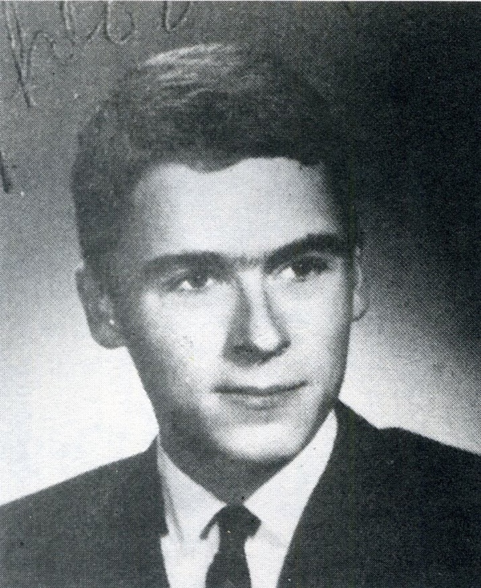
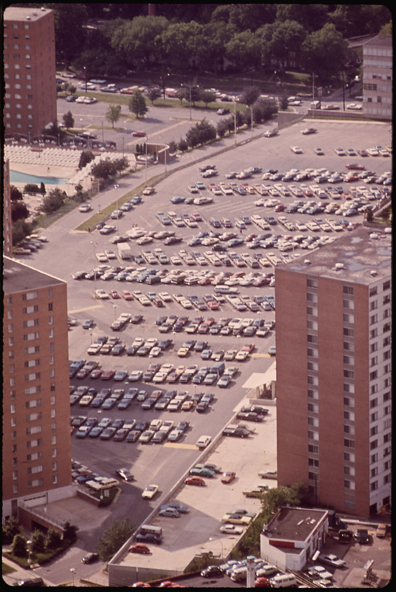

52 years ago today, November 8, 1974, 18-year-old Carol DaRonch fought her way out of Ted Bundy's vehicle in Murray, Utah. Her narrow escape broke the veil of secrecy surrounding one of the most notorious serial killers in American history.

## An Encounter at Fashion Place Mall

On the evening of November 8, 1974, around 7:00 PM, Carol Ann DaRonch was window-shopping inside the Fashion Place Mall in Murray, Utah. DaRonch, born in Salt Lake City in 1956, was an 18-year-old high school graduate working as a telephone operator. She considered herself extremely shy and trusting, traits that predatory criminals often sought out.

While she was browsing the mall, a clean-cut man approached her, introducing himself as Officer Roseland. He told her that someone had attempted to break into her car, a 1974 maroon Camaro parked outside. DaRonch walked out with the man to check her vehicle, which appeared untouched.

## The Ploy of the False Officer

The stranger insisted that DaRonch needed to file an official complaint. He convinced her to accompany him to a police substation located behind a nearby laundromat. When they arrived at the rear building, the door was locked.

The man then told her they would need to drive to the main police station instead. He led DaRonch to his own vehicle, a 1968 Volkswagen Beetle. Trusting the man's claimed authority, DaRonch got into the passenger seat, unaware that she was sitting next to Theodore Robert Bundy, who was operating under aliases like Chris Hagen.

*Ted Bundy HS Yearbook — Photo: Associated students, Woodrow Wilson High School / Public domain*

## A Desperate Fight for Life

Bundy did not head toward the police station. Instead, he drove toward a nearby elementary school and pulled over along the street. Without warning, he grabbed DaRonch's arm and snapped a single handcuff onto her left wrist.

Bundy threatened her with a handgun and raised a crowbar to strike her. Rather than freezing, DaRonch fought back violently inside the tight confines of the Volkswagen Beetle. She managed to force the car door open, tumbled out onto the roadway, and screamed for help.

*Sunset over Murray, Utah — Photo: Ken Lund / CC BY-SA 2.0*

## Rescue on the Road

As DaRonch fled into the street, a passing car approached. Inside were Wilbur and Mary Walsh, who saw the distressed teenager waving them down in the darkness. The couple immediately pulled over and let her into their vehicle to safety.

When the Walshes brought her to safety, the single metal handcuff was still locked to DaRonch's left wrist. This abandoned restraint gave Utah investigators their very first piece of tangible physical evidence connected to Bundy's crimes.

*SUBURBAN HIGH RISE APARTMENT PARKING FACILITY - NARA - 546715 — Photo: Yoichi Okamoto / Public domain*

## The Courtroom Confrontations

In October 1975, Bundy was stopped and arrested in Utah for a traffic violation. Police organized an in-person lineup, and DaRonch positively identified him as the man who posed as Officer Roseland. In February 1976, she stood as the key prosecution witness at his trial for aggravated kidnapping.

Defense attorney John O'Connell subjected her to aggressive cross-examination over details of the car and the badge. DaRonch held her ground without wavering, famously stating in court that she would never forget his face. Bundy was convicted of aggravated kidnapping and sentenced to 1 to 15 years in prison.

Later, DaRonch traveled to Aspen, Colorado, to testify during Bundy's trial for the murder of Caryn Campbell, where Bundy acted as his own attorney and cross-examined her directly. She took the witness stand once more in 1979 during his pre-sentencing hearing in Miami.

## A Legacy of Courage and Survival

Following the grueling trials, DaRonch chose to step back from the spotlight and pursue a private life. She took night classes in business management at the University of Utah, later marrying and raising a family in Utah with her husband Michael and their son Levi.

Her remarkable survival remains a turning point in modern American true-crime history. Portrayed in television and film projects—including the 1986 series The Deliberate Stranger and the 2019 documentary Conversations with a Killer: The Ted Bundy Tapes—her quick instincts on a November evening in 1974 halted an unchecked predator and provided the crucial breakthrough law enforcement needed.

### Sources

- <https://en.wikipedia.org/wiki/Salt_Lake_City>
- <https://commons.wikimedia.org/wiki/File:Donna_Manson_Ted_Bundy_New_York_Daily_News_September_8_1974.png>
- <https://commons.wikimedia.org/wiki/File:Ted_Bundy_HS_Yearbook.jpeg>
- <https://www.flickr.com/photos/75683070@N00/68885784>
- <https://commons.wikimedia.org/wiki/File:SUBURBAN_HIGH_RISE_APARTMENT_PARKING_FACILITY_-_NARA_-_546715.jpg>
