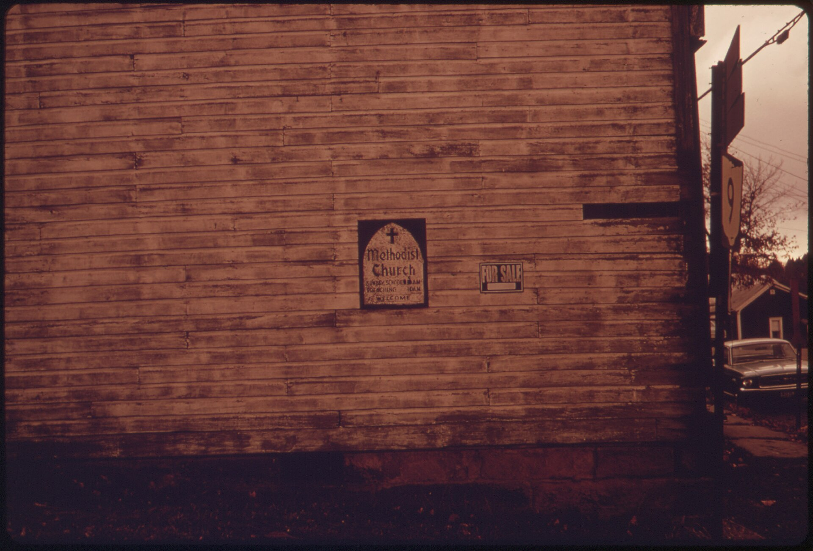
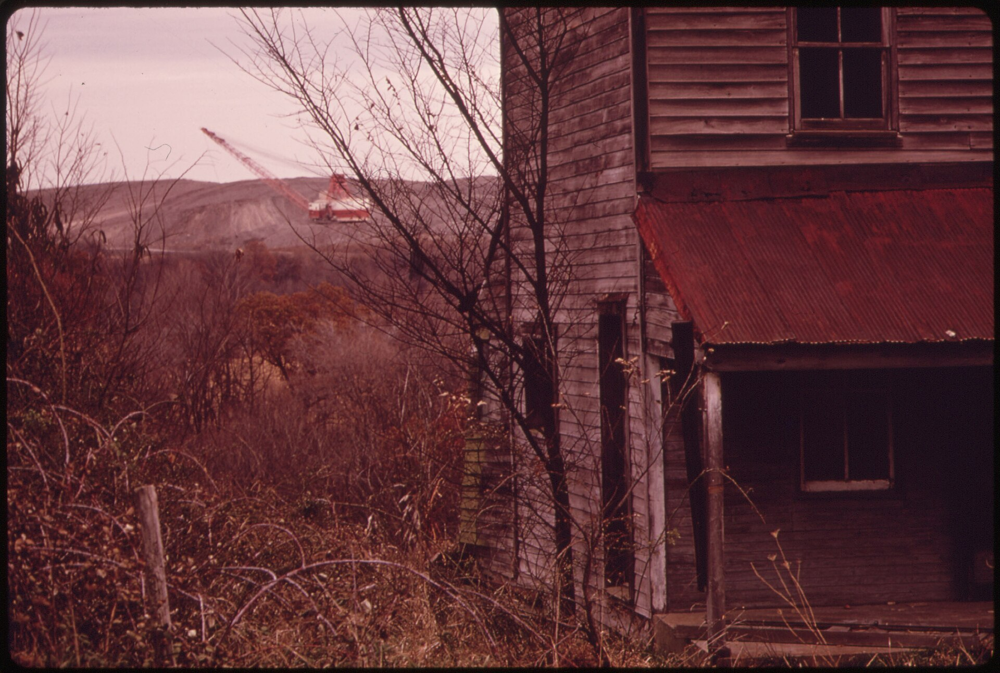
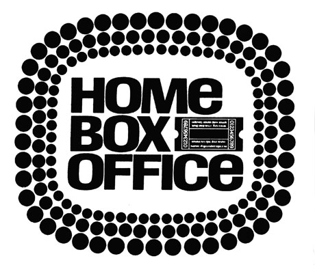

54 years ago today, November 8, 1972, a fledgling service called Home Box Office made its debut on cable television. That single launch established the blueprint for modern subscription television and fundamentally altered how audiences experienced entertainment in their homes.

## An Idea Hatched at Sea

In the early 1970s, cable executive Charles Dolan faced a serious business challenge. Through his firm, Sterling Information Services, Dolan ran Sterling Manhattan Cable Television, an underground urban cable franchise serving an Upper Manhattan territory between 79th Street and 86th Street. While Manhattan Cable was notable for being the first urban underground cable system in the United States, high operational expenses were producing ongoing financial deficits.

During the summer of 1971, while traveling with his family to France aboard the ocean liner Queen Elizabeth 2, Dolan conceived a novel plan to reverse those losses. He envisioned distributing a specialized entertainment channel directly to cable systems. Instead of relying on commercial sponsors, the channel would be supported entirely by monthly subscription fees paid directly by individual viewers.

## The Birth of the Premium Model

On November 8, 1972, Dolan's concept became reality under the name Home Box Office. HBO debuted as the country's first cable-originated television content service and the conceptual blueprint for what the industry would term the 'premium channel.' Unlike broadcast networks, which depended on advertisers and carriage fees, HBO relied almost exclusively on monthly subscriber revenue.

This business structure freed the network from the traditional content restrictions imposed by commercial advertisers. Because sponsors were not in the picture, HBO was able to deliver full-length theatrical films without commercials and without editing for mature content, time constraints, or profanity. For viewers who had spent decades tolerating commercial breaks and censored movie broadcasts, the uncut format represented an unprecedented home viewing experience.

*Archive, 1972 — Photo: The U.S. National Archives / Public domain*

## From Regional Microwave to Satellite Pioneer

In its earliest days, HBO was a regional service. The channel relied on microwave transmission towers to distribute its signal to cable systems and multipoint distribution service providers located across the northern Mid-Atlantic and southern New England regions. The programming slate featured theatrically released motion pictures, concert performances, and live athletic events, including professional basketball and hockey games.

Everything changed dramatically in September 1975. HBO made history by becoming the very first television channel in the world to transmit its signal via satellite. By leasing transponder space on a communications satellite, the network broke free of regional microwave limitations. Cable operators across the entire United States could now install satellite dish receivers and offer HBO directly to their local subscribers, transforming the regional channel into a truly national television network.

*Archive, 1972 — Photo: The U.S. National Archives / Public domain*

## Championship Sports and Big-Screen Hits

Sports played a crucial role in building HBO's early reputation. During its formative years, the network carried games from the National Basketball Association, the American Basketball Association, and the National Hockey League. From 1975 through 1999, HBO broadcast live coverage of the prestigious Wimbledon tennis tournament. It also built a legendary reputation around championship boxing coverage, drawing sports enthusiasts who were willing to pay extra for premier matchups.

Complementing its sports schedule, HBO acquired broadcast licensing deals with major movie distributors. In addition to primary feature films, the network broadcast sub-runs and library titles, while also offering comedy specials, documentaries, and interstitial behind-the-scenes programs between scheduled movies.

*Archive, 1972 — Photo: WarnerMedia / CC BY-SA 4.0*

## Multiplexing and Award-Winning Original Series

As subscriber numbers expanded, the network continued to innovate. In August 1991, HBO and its sister network Cinemax became the first American pay television services to introduce multiplexed channels. Instead of offering only a single linear channel, subscribers received companion channels organized around different schedules, genres, and audience tastes at no additional charge.

Over time, HBO expanded beyond licensed Hollywood movies into ambitious original series. Supported by higher production budgets and leniency in content standards, the network produced groundbreaking, critically acclaimed dramas and comedies such as The Sopranos, Sex and the City, Curb Your Enthusiasm, and Game of Thrones. These high-budget productions set a new standard for quality television and earned widespread critical acclaim and major television awards.

## A Enduring Global Legacy

By September 2018, HBO's programming was available to approximately 35.656 million American households with multichannel television subscriptions, maintaining the largest subscriber base of any premium channel in the United States. Beyond the domestic market, HBO distributed its programming across at least 151 countries to an estimated 140 million cumulative subscribers worldwide.

Today, HBO operates multiple 24-hour linear multiplex channels, on-demand platforms, and streaming feeds under Home Box Office, Inc. More than five decades after Charles Dolan's journey across the Atlantic, the concept launched on a cold November day in 1972 continues to define the landscape of subscription television around the globe.

### Sources

- <https://en.wikipedia.org/wiki/HBO>
- <https://commons.wikimedia.org/wiki/File:The_1972_Agnes_flood_at_Wilkes-Barre,_PA.jpg>
- <https://commons.wikimedia.org/wiki/File:As_the_Population_Moves_from_Stripped_Areas_in_Southeastern_Ohio,_Some_Towns_Are_Slowly_Abandoned._This_Building,_at_the_Intersection_of_Routes_9_and_519_Is_for_Sale._10-1973_(3769861308).jpg>
- <https://commons.wikimedia.org/wiki/File:An_Abandoned_House_in_the_Foreground,_an_Ohio_Power_Company_Shovel_in_the_Background._By_Knocking_Out_Windows_and_Doors,_the_Building_Is_Taxed_at_A_Lower_Rate._Off_Route_146._10-1973_(3769868122).jpg>
- <https://commons.wikimedia.org/wiki/File:HBO_1972.jpg>
