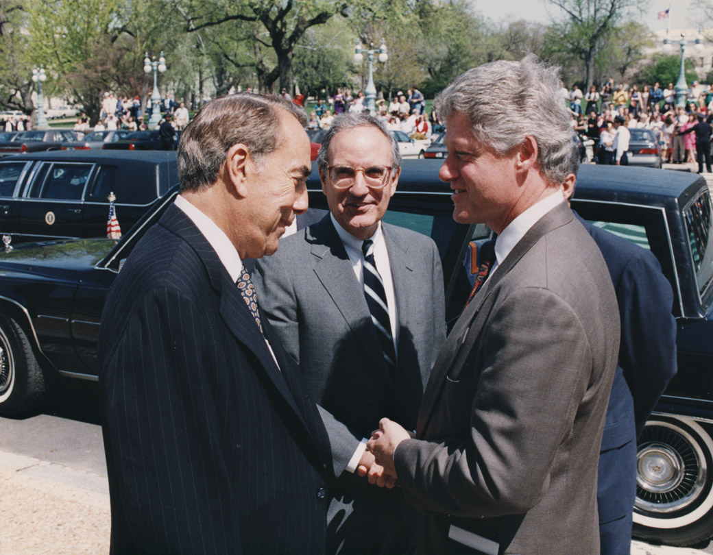
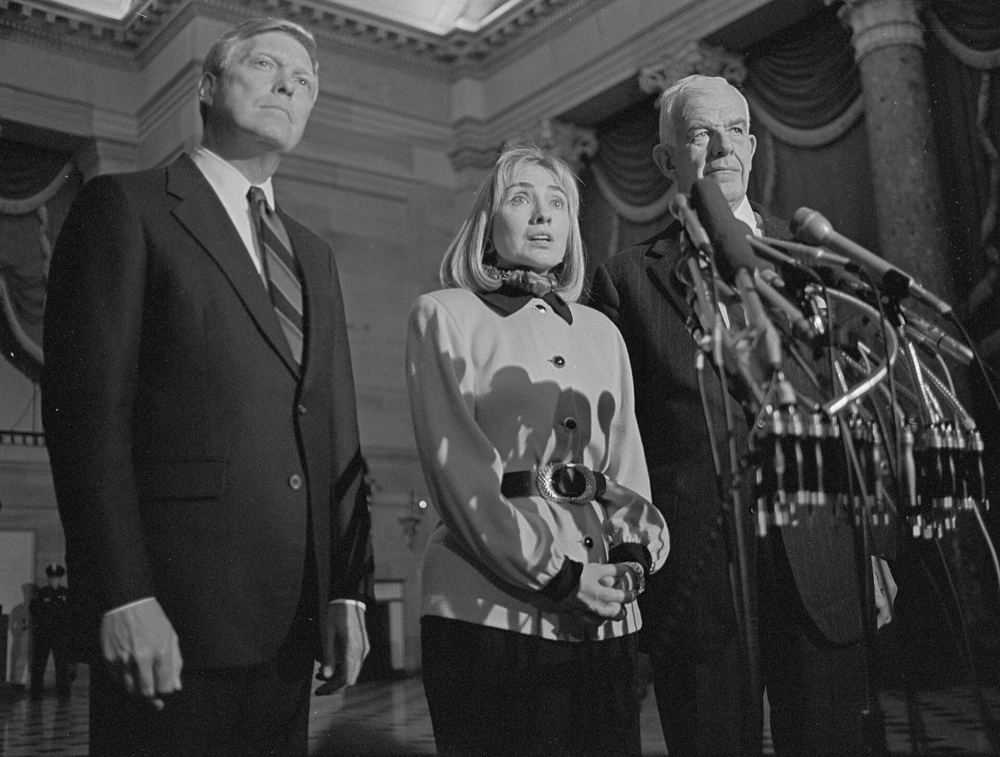

32 years ago today, on November 8, 1994, American politics underwent one of the most dramatic upheavals in modern history. In the midterm elections of President Bill Clinton's first term, the Republican Party captured decisive majorities in both chambers of Congress. Known as the Republican Revolution, or the Revolution of '94, the historic landslide swept away four decades of Democratic dominance in the House of Representatives and fundamentally transformed the balance of power in Washington.

## Four Decades of Democratic Dominance

Heading into the autumn of 1994, the Democratic Party had maintained unbroken control of the House of Representatives for 40 years, dating back to the 83rd Congress elected in 1952. Between 1933 and 1995, Republicans had controlled both the House and the Senate for a combined total of only four years. Across the American South, a long-standing coalition of conservative Democrats, often referred to as boll weevil Democrats, had worked alongside northern colleagues to ensure committee chairmanships and congressional gavels stayed firmly in Democratic hands.

For generations of voters, Democratic control on Capitol Hill felt like a permanent fixture of American governance. Despite Republican presidential triumphs under Dwight D. Eisenhower and Ronald Reagan, congressional majorities remained elusive. By 1994, however, national political headwinds were shifting rapidly against the Clinton administration. Voter dissatisfaction was mounting over federal spending and Clinton's failed health care plan, creating an opening that Republican strategists had waited decades to exploit.

## A Unified Platform: The Contract with America

Rather than allowing Republican candidates to wage separate, localized campaigns in individual congressional districts, Georgia congressman and House Minority Whip Newt Gingrich orchestrated an unprecedented national strategy. Alongside Republican leaders including Richard Armey, Tom DeLay, John Boehner, Robert Walker, Bill Paxon, Jim Nussle, and policy analyst Larry Hunter, Gingrich authored a detailed legislative agenda known as the Contract with America.

The document outlined specific conservative measures that Republicans promised to bring to an immediate vote if they captured the majority. The campaign aggressively nationalized congressional races, accusing President Clinton of failing to govern as a New Democrat and painting Democratic leaders as tax-and-spend liberals. Discontent had already manifested in earlier municipal and state contests, including Republican mayoral victories in New York and Los Angeles in 1993, as well as gubernatorial victories in New Jersey and Virginia, signaling that a broader political shift was underway.

*Bob Dole and Bill Clinton conversing — Photo: Robert and Elizabeth Dole Archive and Special Collections / Public domain*

## A Historic Sweep on Election Night

When ballots were tallied on November 8, 1994, the magnitude of the Republican victory astonished political analysts. Republicans carried the national popular vote for the House of Representatives by a decisive margin of 6.8 percentage points. In total, the GOP achieved a net gain of 54 seats in the House and picked up 8 seats in the Senate, capturing unified control of both houses of Congress for the first time since 1952.

The election marked the first midterm since 1946 in which Republicans flipped both chambers under a Democratic president, and the first midterm since 1954 where any party broke a unified government trifecta. In the Senate, Republicans defended every seat they held and secured open seats across Arizona, Maine, Michigan, Ohio, Oklahoma, and Tennessee. In Pennsylvania, Democratic incumbent Harris Wofford was defeated, while in Tennessee, incumbent Jim Sasser lost his seat alongside a special election victory to replace Al Gore, turning the state's Senate delegation entirely Republican.

*First Lady Hillary Clinton, Speaker of the House Tom Foley, and House Majority Leader Richard Gephardt speak at a press conference at the U.S. Capitol (cropped) — Photo: Laura Patterson / Public domain*

## The Fall of Long-Serving House Leaders

The scale of the turnover was made clear by the defeat of some of the most influential Democratic figures in Congress. The incumbent Speaker of the House, Democrat Tom Foley of Washington state, was defeated in his re-election bid. Foley became the first sitting Speaker to lose re-election in his home district since Galusha Grow was unseated in 1863 during the Civil War.

Other long-serving titans of Capitol Hill fell in rapid succession. Dan Rostenkowski of Illinois, the powerful chairman of the House Ways and Means Committee, lost his seat to a Republican challenger. Jack Brooks of Texas, the veteran chairman of the House Judiciary Committee, was also unseated. The wave ushered an unprecedented class of new lawmakers into Washington, with nearly one-third of the 230 House Republicans in the incoming 104th Congress serving as first-term freshmen.

*Bob Dole at Fort Riley 1990 — Photo: US Army / Public domain*

## Realignment in the South and Statehouses

The 1994 election accelerated a fundamental realignment in American politics, particularly throughout the South. Republicans picked up 19 Southern House seats, securing a majority of Southern congressional districts for the first time since Reconstruction. This seismic shift brought an end to the historic conservative coalition that had influenced legislative battles since the New Deal era.

The shift quickly echoed across party lines in the Senate. On November 9, 1994, the day after the election, conservative Alabama Democrat Richard Shelby switched parties to become a Republican. On March 3, 1995, Colorado Senator Ben Nighthorse Campbell crossed the aisle as well, expanding the Republican Senate majority from 52-48 to 54-46. State governments witnessed a similar transformation, as the GOP picked up 12 governorships—including George W. Bush's victory in Texas—and gained control of 20 state legislative chambers, capturing a majority of state legislatures for the first time in 50 years.

## The Lasting Impact of the 104th Congress

When the 104th Congress convened in January 1995, House Republicans elected Newt Gingrich as Speaker of the House, while Bob Dole assumed leadership of the Senate as Majority Leader. The newly empowered Republican majorities advanced an ambitious conservative agenda, eventually passing major legislation such as the Personal Responsibility and Work Opportunity Act, the Telecommunications Act of 1996, and the Defense of Marriage Act.

While President Clinton used his veto power to force budgetary and policy compromises, the 1994 elections permanently altered the dynamics of governance in Washington. Divided government became a regular reality, and the nationalized campaign playbook introduced by the Contract with America reshaped how modern congressional elections are contested nationwide.

### Sources

- <https://en.wikipedia.org/wiki/Republican_Revolution>
- <https://commons.wikimedia.org/wiki/File:Terry_Everett_with_Bill_Clinton_and_Bob_Dole.jpg>
- <https://commons.wikimedia.org/wiki/File:Bob_Dole_and_Bill_Clinton_conversing.jpg>
- <https://commons.wikimedia.org/wiki/File:First_Lady_Hillary_Clinton,_Speaker_of_the_House_Tom_Foley,_and_House_Majority_Leader_Richard_Gephardt_speak_at_a_press_conference_at_the_U.S._Capitol_(cropped).jpg>
- <https://commons.wikimedia.org/wiki/File:Bob_Dole_at_Fort_Riley_1990.jpg>
