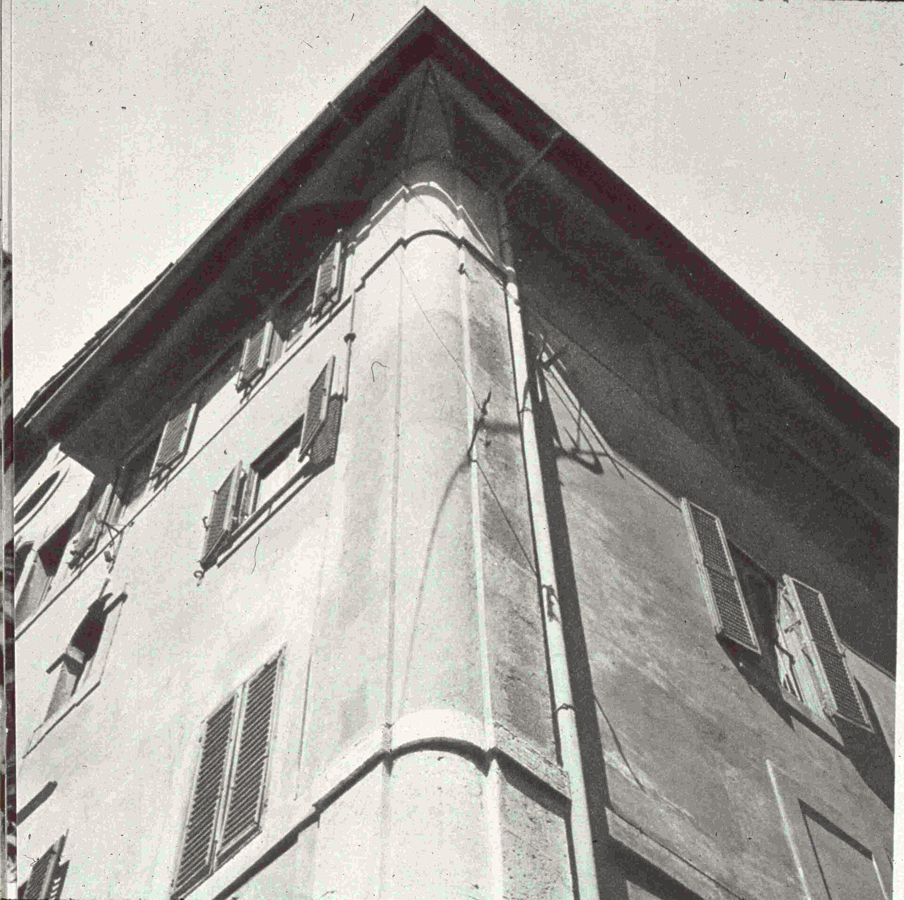
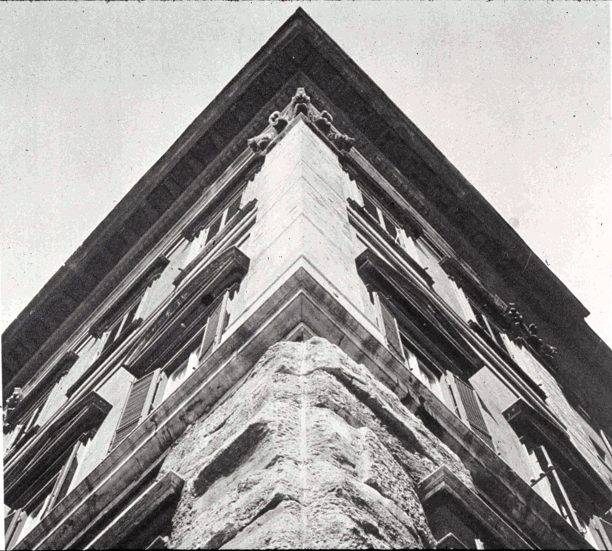
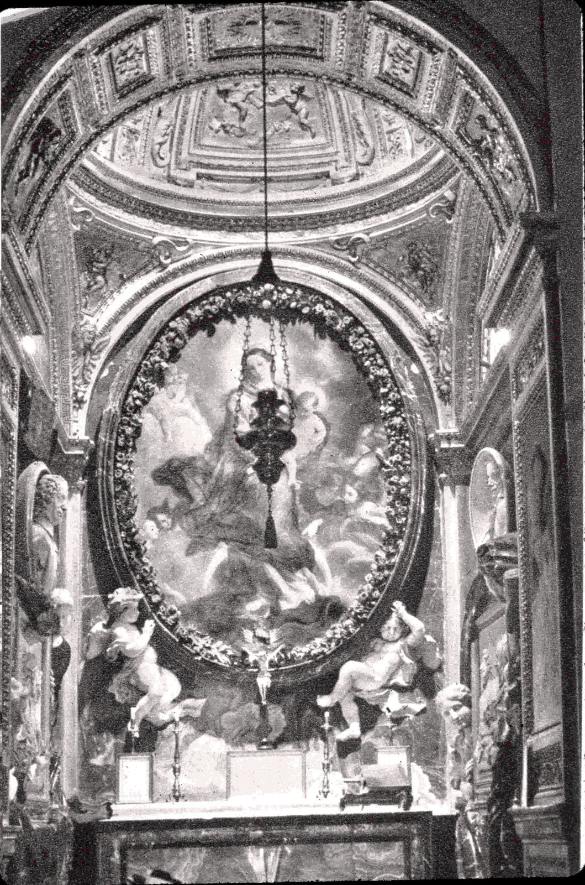

53 years ago today, November 8, 1973, an envelope arrived at the offices of an Italian daily newspaper. Inside lay a horrifying message: a lock of reddish hair, a ransom letter, and the severed right ear of 16-year-old American heir John Paul Getty III. It was the terrifying climax of a four-month kidnapping drama that pitted ruthless mobsters against the richest and most stubborn patriarch on earth.

## The Disappearance in Rome

In the early morning hours of July 10, 1973, 16-year-old John Paul Getty III was walking through the Piazza Farnese in Rome. Living a bohemian lifestyle in Italy, the teenager earned modest money selling paintings, making jewelry, and working as a movie extra. Suddenly, operatives from the 'Ndrangheta, a ruthless organized crime syndicate based in Calabria, seized the boy, blindfolded him, and transported him southward into the rugged mountains of southern Italy. He was chained inside a remote cave, completely cut off from the outside world.

## A Billionaire's Cold Calculation

Shortly after the abduction, the kidnappers issued an exorbitant demand: 17 million dollars for the teenager's safe return. Paul's father, John Paul Getty Jr., did not have access to that kind of fortune and immediately appealed to the family patriarch, J. Paul Getty. The elder Getty had amassed an unimaginable oil empire and was widely recognized as the wealthiest private citizen in the world. Yet his response shocked the public. The oil baron flatly refused to pay a single dollar. He publicly insisted that he had 14 grandchildren in total, and that capitulating to kidnappers would instantly put bounties on the heads of the other 13. Furthermore, relatives and investigators initially suspected that the rebellious youth had staged his own abduction as a reckless stunt to extract cash from his notoriously frugal grandfather.

*Angolo del Convento di S. Marcello, 1970 - Archivio Accademia delle Scienze Torino, Millon 64 05 073 — Photo: Henry A. Millon / Public domain*

## Ordeal in the Calabrian Cave

While the Getty family remained skeptical and deadlocked, Paul was subjected to increasingly brutal conditions in captivity. His kidnappers confiscated his small radio, killed a pet bird he had befriended, and subjected him to psychological torture by spinning the cylinder in games of Russian roulette against his skull. The situation deteriorated further when an Italian postal strike delayed letters sent by the syndicate, leading the frustrated criminals to believe they were being intentionally ignored. In November, as winter set in and the boy's captors grew desperate, they took a knife and sliced off his right ear.

*Angolo di palazzo Montecitorio, 1970 - Archivio Accademia delle Scienze Torino, Millon 64 05 072 — Photo: Henry A. Millon / Public domain*

## The Grisly Package Arrives

The delivery to a Rome newspaper on November 8, 1973, erased all doubt about the legitimacy of the abduction. Along with the severed ear and hair, the accompanying letter issued an ultimatum: pay 3.2 million dollars within ten days, or the teenager would arrive home in little bits. The wound soon turned septic, and Paul developed pneumonia while locked away in the damp cave. Alarmed that their leverage might die, the kidnappers administered massive doses of penicillin to keep him alive, inadvertently triggering a severe allergic reaction that further weakened his body.

*Cappella de Silva in S. Isidoro, 1970 - Archivio Accademia delle Scienze Torino, Millon 64 05 056 — Photo: Henry A. Millon / Public domain*

## The Tax-Deductible Bargain and Release

Confronted by photographic and physical evidence of his grandson's mutilation, J. Paul Getty finally agreed to negotiate, but on characteristically ruthless financial terms. He settled on a final ransom of roughly 2.9 million dollars. Of that sum, the billionaire patriarch provided 2.2 million dollars out of his own pocket—because that was the exact ceiling permitted as a tax deduction under United States law. He lent the remaining balance to his distraught son, charging an annual interest rate of four percent. Once the money was delivered, the captors abandoned the teenager. On December 15, 1973, a truck driver spotted Paul shivering at a desolate petrol station in Lauria, in the province of Potenza.

## A Lifetime of Scars

After being rescued, Paul's mother urged him to call his grandfather to express his gratitude for paying the ransom. J. Paul Getty refused to come to the phone. Italian authorities eventually arrested nine suspects, but only two lower-level accomplices were convicted; the mob bosses were acquitted for lack of evidence, and nearly all the cash disappeared. Though Paul underwent plastic surgery in 1977 to reconstruct his ear, the psychological damage proved permanent. Battling deep depression and substance abuse, he suffered an overdose-induced stroke in 1981 at age 25 that left him paralyzed and partially blind until his death in 2011. The 1973 ordeal remains one of the darkest chapters in American family history, an enduring reminder of how extreme wealth and cold calculation collided with unimaginable tragedy.

### Sources

- <https://en.wikipedia.org/wiki/John_Paul_Getty_III>
- <https://commons.wikimedia.org/wiki/File:Angelo_nella_Cappella_Cornaro_in_S.M._della_Vittoria,_1970_-_Archivio_Accademia_delle_Scienze_Torino,_Millon_64_05_043.jpg>
- <https://commons.wikimedia.org/wiki/File:Angolo_del_Convento_di_S._Marcello,_1970_-_Archivio_Accademia_delle_Scienze_Torino,_Millon_64_05_073.jpg>
- <https://commons.wikimedia.org/wiki/File:Angolo_di_palazzo_Montecitorio,_1970_-_Archivio_Accademia_delle_Scienze_Torino,_Millon_64_05_072.jpg>
- <https://commons.wikimedia.org/wiki/File:Cappella_de_Silva_in_S._Isidoro,_1970_-_Archivio_Accademia_delle_Scienze_Torino,_Millon_64_05_056.jpg>
