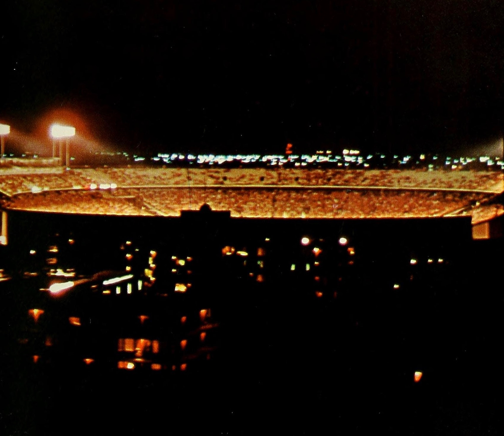
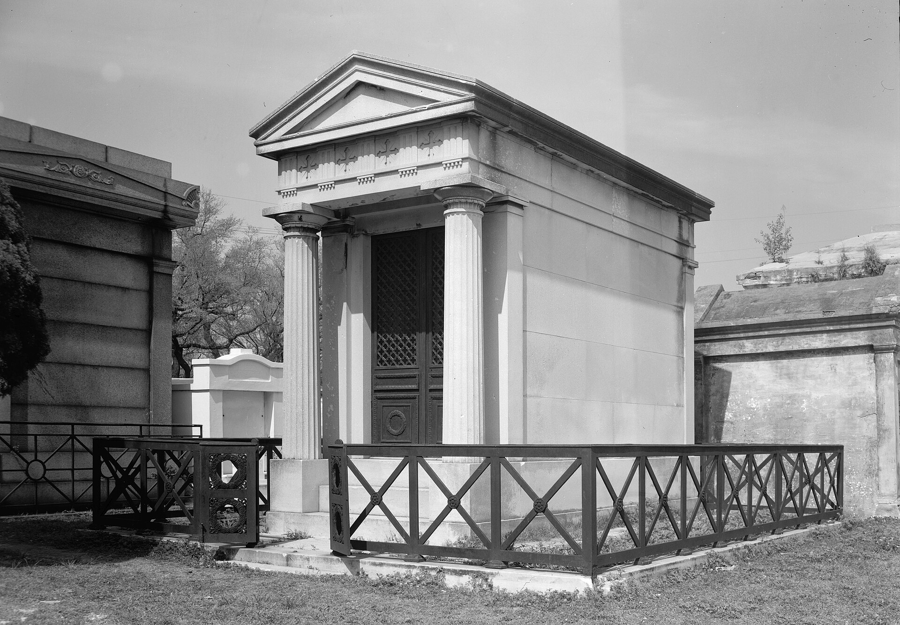
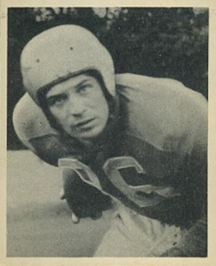

56 years ago today, November 8, 1970, placekicker Tom Dempsey stepped onto the field at Tulane Stadium and kicked a historic 63-yard field goal to lift the New Orleans Saints to a 19–17 victory over the Detroit Lions. At a time when kicks beyond fifty yards were extraordinary rarities, Dempsey's booming kick astonished football fans across the nation and etched his name forever into sports lore.

## Overcoming Physical Odds with a Custom Shoe

Thomas John Dempsey was born on January 12, 1947, in Milwaukee, Wisconsin, and grew up attending school in Southern California. From birth, Dempsey lacked toes on his right foot and fingers on his right hand. Undeterred by physical challenges, he pursued football and developed an effective kicking technique using the traditional straight-toe style rather than the emerging soccer-style approach.

To accommodate his right foot, Dempsey wore a specially modified shoe featuring a flattened, enlarged toe surface without a standard toe box. The custom shoe cost $200 to manufacture. In later years, critics and opponents occasionally questioned whether the flat surface gave him an unfair mechanical advantage. Dempsey dismissed such claims with his characteristic humor, asking reporters how easy they thought it was to boot a winning kick with a square shoe and no toes. Later scientific evaluations confirmed that the specialized footwear provided him no competitive advantage.

## A Struggling Franchise at Tulane Stadium

The New Orleans Saints were in the middle of a very difficult era when the 1970 season took place. Founded on November 1, 1966, by John W. Mecom Jr., David Dixon, and the city of New Orleans, the franchise joined the NFL as an expansion club in 1967. During their inaugural game on September 17, 1967, wide receiver John Gilliam returned the opening kickoff 94 yards for a touchdown before over 80,000 spectators at Tulane Stadium, but the team lost 27–13 and finished 3–11.

By 1970, the Saints were still searching for consistency and would endure twenty consecutive seasons without a winning record. Their home games were played at Tulane Stadium, where they remained for eight seasons before moving to the Superdome in 1975. In the 1970 campaign, New Orleans would manage to win only two games all year, making any moment of triumph desperately needed by the local fans.

*NOT FROM THE EVENT · 1966 — Photo: Uncredited for the Jambalaya / Public domain*

## The Dramatic Final Seconds Against Detroit

On November 8, 1970, the Saints hosted the Detroit Lions at Tulane Stadium in New Orleans. As the final seconds ticked away, the Saints found themselves trailing 17 points to Detroit, needing points on the final play to avoid another defeat.

With just two seconds remaining on the clock, Saints coach Tom Fears sent Dempsey out onto the field. The previous NFL record for the longest field goal was 56 yards, kicked by Bert Rechichar in 1953. Dempsey was lining up seven yards deeper than Rechichar's mark. Prior to 1974, NFL goal posts were positioned right on the goal lines rather than the end lines, meaning a kick attempted from the Saints' own 37-yard line would measure exactly 63 yards.

The snap from center Jackie Burkett was clean, and holder Joe Scarpati placed the football securely on the 37-yard line. Dempsey stepped forward and drove his modified right shoe into the ball. The football traveled high and straight through the New Orleans air, just barely clearing the crossbar as time expired to give the Saints a 19–17 victory.

*DuplantierTombStLouisCem2NOLADanLeyrer — Photo: http://loc.gov/pictures/item/LA0051/ / Public domain*

## A Longstanding Record and League Reactions

Dempsey's 63-yard kick immediately became one of the most famous plays in professional football history. It shattered the previous record by seven full yards and remained untouched for decades. The record was tied three times: first by Jason Elam of the Denver Broncos in 1998, then by Sebastian Janikowski of the Oakland Raiders in 2011, and by David Akers of the San Francisco 49ers in 2012. It was finally broken on December 8, 2013, when Denver's Matt Prater kicked a 64-yard field goal, one yard farther than Dempsey.

The kick also prompted the NFL to reconsider its rules. In 1974, the league voted to move the goal posts from the goal line to the back of the end zone, adding ten yards of distance to every field goal attempt. Later, in 1977, the league adopted what became known as the Tom Dempsey Rule, mandating that any shoe worn by a player with an artificial limb or modified foot structure must conform to the kicking surface of a standard shoe.

*Paul Sarringhaus - 1948 Bowman — Photo: Bowman / Public domain*

## Remembering Dempsey's Enduring Legacy

Because the league moved the goal posts to the back of the end zone in 1974, Tom Dempsey remains the only kicker in NFL history to successfully make a field goal from beyond his own team's 40-yard line. That geometric feat can almost certainly never be matched under modern field configurations.

Dempsey retired from professional football after stints with several teams, including the Philadelphia Eagles, Los Angeles Rams, Houston Oilers, and Buffalo Bills. In 1983, he was inducted into the American Football Association's Semi-Pro Football Hall of Fame. He later settled in Metairie, Louisiana, with his wife Carlene, who taught history at Kehoe-France school, and their three children, including daughter Ashley. Though his home was flooded during Hurricane Katrina in 2005 and he faced health challenges before passing away on April 4, 2020, his 63-yard miracle at Tulane Stadium remains an unforgettable symbol of perseverance against all odds.

### Sources

- <https://en.wikipedia.org/wiki/National_Football_League>
- <https://commons.wikimedia.org/wiki/File:Tulane_Stadium_seen_from_campus_-_Jambaya_1967_-_Day.jpg>
- <https://commons.wikimedia.org/wiki/File:Tulane_Stadium_seen_from_campus_-_Jambaya_1967_-_Night.jpg>
- <https://commons.wikimedia.org/wiki/File:DuplantierTombStLouisCem2NOLADanLeyrer.jpg>
- <https://commons.wikimedia.org/wiki/File:Paul_Sarringhaus_-_1948_Bowman.jpg>
