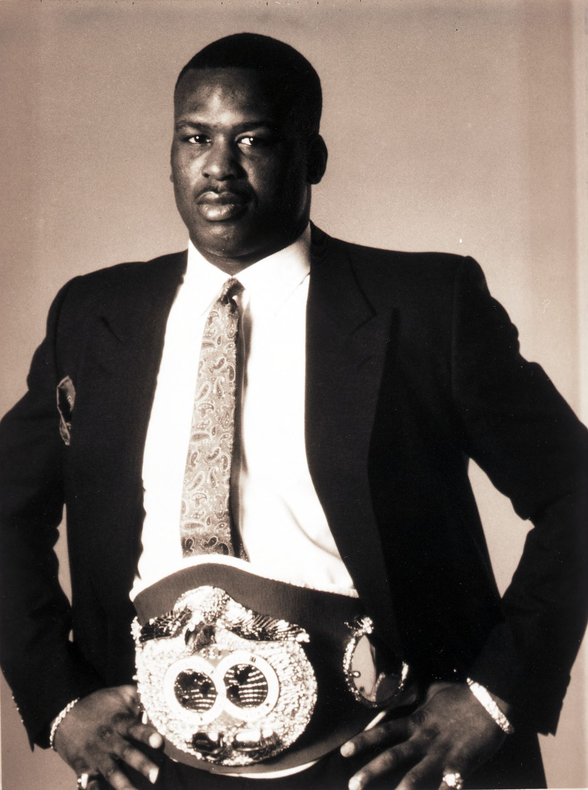
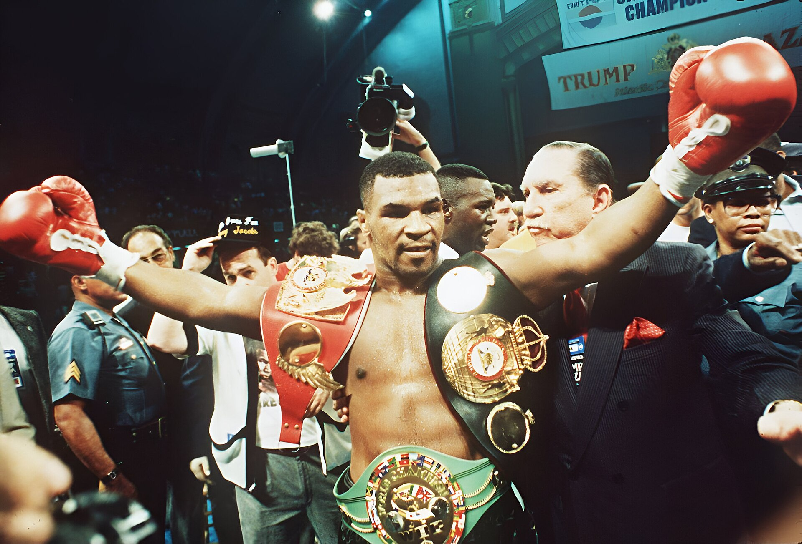
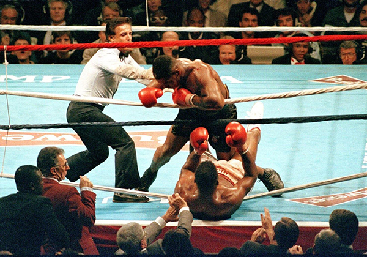

30 years ago today, November 9, 1996. Evander Holyfield stunned the sports world by defeating Mike Tyson in the 11th round to capture the World Boxing Association heavyweight championship. The victory shattered public expectations and restored Holyfield to the very summit of professional boxing.

## From Humble Beginnings to Undisputed Champion

Evander Holyfield was born on October 19, 1962, in Atmore, Alabama, the youngest of nine children. His family eventually moved to Atlanta, Georgia, where Holyfield grew up in the Bowen Homes Housing Projects. Boxing entered his life early when he began competing at age seven in Boys Club tournaments. A self-described physical late bloomer, he graduated from high school at 5 feet 8 inches and 147 pounds, eventually growing into a 6-foot-2-and-a-half-inch powerhouse.

His amateur record included an astonishing 160 victories against just 14 losses, with 76 knockouts. Holyfield captured a silver medal at the 1983 Pan American Games in Caracas, Venezuela, and won a bronze medal at the 1984 Summer Olympics in Los Angeles. After turning professional later that year, he dominated the cruiserweight division, unifying the WBA, WBC, and IBF titles to become undisputed champion before transitioning to the heavyweight division in 1988.

## Heavyweight Glory and Sudden Medical Setback

In 1990, Holyfield knocked out Buster Douglas to claim the unified WBA, WBC, and IBF heavyweight titles. He successfully defended his crowns against legendary former champions George Foreman and Larry Holmes. A fierce rivalry with Riddick Bowe saw Holyfield lose his belts in 1992, only to reclaim the WBA and IBF titles in their dramatic 1993 rematch.

Disaster struck in 1994 when Holyfield lost an upset decision to Michael Moorer. Following the bout, medical advice forced Holyfield into what appeared to be permanent retirement. Yet Holyfield refused to let his career conclude on that note. Just one year later, after receiving a clean bill of health, he returned to professional competition determined to prove he could still perform at the highest level of the sport.

*James "Buster" Douglas portrait - DPLA - cc7b18342c9d2a30f336a4baa19aacf0 (page 2) — Photo: This file was contributed to Wikimedia Commons by Columbus M / Public domain*

## The Showdown on November 9, 1996

When the matchup with Mike Tyson was arranged for November 9, 1996, few boxing analysts gave Holyfield a realistic chance. Tyson was widely considered the most terrifying puncher in the division, holding the WBA crown and steamrolling recent opponents. Holyfield entered the ring as a significant underdog.

From the opening bell, Holyfield disrupted Tyson's aggressive strategy. Rather than retreating under Tyson's explosive charges, Holyfield stood his ground, absorbed Tyson's signature hooks, and pushed the fight backward. Utilizing his physical strength and calculated counterpunches, Holyfield controlled the exchanges and gradually exhausted Tyson over the middle rounds.

*Mike Tyson after knocking out Michael Spinks — Photo: Richard Drew / Public domain*

## An 11th-Round Stoppage for the Ages

As the bout entered the late championship rounds, Holyfield's dominance grew unmistakable. Tyson was visibly fatigued, unable to mount the fierce combinations that had previously overwhelmed opponents. Holyfield continued to land heavy, precise blows that rattled the defending champion.

In the 11th round, Holyfield cornered Tyson and unleashed an unanswered flurry of power punches. With Tyson unable to defend himself effectively, the referee stepped in to stop the fight. Evander Holyfield was declared the winner by technical knockout, capturing the WBA heavyweight championship and creating an unforgettable moment in sports history. The Ring magazine designated the bout both the Fight of the Year and the Upset of the Year.

*Mike tyson knocks out tyrell biggs — Photo: BillCramer / CC BY-SA 4.0*

## Echoing Muhammad Ali in the Record Books

The victory carried enormous historical weight. By capturing the WBA heavyweight crown on November 9, 1996, Holyfield became the first fighter since Muhammad Ali to win a world heavyweight championship three separate times. The feat cemented Holyfield's nickname, "The Real Deal."

The two fighters met again the following year in June 1997 for an infamous rematch that ended when Tyson was disqualified in round three for biting Holyfield's ears. Holyfield continued his title reign by avenging his earlier loss to Michael Moorer and winning back the IBF title, remaining at the pinnacle of the heavyweight division.

## A Legacy Across Three Decades

Holyfield's achievements did not stop there. In 2000, he defeated John Ruiz to claim the vacant WBA championship, becoming the only boxer in history to win a version of the world heavyweight title four times. Over a professional career spanning from 1984 to 2011, Holyfield achieved the rare distinction of holding world championship titles across three separate decades: the 1980s, 1990s, and 2000s.

Holyfield formally retired in 2014 and was inducted into the International Sports Hall of Fame in 2015. Three decades after his stunning 11th-round triumph over Mike Tyson, the bout on November 9, 1996, remains one of the defining upsets in American boxing lore.

### Sources

- <https://www.nytimes.com/1996/11/10/sports/holyfield-upsets-tyson-in-11-round-bout.html>
- <https://commons.wikimedia.org/wiki/File:Mike_Tyson_shows_off_his_3_championship_belts_after_knocking_out_Michael_Spinks.jpg>
- <https://commons.wikimedia.org/wiki/File:James_%22Buster%22_Douglas_portrait_-_DPLA_-_cc7b18342c9d2a30f336a4baa19aacf0_(page_2).jpg>
- <https://commons.wikimedia.org/wiki/File:Mike_Tyson_after_knocking_out_Michael_Spinks.jpg>
- <https://commons.wikimedia.org/wiki/File:Mike_tyson_knocks_out_tyrell_biggs.jpg>
