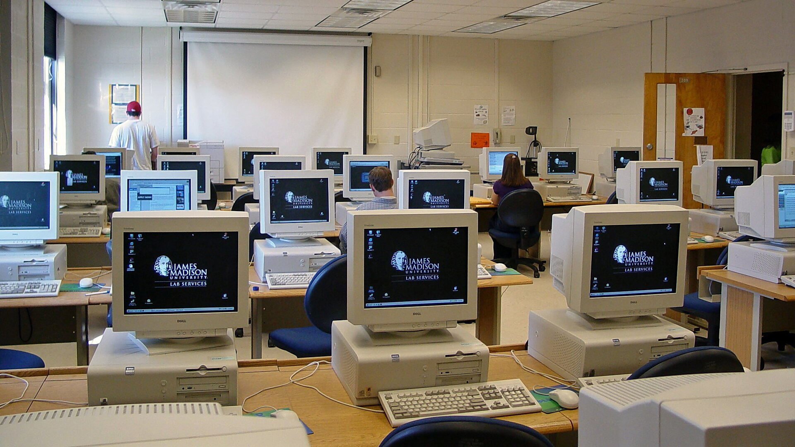
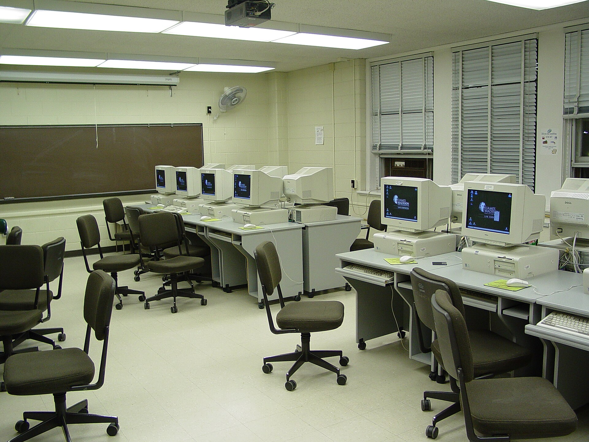
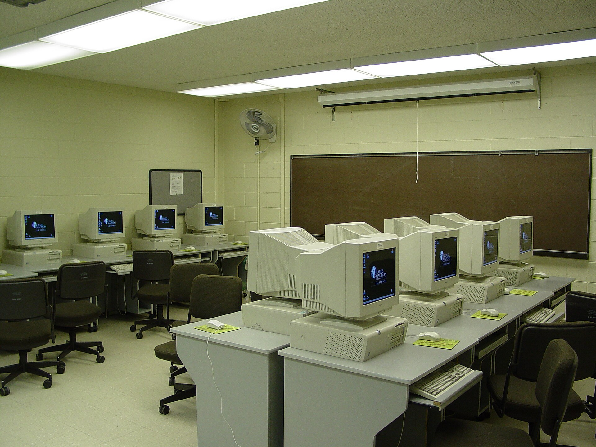

22 years ago today, on November 9, 2004, the Mozilla Foundation officially launched Firefox 1.0 to computer users across the globe. For millions who had grown weary of slow browsing and recurring security alerts, this small open-source application represented a breath of fresh air. It quickly transformed from an experimental project into one of the most celebrated software debuts in personal computing history.

## The Roots in Netscape and the Phoenix Project

The origins of Firefox trace back to the intense browser wars of the 1990s. Netscape Navigator had once been the primary window to the World Wide Web, but aggressive competition from Microsoft left it struggling to survive. On January 23, 1998, Netscape took the historic step of announcing that its browser software and source code would become entirely free. The very next day, Jamie Zawinski registered mozilla.org, borrowing the internal code name for Netscape Navigator derived from a blend of Mosaic and Godzilla.

When Netscape was acquired by AOL, the Mozilla community continued building what was initially known as the Mozilla Application Suite. However, many volunteer developers found the full suite too bloated and cumbersome for ordinary users. In 2002, community members launched a focused side project under the codename Phoenix. Their goal was straightforward: design a lean, fast, standalone browser that gave users control over their online experience. When AOL reduced its involvement in July 2003, the newly formed Mozilla Foundation stepped forward as the legal steward of the open-source movement.

## November 9, 2004: Firefox 1.0 Arrives

After extensive testing and renaming, Firefox 1.0 officially arrived on November 9, 2004. Running on the Gecko layout engine, the new software felt remarkably swift compared to Microsoft's dominant Internet Explorer 6. Testers and early adopters praised Firefox for its stability, quick rendering, and strong security architecture.

What truly captured the imagination of users was its clean design and innovative toolset. Firefox 1.0 popularized tabbed browsing, freeing people from juggling dozens of separate taskbar windows. It introduced integrated pop-up blocking, a streamlined download manager, and flexible bookmarks. Most importantly, it offered an extensible architecture that allowed independent developers to create custom add-ons, letting users tailor the browser to their specific needs.

*Moody Hall computer lab (50018504797) — Photo: Ben Schumin from Montgomery Village, Maryland, USA / CC BY-SA 2.0*

## A Rapid Rise and 60 Million Downloads

The public reception of Firefox 1.0 exceeded even the most optimistic expectations of the Mozilla Foundation. Weary of malware and stagnant development on Internet Explorer 6, everyday users switched to the new browser in droves. Word-of-mouth recommendations and community-driven campaigns turned Firefox into a genuine grassroots phenomenon.

Within nine months of its release, Firefox reached an astonishing milestone of 60 million downloads. It proved that a community-driven, non-profit initiative could mount a direct challenge to the largest technology corporation in the world. As adoption accelerated, web developers began building websites that adhered to open internet standards rather than proprietary Microsoft specifications.

*JMU Maury Hall computer lab 4 — Photo: Ben Schumin / CC BY-SA 3.0*

## Reaching the Peak and Evolving Features

Firefox maintained its rapid momentum over the following years. Its market share climbed steadily, culminating in November 2009 when Firefox 3.5 officially overtook Internet Explorer 7. The browser continued to push technical boundaries, passing the Acid2 standards test and later earning a perfect 100 out of 100 on the Acid3 test.

With Firefox 4, Mozilla introduced significant support for modern HTML5 and CSS3 technologies, while constantly refining its SpiderMonkey JavaScript engine. Over time, features evolved to include private browsing, drag-and-drop downloading, and enhanced developer tools like the DOM Inspector. In November 2017, Mozilla rolled out the Quantum update, introducing new multi-process architecture to boost performance and modern user interface design.

*JMU Maury Hall computer lab 2 — Photo: Ben Schumin / CC BY-SA 3.0*

## The Legacy of Open Standards Today

The web landscape eventually shifted with the arrival of Google Chrome and smartphones, but Firefox left an indelible mark on how people experience the internet. According to StatCounter data from July 2026, Firefox maintains a 6.3% share of traditional desktop PC browsing, standing as the third-most popular PC browser behind Google Chrome at 72% and Microsoft Edge at 10%, ahead of Apple's Safari at 5.2%.

More than two decades after version 1.0 debuted, Firefox remains a vital symbol of open standards and independent choice. It reminded the technology industry that the internet belongs to the public, setting off an era of rapid innovation that benefits every web user today.

### Sources

- <https://en.wikipedia.org/wiki/Firefox>
- <https://commons.wikimedia.org/wiki/File:Firefox_everywhere_-_Flickr_-_fczuardi.jpg>
- <https://commons.wikimedia.org/wiki/File:Moody_Hall_computer_lab_(50018504797).jpg>
- <https://commons.wikimedia.org/wiki/File:JMU_Maury_Hall_computer_lab_4.jpg>
- <https://commons.wikimedia.org/wiki/File:JMU_Maury_Hall_computer_lab_2.jpg>
