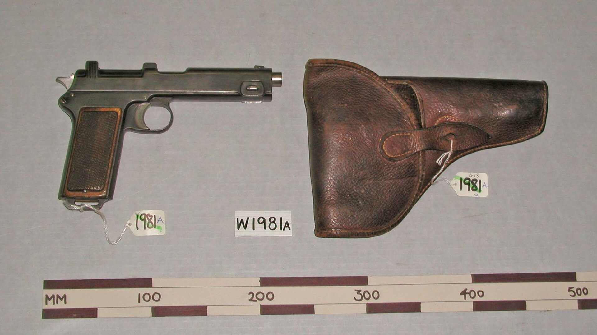
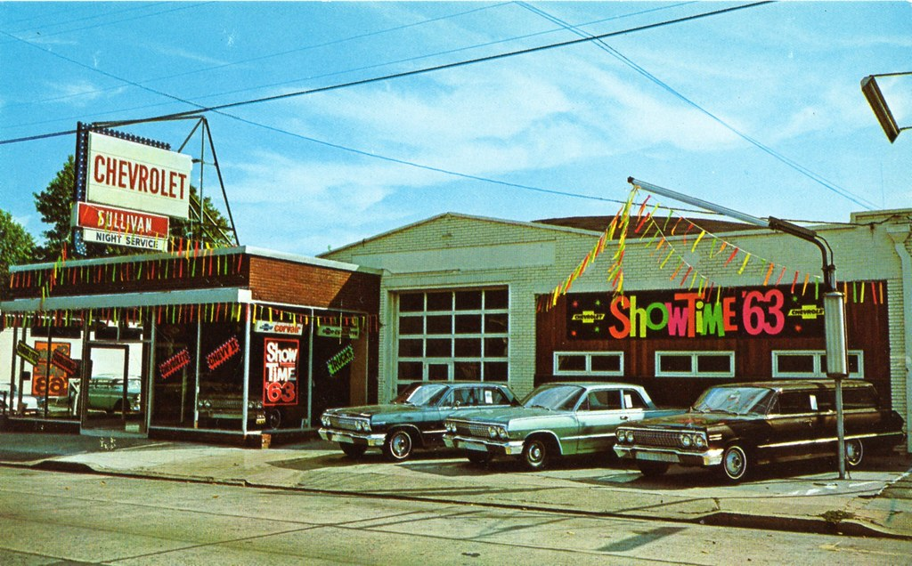

55 years ago today, November 9, 1971, one of the most chilling crimes in modern American history took place inside a sprawling Victorian home in Westfield, New Jersey. John Emil List, an unassuming accountant and devout churchgoer, murdered his wife, his elderly mother, and his three teenage children in cold blood before disappearing into thin air.

## The Illusion of Suburban Respectability

To neighbors and acquaintances in Westfield, New Jersey, John Emil List appeared to embody quiet mid-century success. Born in Bay City, Michigan, List served as an Army laboratory technician during World War II, earned degrees in business administration and accounting from the University of Michigan, and served again in the Army Finance Corps during the Korean War. By 1965, he had secured a prestigious position as vice president and comptroller at a bank in Jersey City.

That same year, List moved his family into Breeze Knoll, an impressive 19-room Victorian mansion at 431 Hillside Avenue. The household included his 47-year-old wife Helen, his 84-year-old mother Alma, and his three children: Patricia, 16, John Frederick, 15, and Frederick, 13. To outside observers, List was an upright citizen, a devout Lutheran, and a dedicated Sunday school teacher who seemed deeply committed to his faith and community.

## Desperation Behind Closed Doors

Behind the stately facade of Breeze Knoll, List's world was collapsing. His financial problems had become critical, threatening the affluent lifestyle he desperately tried to maintain. At home, family dynamics had grown increasingly strained. Helen struggled with severe health issues and alcoholism, while List grew obsessed with the perception that his children were drifting away from their religious upbringing.

Faced with mounting debts and the loss of his livelihood, List rationalized a monstrous solution. He would later claim that killing his family would spare them from poverty and public humiliation while ensuring their souls reached heaven. Rather than face impending financial ruin, he spent weeks planning their executions down to the smallest detail.

*Pistol, semi-automatic (AM 775919-16) — Photo: Osterreichische Waffenfabrik Gesellschaft of Steyr / CC BY 4.0*

## A Tuesday Morning of Calculated Horror

On Tuesday morning, November 9, 1971, List waited until his three children had left for school. Armed with two handguns—a 9mm Steyr 1912 semi-automatic pistol and his father's Colt .22-calibre revolver—he initiated his lethal sequence. In the kitchen, List walked up behind his wife Helen and shot her in the back of the head. He then walked upstairs to his mother's third-floor apartment and shot 84-year-old Alma directly above the left eye.

List waited in the house as the afternoon approached. When his daughter Patricia returned home from school, he shot her in the back of the head. Shortly afterward, his 13-year-old son Frederick entered the house and was killed in the same manner. Showing unfathomable detachment, List then made himself lunch, drove to his local bank to close out both his and his mother's accounts, and proceeded to Westfield High School to watch his elder son, 15-year-old John Frederick, compete in an afternoon soccer match.

After the game concluded, List drove his son back to Breeze Knoll. Inside the kitchen, List ambushed the boy. Forensic evidence later revealed that the teenager attempted to defend himself, forcing List to fire multiple shots before John Frederick collapsed.

*Sullivan Chevrolet, Roselle Park NJ, 1963 — Photo: aldenjewell / CC BY 2.0*

## Nearly a Month in the Dark

Having killed five members of his family, List took deliberate steps to buy himself time. He arranged the bodies inside the home, cleaned up portions of the crime scene, and carefully clipped his own face out of every family photograph in the house to hinder police identification. He notified the children's schools and his part-time employers that the family would be traveling out of state to visit sick relatives, and he canceled mail and newspaper deliveries.

List turned on the mansion's lights and set a radio to play religious music before locking the doors and walking away. Because of his meticulous planning, nearly an entire month passed before concerned neighbors and teachers alerted local authorities. Police finally entered Breeze Knoll in early December 1971, uncovering the horrific scene weeks after List had already begun building a new life.

*Path in Brightwood Park, Westfield, New Jersey — Photo: Bogdan Migulski / CC BY 2.0*

## Eighteen Years as a Ghost

By the time law enforcement launched a nationwide manhunt, the trail was completely cold. John List had assumed a new name, secured employment in accounting, and remarried, effectively vanishing from the radar of federal and local investigators. For nearly eighteen years, the Breeze Knoll murders remained one of the country's most frustrating unsolved cold cases.

The breakthrough came in the spring of 1989. Prolific television program America's Most Wanted decided to profile the fugitive accountant, commissioning forensic sculptor Frank Bender to create an age-progressed clay bust depicting how List might appear after nearly two decades on the run. On May 21, 1989, the broadcast aired across the nation.

The visual likeness was striking. Tips poured in from viewers, leading investigators directly to Richmond, Virginia. There, living under the alias Robert Clark, List was working as an accountant and residing quietly with his new wife. On June 1, 1989, authorities arrested List, closing nearly eighteen years of evasion.

## Justice and the Legacy of Breeze Knoll

Extradited back to New Jersey, List stood trial for the crimes he had committed nearly two decades earlier. Prosecutors dismantled his defense claims of diminished capacity, emphasizing the deliberate planning and cold composure he displayed throughout November 9, 1971. In 1990, a jury found List guilty on five counts of first-degree murder.

The presiding judge sentenced List to five consecutive terms of life imprisonment, ensuring he would not be eligible for parole for nearly 125 years. List remained incarcerated in New Jersey until his death on March 21, 2008, at the age of 82.

The tragedy at Breeze Knoll left an indelible mark on Westfield and the nation. It stands as a stark reminder of how a facade of quiet suburban normalcy can conceal desperate motives, and how modern forensic broadcasting ultimately brought one of America's most elusive fugitives to justice.

### Sources

- <https://en.wikipedia.org/wiki/John_List>
- <https://commons.wikimedia.org/wiki/File:Patricia_List_John_List_Jr.jpg>
- <https://commons.wikimedia.org/wiki/File:Pistol,_semi-automatic_(AM_775919-16).jpg>
- <https://www.flickr.com/photos/31411679@N08/28212963790>
- <https://www.flickr.com/photos/20172348@N00/4932061627>
